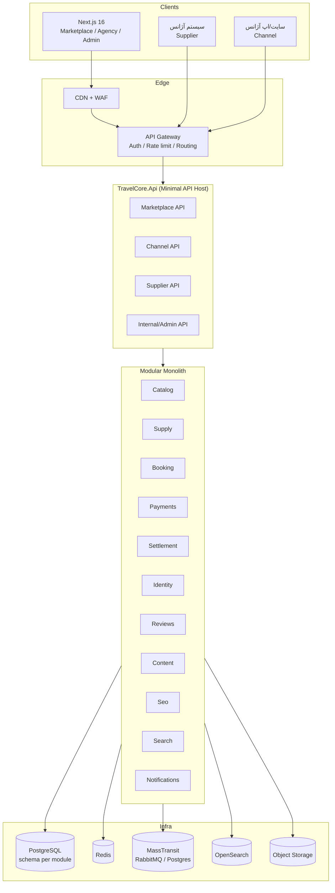

# TravelCore — برنامه معماری و پیاده‌سازی (نسخه ۱.۰)

> **وضعیت:** قفل‌شده برای شروع پیاده‌سازی
> **مخزن:** https://github.com/mrnikiemami-code/Hani
> **تاریخ:** ۱۹ آبان ۱۴۰۵ / ۱۰ نوامبر ۲۰۲۶
> **مالک سند:** تیم معماری TravelCore
> **قاعده:** تصمیم‌های این سند تا زمانی که ADR جدیدی تصویب نشود تغییر نمی‌کنند.

---

## فهرست

1. خلاصه اجرایی
2. تصمیم‌های قفل‌شده
3. اصلاح مهم: `TourProduct` مشترک + `AgencyOffer` مستقل
4. سه مدل کسب‌وکار و مرزهای معماری
5. قابلیت‌های محصول
6. معماری کلان (Modular Monolith + Clean Architecture)
7. ساختار پوشه‌ها (فولدر بندی)
8. CQRS با MediatR 12.5.0
9. BuildingBlocks
10. Logging و Telemetry با قابلیت خاموش/روشن
11. Idempotency (با تمرکز روی پرداخت)
12. Messaging با MassTransit 8.5.12
13. Cache قابل جایگزینی
14. PostgreSQL و مرز داده ماژول‌ها
15. چندزبانه: FA / EN / AR
16. موتور SEO
17. امنیت، انطباق و چندمستأجری
18. تست
19. CI/CD و محیط‌ها
20. Git و همگام‌سازی محلی
21. نقشه راه و فازها
22. بک‌لاگ تسک‌های کوچک (Cursor-friendly)
23. ریسک‌ها
24. سؤالات باز
25. ADRها
26. نسخه‌های پکیج و لایسنس
27. تأیید درک: فولدر بندی و لاگینگ
28. پیوست: درس‌های تحلیل لست‌سکند

---

## ۱. خلاصه اجرایی

TravelCore یک **مارکت‌پلیس چندآژانسه سفر** است با سه کانال درآمدی/تعامل مستقل:

1. **Supplier API** — آژانس موجودی، ظرفیت و قیمت را وارد TravelCore می‌کند.
2. **Channel API** — آژانس از سایت/اپ خودش، تورهای مجاز را با API می‌فروشد.
3. **Marketplace** — مشتری مستقیم وارد TravelCore می‌شود، پیشنهاد چند آژانس را مقایسه و رزرو می‌کند.

هسته مشترک همه این‌ها یکی است: **کاتالوگ تور مشترک (`TourProduct`) + پیشنهاد مستقل هر آژانس (`AgencyOffer`) + سانس/ظرفیت/قیمت (`TourDeparture`) + رزرو/قرارداد/پرداخت/تسویه**.

این سند علاوه بر معماری، **برنامه اجرایی** است: ساختار پوشه‌ها، قواعد وابستگی، الگوی CQRS، BuildingBlocks، لاگینگ، تلمتری، idempotency، messaging، کش، دیتابیس، i18n، SEO، تست، CI/CD، نقشه راه و بک‌لاگ.

**تفاوت کلیدی با لست‌سکند:** لست‌سکند عمدتاً سرنخ (Lead) تولید می‌کند و کاربر را به تماس با آژانس می‌فرستد؛ TravelCore **رزرو آنلاین واقعی** با قرارداد، پرداخت و تسویه دارد.

---

## ۲. تصمیم‌های قفل‌شده

| بخش | تصمیم | وضعیت |
|---|---|---|
| Backend | ASP.NET Core 10 / Minimal API | 🔒 قفل |
| Frontend | Next.js 16 / React 19 | 🔒 قفل |
| معماری | Modular Monolith + Clean Architecture | 🔒 قفل |
| آمادگی | قابل استخراج به میکروسرویس بدون بازنویسی دامنه | 🔒 قفل |
| Database | PostgreSQL + Schema مستقل برای هر ماژول | 🔒 قفل |
| Cache | Redis با انتزاع قابل جایگزینی | 🔒 قفل |
| زبان‌ها | FA (پیش‌فرض) / EN / AR | 🔒 قفل |
| SEO | Server Components + ماژول SEO مستقل | 🔒 قفل |
| MediatR | 12.5.0 — آخرین نسخه Apache-2.0 | 🔒 قفل |
| MassTransit | 8.5.12 — آخرین نسخه Apache-2.0 | 🔒 قفل |
| Transport | RabbitMQ یا PostgreSQL SQL Transport — قابل سوییچ | 🔒 قفل |
| روش توسعه | Cursor + تسک‌های کوچک + معماری قفل‌شده | 🔒 قفل |

**قاعده تغییر:** هیچ پیشنهاد جدیدی (حتی اگر در گزارش تحلیل لست‌سکند آمده باشد) بدون ADR مصوب، این جدول را تغییر نمی‌دهد.

---

## ۳. اصلاح مهم: `TourProduct` مشترک + `AgencyOffer` مستقل

گزارش تحلیل لست‌سکند مدلی پیشنهاد داده بود که در آن `TourProduct` مالک آژانس دارد. **این مدل برای TravelCore پذیرفته نیست.** مدل قفل‌شده:

```
TourProduct (مشترک، مالک: پلتفرم/تیم کاتالوگ)
   │  تور استانبول ۴ شب و ۳ روز — ۵ ستاره — پرواز مستقیم
   │  مسیر، برنامه سفر، رسانه، مقاصد، سئو
   │
   ├── AgencyOffer (آژانس A)
   │      ├── Departure 1405-09-15 — ظرفیت 20 — قیمت 45,000,000
   │      ├── Departure 1405-09-22 — ظرفیت 16 — قیمت 47,500,000
   │      └── قوانین کنسلی، هتل‌ها، خدمات، کمیسیون
   │
   ├── AgencyOffer (آژانس B)
   │      ├── Departure 1405-09-15 — ظرفیت 12 — قیمت 42,900,000
   │      └── ...
   │
   └── AgencyOffer (آژانس C)
          └── ...
```

### چرا این مدل؟

| دلیل | توضیح |
|---|---|
| مقایسه واقعی | صفحه محصول یکی است؛ کاربر پیشنهاد چند آژانس را کنار هم می‌بیند |
| SEO قوی | یک URL canonical برای «تور استانبول»، نه صدها صفحه تکراری |
| کیفیت داده | تیم کاتالوگ محصول را استاندارد می‌کند؛ آژانس فقط پیشنهاد می‌دهد |
| جلوگیری از تکرار | مشخصات تور (برنامه سفر، مقاصد) یک بار تعریف می‌شود |
| مقیاس | افزودن آژانس جدید = افزودن Offer، نه ساختن محصول جدید |
| تسویه شفاف | هر سفارش به `AgencyOfferId` و در نتیجه به یک آژانس وصل است |

### قواعد مدل

1. `TourProduct` مالک ندارد؛ فقط `Catalog` آن را مدیریت می‌کند.
2. `AgencyOffer` همیشه `AgencyId` دارد و tenant-owned است.
3. `TourDeparture` به `AgencyOfferId` وصل است، نه مستقیم به `TourProduct`.
4. قیمت، ظرفیت و قوانین کنسلی روی Offer/Departure است، نه Product.
5. هنگام رزرو، از Offer و Departure **snapshot** گرفته می‌شود.
6. یک Product می‌تواند ده‌ها Offer از آژانس‌های مختلف داشته باشد.
7. نقشه‌برداری آژانس به Product (mapping) توسط ادمین تایید می‌شود.
8. Product می‌تواند در آینده Variant داشته باشد (مثلاً ۴ شب / ۵ شب)؛ فعلاً ساده نگه می‌داریم.

---

## ۴. سه مدل کسب‌وکار و مرزهای معماری

### ۴.۱. جدول مقایسه

| محور | Supplier API | Channel API | Marketplace |
|---|---|---|---|
| بازیگر | آژانس (تأمین‌کننده) | آژانس (کانال فروش) | مشتری نهایی |
| جهت داده | آژانس → TravelCore | TravelCore → سایت/اپ آژانس | دوطرفه (خرید) |
| احراز هویت | API Key + HMAC یا OAuth2 CC | OAuth2 Client Credentials | JWT کاربر / مهمان |
| اسکوپ | `supplier.write`, `supplier.read` | `channel.catalog.read`, `channel.booking.write` | `market.*` (داخلی) |
| مالکیت داده | Offer/Departure آژانس | فقط خواندن Offerهای مجاز | سفارش مشتری |
| سطح API | `/supplier/v1` | `/channel/v1` | `/market/v1` + BFF |
| SLA | ۹۹.۹٪ (Ingestion) | ۹۹.۹۵٪ | ۹۹.۹٪ |
| Rate limit | نوشتن ۳۰ RPM / خواندن ۱۲۰ RPM | ۶۰ RPM خواندن / ۳۰ RPM نوشتن | بر اساس کاربر/IP |
| مدل درآمد | اشتراک/کیفیت داده | کمیسیون/کارمزد | کمیسیون + تبلیغات |

### ۴.۲. قاعده «یک هسته، سه نما»

- **هسته دامنه مشترک:** `Catalog`, `Supply`, `Booking`, `Payments`, `Settlement`.
- هر مدل، **لایه Presentation و Application جدا** دارد؛ DTOها و endpointها قاطی نمی‌شوند.
- هیچ DTO مربوط به Supplier به Channel یا Marketplace نشت نمی‌کند.
- قواعد کسب‌وکار مشترک در Domain می‌ماند؛ سیاست‌های هر کانال در Application همان کانال.
- مجوزها و rate limit در لایه API Gateway/Endpoint Filter اعمال می‌شوند، نه در Domain.

### ۴.۳. Supplier API

**هدف:** آژانس موجودی خود را با API وارد می‌کند.

نمونه Endpointها:

| متد | مسیر | کار |
|---|---|---|
| `PUT` | `/supplier/v1/offers/{externalId}` | Upsert پیشنهاد (Idempotent) |
| `GET` | `/supplier/v1/offers` | لیست پیشنهادهای آژانس |
| `PUT` | `/supplier/v1/offers/{offerId}/departures/{externalId}` | Upsert سانس |
| `PATCH` | `/supplier/v1/departures/{id}/availability` | به‌روزرسانی ظرفیت |
| `POST` | `/supplier/v1/offers/{id}/submit` | ارسال برای تایید |
| `GET` | `/supplier/v1/offers/{id}/status` | وضعیت تایید/رد |
| Webhook | `offer.approved`, `offer.rejected`, `departure.changed` | اطلاع‌رسانی |

**قواعد:**
- `externalId` کلید یکتای آژانس است؛ upsert idempotent.
- نگاشت به `TourProduct` توسط آژانس پیشنهاد و توسط ادمین تایید می‌شود.
- اعتبارسنجی: تاریخ، ظرفیت، قیمت، ارز، قوانین کنسلی، رسانه.
- تغییر قیمت/ظرفیت با `version` و ETag برای جلوگیری از بازنویسی.
- موجودی کهنه‌تر از آستانه → هشدار و در صورت لزوم غیرفعال‌سازی خودکار.

### ۴.۴. Channel API

**هدف:** آژانس روی سایت/اپ خودش تورهای مجاز را می‌فروشد.

| متد | مسیر | کار |
|---|---|---|
| `GET` | `/channel/v1/catalog/products` | محصولات مجاز |
| `GET` | `/channel/v1/offers` | پیشنهادهای مجاز این آژانس |
| `GET` | `/channel/v1/offers/{id}/departures` | سانس‌ها |
| `POST` | `/channel/v1/quotes` | استعلام + hold |
| `POST` | `/channel/v1/bookings` | ثبت سفارش |
| `GET` | `/channel/v1/bookings/{id}` | وضعیت |
| `POST` | `/channel/v1/bookings/{id}/cancel` | لغو |
| `GET` | `/channel/v1/settlements` | تسویه |

**قواعد:**
- توکن فقط به `AgencyId` خودش دسترسی دارد.
- آژانس فقط Offerهای خودش (یا Offerهای صریحاً مجاز) را می‌بیند.
- `Idempotency-Key` اجباری برای همه POSTها.
- Webhook با HMAC و retry.
- محدودیت IP پیش‌فرض فعال.

### ۴.۵. Marketplace

**هدف:** مشتری نهایی وارد TravelCore می‌شود و مقایسه/رزرو می‌کند.

| صفحه/API | کار |
|---|---|
| جستجو | فیلتر مقصد، تاریخ، مدت، ستاره، قیمت، آژانس |
| صفحه محصول | مشخصات مشترک + جدول مقایسه Offerها |
| انتخاب Offer | مشاهده قیمت/هتل/کنسلی/امتیاز آژانس |
| استعلام/رزرو | Quote → Hold → Booking |
| پرداخت | درگاه، قرارداد، بلیط/واچر |
| داشبورد مسافر | سفارش‌ها، مدارک، لغو |

**قواعد:**
- رتبه‌بندی شفاف: قیمت، امتیاز آژانس، سرعت تایید، کیفیت داده.
- نمایش «پیشنهاد دهنده» و شرایط هر آژانس.
- قرارداد با اسنپ‌شات کامل Offer/Departure.
- در صورت نبود ظرفیت، پیشنهاد جایگزین (همان Product از آژانس دیگر).

---

## ۵. قابلیت‌های محصول

| حوزه | قابلیت‌ها |
|---|---|
| مارکت‌پلیس | مقایسه چند آژانس، رتبه‌بندی، پیشنهاد جایگزین، جستجوی چندزبانه |
| تور | محصول مشترک، برنامه سفر، تاریخ حرکت، ظرفیت، قیمت‌گذاری چندنوعی (دو/یک تخته/کودک/نوزاد) |
| رزرو | Quote، Hold، Order، Contract، Ticket/Voucher، Amendment، Cancellation |
| پرداخت | درگاه داخلی، Idempotency، Webhook، Refund، Reconciliation |
| تسویه | کمیسیون، دفتر کل دوطرفه، دوره تسویه، فاکتور، پرداخت به آژانس |
| هتل/مقصد/جاذبه | کاتالوگ محتوایی، نقشه، امکانات، رتبه، نقد |
| ویزا | سرویس، قیمت، مدارک، مراحل، درخواست |
| محتوا | سفرنامه، خاطرات سفر، بلاگ، ویدیو، نویسنده، دسته‌بندی |
| نظرات | نقد چندمعیاره، تایید، پاسخ، گزارش |
| پنل‌ها | پنل مدیریت، پنل آژانس، داشبورد مسافر |
| چندزبانه | FA/EN/AR در UI، محتوا، خطاها، SEO |
| SEO | Slug، متا، Sitemap، JSON-LD، Redirect، hreflang |

---

## ۶. معماری کلان

### ۶.۱. نمای کلی



### ۶.۲. ماژول‌ها و مسئولیت‌ها

| ماژول | مسئولیت | Schema |
|---|---|---|
| Identity | کاربر، آژانس، نقش، ApiClient، توکن | `identity` |
| Catalog | TourProduct، مقصد، هتل، جاذبه، ویزا، رسانه | `catalog` |
| Supply | AgencyOffer، Departure، ظرفیت، قیمت، moderation | `supply` |
| Marketplace | Read model مقایسه، رتبه‌بندی، BFF مصرف‌کننده | `marketplace` |
| Search | ایندکس و کوئری جستجو | `search` (OpenSearch) |
| Booking | Quote، Hold، Order، Contract، Ticket، Cancel | `booking` |
| Payments | PaymentIntent، Gateway، Webhook، Refund | `payment` |
| Settlement | Ledger، Commission، Payout، Invoice | `settlement` |
| Reviews | نقد، امتیاز، پاسخ، گزارش | `review` |
| Content | سفرنامه، خاطرات، بلاگ، ویدیو | `content` |
| Seo | Slug، Meta، Redirect، Sitemap | `seo` |
| Notifications | ایمیل/پیامک/داخل‌اپ، قالب چندزبانه | `notification` |
| Platform | Outbox، Inbox، Idempotency، Audit، FeatureFlag | `platform` |

### ۶.۳. لایه‌های Clean Architecture

هر ماژول چهار پروژه دارد:

```
Domain          → موجودیت، Value Object، Domain Event، Invariant (بدون وابستگی)
Application     → Command/Query/Handler/Validator/Port/DTO
Infrastructure  → EF Core، Migration، Repository، Adapter (Cache/Messaging/HTTP)
Presentation    → Minimal API Endpoint، Contract، Filter، OpenAPI
```

**قواعد وابستگی:**

```
Domain          → BuildingBlocks.Domain
Application     → Domain + BuildingBlocks.Application + Contracts
Infrastructure  → Application + BuildingBlocks.Infrastructure
Presentation    → Application + BuildingBlocks.AspNetCore
Api Host        → Presentation + Infrastructure همه ماژول‌ها (Composition Root)
```

- Domain به EF Core، ASP.NET، Redis، MassTransit و هیچ کتابخانه خارجی وابسته نیست.
- Application به `DbContext` و `HttpClient` وابسته نیست؛ فقط به Portها.
- ماژول A به Domain/Application ماژول B ارجاع نمی‌دهد.
- ارتباط بین ماژول‌ها: `Contracts` (Integration Event/DTO) یا Read Model.
- ArchitectureTests این قواعد را در CI الزامی می‌کند.

### ۶.۴. آمادگی میکروسرویس

- هر ماژول DbContext و Migration مستقل دارد.
- هیچ Join بین Schemaها در کد وجود ندارد.
- تراکنش بین ماژول‌ها با Outbox/Saga، نه Distributed Transaction.
- Integration Eventها در `TravelCore.Contracts.*` نسخه‌بندی می‌شوند.
- استخراج هر ماژول = جدا کردن Host + DbContext + Consumers؛ دامنه دست نمی‌خورد.
- ترتیب پیشنهادی استخراج: Notifications → Search → Content → Reviews → Settlement → Payments → Booking → Supply → Catalog.

---

## ۷. ساختار پوشه‌ها (فولدر بندی)

### ۷.۱. نمای ریشه

```
D:\Hani\
├─ .cursor\
│  └─ rules\
│     └─ travelcore-architecture.mdc
├─ .editorconfig
├─ .gitignore
├─ Directory.Build.props
├─ Directory.Packages.props
├─ global.json
├─ README.md
├─ PLAN.md
├─ TravelCore.sln
├─ src\
│  ├─ TravelCore.Api\
│  ├─ TravelCore.BuildingBlocks\
│  ├─ TravelCore.Contracts\
│  └─ Modules\
├─ tests\
├─ frontend\
├─ deploy\
├─ docs\
└─ scripts\
```

### ۷.۲. Host

```
src/TravelCore.Api/
├─ Program.cs
├─ DependencyInjection.cs
├─ Endpoints/
│  ├─ Marketplace/
│  │  ├─ ProductsEndpoints.cs
│  │  ├─ CompareEndpoints.cs
│  │  └─ BookingEndpoints.cs
│  ├─ Channel/
│  │  ├─ ChannelCatalogEndpoints.cs
│  │  ├─ ChannelBookingEndpoints.cs
│  │  └─ ChannelSettlementEndpoints.cs
│  ├─ Supplier/
│  │  ├─ SupplierOfferEndpoints.cs
│  │  ├─ SupplierDepartureEndpoints.cs
│  │  └─ SupplierAvailabilityEndpoints.cs
│  └─ Internal/
│     ├─ AdminEndpoints.cs
│     └─ HealthEndpoints.cs
├─ Middleware/
│  ├─ CorrelationIdMiddleware.cs
│  ├─ GlobalExceptionMiddleware.cs
│  └─ RequestLoggingMiddleware.cs
├─ Filters/
│  ├─ IdempotencyFilter.cs
│  └─ PermissionFilter.cs
├─ OpenApi/
│  ├─ OpenApiConfiguration.cs
│  └─ SecuritySchemeTransformer.cs
├─ appsettings.json
├─ appsettings.Development.json
└─ appsettings.Production.json
```

### ۷.۳. BuildingBlocks

```
src/TravelCore.BuildingBlocks/
├─ TravelCore.BuildingBlocks.Domain/
│  ├─ Entity.cs
│  ├─ AggregateRoot.cs
│  ├─ ValueObject.cs
│  ├─ StronglyTypedId.cs
│  ├─ DomainEvent.cs
│  ├─ Money.cs
│  ├─ Currency.cs
│  ├─ LocalizedText.cs
│  ├─ DateRange.cs
│  └─ Guard.cs
├─ TravelCore.BuildingBlocks.Application/
│  ├─ Cqrs/
│  │  ├─ ICommand.cs
│  │  ├─ IQuery.cs
│  │  ├─ ICommandHandler.cs
│  │  ├─ IQueryHandler.cs
│  │  └─ Result.cs
│  ├─ Abstractions/
│  │  ├─ IUnitOfWork.cs
│  │  ├─ ICurrentTenant.cs
│  │  ├─ ICurrentUser.cs
│  │  ├─ IDateTimeProvider.cs
│  │  ├─ ICacheService.cs
│  │  ├─ IIdempotencyStore.cs
│  │  ├─ IOutbox.cs
│  │  ├─ IIntegrationEventPublisher.cs
│  │  └─ ILocalizationService.cs
│  ├─ Behaviors/
│  │  ├─ LoggingBehavior.cs
│  │  ├─ MetricsBehavior.cs
│  │  ├─ ValidationBehavior.cs
│  │  ├─ IdempotencyBehavior.cs
│  │  ├─ TransactionBehavior.cs
│  │  └─ CachingBehavior.cs
│  ├─ Idempotency/
│  │  ├─ IIdempotentCommand.cs
│  │  └─ IdempotencyResult.cs
│  └─ Pagination/
│     ├─ PagedResult.cs
│     └─ Cursor.cs
├─ TravelCore.BuildingBlocks.Infrastructure/
│  ├─ Persistence/
│  │  ├─ BaseDbContext.cs
│  │  ├─ Outbox/
│  │  └─ Interceptors/
│  ├─ Caching/
│  │  ├─ RedisCacheService.cs
│  │  ├─ MemoryCacheService.cs
│  │  ├─ HybridCacheService.cs
│  │  └─ NullCacheService.cs
│  ├─ Messaging/
│  │  ├─ MassTransitConfiguration.cs
│  │  ├─ RabbitMqTransport.cs
│  │  ├─ PostgresTransport.cs
│  │  └─ OutboxPublisher.cs
│  ├─ Idempotency/
│  │  └─ PostgresIdempotencyStore.cs
│  ├─ Observability/
│  │  ├─ ObservabilityOptions.cs
│  │  ├─ SerilogConfiguration.cs
│  │  ├─ OpenTelemetryConfiguration.cs
│  │  └─ Telemetry.cs
│  └─ Security/
│     ├─ Hashing.cs
│     ├─ HmacSignature.cs
│     └─ TenantContext.cs
├─ TravelCore.BuildingBlocks.AspNetCore/
│  ├─ ProblemDetails/
│  ├─ ExceptionHandling/
│  ├─ Localization/
│  ├─ Versioning/
│  ├─ RateLimiting/
│  └─ EndpointFilters/
│     └─ IdempotencyEndpointFilter.cs
└─ TravelCore.BuildingBlocks.Testing/
   ├─ Testcontainers/
   ├─ Fakes/
   └─ Assertions/
```

### ۷.۴. قراردادهای بین ماژول‌ها

```
src/TravelCore.Contracts/
├─ TravelCore.Contracts.Catalog/
│  ├─ TourProductCreatedIntegrationEvent.cs
│  ├─ TourProductUpdatedIntegrationEvent.cs
│  └─ CatalogReadDtos.cs
├─ TravelCore.Contracts.Supply/
│  ├─ OfferPublishedIntegrationEvent.cs
│  ├─ DepartureChangedIntegrationEvent.cs
│  └─ AvailabilityChangedIntegrationEvent.cs
├─ TravelCore.Contracts.Booking/
│  ├─ BookingCreatedIntegrationEvent.cs
│  ├─ BookingConfirmedIntegrationEvent.cs
│  └─ BookingCancelledIntegrationEvent.cs
├─ TravelCore.Contracts.Payments/
│  ├─ PaymentSucceededIntegrationEvent.cs
│  ├─ PaymentFailedIntegrationEvent.cs
│  └─ RefundIssuedIntegrationEvent.cs
└─ TravelCore.Contracts.Settlement/
   └─ SettlementPaidIntegrationEvent.cs
```

### ۷.۵. قالب هر ماژول (مثال: Supply)

```
src/Modules/Supply/
├─ TravelCore.Modules.Supply.Domain/
│  ├─ AgencyOffers/
│  │  ├─ AgencyOffer.cs
│  │  ├─ AgencyOfferId.cs
│  │  ├─ AgencyOfferStatus.cs
│  │  └─ OfferPolicy.cs
│  ├─ Departures/
│  │  ├─ TourDeparture.cs
│  │  ├─ TourDepartureId.cs
│  │  ├─ DeparturePrice.cs
│  │  └─ Capacity.cs
│  ├─ Events/
│  │  ├─ OfferPublishedDomainEvent.cs
│  │  └─ DepartureCapacityChangedDomainEvent.cs
│  └─ ValueObjects/
│     ├─ PriceRule.cs
│     └─ CancellationPolicy.cs
├─ TravelCore.Modules.Supply.Application/
│  ├─ Abstractions/
│  │  ├─ IAgencyOfferRepository.cs
│  │  ├─ IDepartureRepository.cs
│  │  └─ IOfferReadService.cs
│  ├─ Commands/
│  │  ├─ CreateAgencyOffer/
│  │  │  ├─ CreateAgencyOfferCommand.cs
│  │  │  ├─ CreateAgencyOfferCommandHandler.cs
│  │  │  ├─ CreateAgencyOfferCommandValidator.cs
│  │  │  └─ CreateAgencyOfferResult.cs
│  │  ├─ UpdateAgencyOffer/
│  │  ├─ PublishAgencyOffer/
│  │  └─ SetDepartureAvailability/
│  ├─ Queries/
│  │  ├─ GetAgencyOffers/
│  │  │  ├─ GetAgencyOffersQuery.cs
│  │  │  ├─ GetAgencyOffersQueryHandler.cs
│  │  │  ├─ GetAgencyOffersQueryValidator.cs
│  │  │  └─ AgencyOfferListItemDto.cs
│  │  └─ GetOfferComparison/
│  ├─ Common/
│  │  ├─ Dtos/
│  │  └─ Mappings/
│  └─ DependencyInjection.cs
├─ TravelCore.Modules.Supply.Infrastructure/
│  ├─ Persistence/
│  │  ├─ SupplyDbContext.cs
│  │  ├─ Configurations/
│  │  │  ├─ AgencyOfferConfiguration.cs
│  │  │  └─ TourDepartureConfiguration.cs
│  │  └─ Migrations/
│  ├─ Repositories/
│  │  ├─ AgencyOfferRepository.cs
│  │  └─ DepartureRepository.cs
│  ├─ ReadServices/
│  │  └─ OfferReadService.cs
│  └─ DependencyInjection.cs
└─ TravelCore.Modules.Supply.Presentation/
   ├─ Supplier/
   │  ├─ UpsertOfferEndpoint.cs
   │  ├─ SetAvailabilityEndpoint.cs
   │  └─ Contracts/
   ├─ Channel/
   │  ├─ GetAuthorizedOffersEndpoint.cs
   │  └─ Contracts/
   ├─ Marketplace/
   │  ├─ CompareOffersEndpoint.cs
   │  └─ Contracts/
   └─ DependencyInjection.cs
```

### ۷.۶. قواعد نام‌گذاری

| مورد | قاعده | مثال |
|---|---|---|
| Command | `{Verb}{Entity}Command` | `CreateAgencyOfferCommand` |
| Query | `Get{Entity}Query` یا `Search{Entity}Query` | `GetAgencyOffersQuery` |
| Handler | `{Command/Query}Handler` | `CreateAgencyOfferCommandHandler` |
| Validator | `{Command/Query}Validator` | `CreateAgencyOfferCommandValidator` |
| Endpoint | `{Action}{Entity}Endpoint` | `UpsertOfferEndpoint` |
| DTO | `{Entity}Dto` / `{Entity}ListItemDto` | `AgencyOfferListItemDto` |
| Integration Event | `{Entity}{PastTense}IntegrationEvent` | `OfferPublishedIntegrationEvent` |
| Domain Event | `{Entity}{PastTense}DomainEvent` | `OfferPublishedDomainEvent` |
| جدول | snake_case جمع | `agency_offers` |
| Schema | نام ماژول | `supply` |
| Cache key | `tc:{env}:{module}:{entity}:{id}:{locale}` | `tc:prod:supply:offer:42:fa` |

**ممنوع:** `Helper`، `Manager`، `Service` عمومی، `Utils`، پوشه `Common` با کد نامرتبط. هر فایل یک نوع اصلی.

---

## ۸. CQRS با MediatR 12.5.0

### ۸.۱. چرا 12.5.0؟

- `MediatR 12.5.0` آخرین نسخه با لایسنس **Apache-2.0** است.
- از `13.x` به بعد لایسنس تجاری دارد.
- نسخه در `Directory.Packages.props` قفل می‌شود و ارتقا فقط با بررسی لایسنس.

### ۸.۲. قراردادها

```csharp
public interface ICommand<TResponse> : IRequest<Result<TResponse>>;
public interface IQuery<TResponse> : IRequest<Result<TResponse>>;

public sealed record Result<T>
{
    public bool IsSuccess { get; init; }
    public T? Value { get; init; }
    public Error? Error { get; init; }

    public static Result<T> Success(T value) => new() { IsSuccess = true, Value = value };
    public static Result<T> Failure(Error error) => new() { IsSuccess = false, Error = error };
}
```

### ۸.۳. نمونه Command + Validator + Handler

```csharp
public sealed record CreateAgencyOfferCommand(
    Guid AgencyId,
    Guid TourProductId,
    string Title,
    decimal BasePrice,
    string Currency) : ICommand<Guid>;

public sealed class CreateAgencyOfferCommandValidator
    : AbstractValidator<CreateAgencyOfferCommand>
{
    public CreateAgencyOfferCommandValidator()
    {
        RuleFor(x => x.AgencyId).NotEmpty();
        RuleFor(x => x.TourProductId).NotEmpty();
        RuleFor(x => x.Title).NotEmpty().MaximumLength(200);
        RuleFor(x => x.BasePrice).GreaterThan(0);
        RuleFor(x => x.Currency).Must(c => Currency.IsSupported(c));
    }
}

internal sealed class CreateAgencyOfferCommandHandler
    : ICommandHandler<CreateAgencyOfferCommand, Guid>
{
    private readonly IAgencyOfferRepository _offers;
    private readonly IUnitOfWork _uow;

    public CreateAgencyOfferCommandHandler(
        IAgencyOfferRepository offers,
        IUnitOfWork uow)
    {
        _offers = offers;
        _uow = uow;
    }

    public async Task<Result<Guid>> Handle(
        CreateAgencyOfferCommand request,
        CancellationToken ct)
    {
        var offer = AgencyOffer.Create(
            new AgencyOfferId(Guid.CreateVersion7()),
            request.AgencyId,
            request.TourProductId,
            request.Title,
            new Money(request.BasePrice, request.Currency));

        await _offers.AddAsync(offer, ct);
        await _uow.SaveChangesAsync(ct);

        return Result<Guid>.Success(offer.Id.Value);
    }
}
```

### ۸.۴. نمونه Query

```csharp
public sealed record GetAgencyOffersQuery(
    Guid AgencyId,
    int Page = 1,
    int PageSize = 20) : IQuery<PagedResult<AgencyOfferListItemDto>>;

internal sealed class GetAgencyOffersQueryHandler
    : IQueryHandler<GetAgencyOffersQuery, PagedResult<AgencyOfferListItemDto>>
{
    private readonly IOfferReadService _read;

    public GetAgencyOffersQueryHandler(IOfferReadService read) => _read = read;

    public Task<PagedResult<AgencyOfferListItemDto>> Handle(
        GetAgencyOffersQuery request,
        CancellationToken ct)
        => _read.GetPagedAsync(request.AgencyId, request.Page, request.PageSize, ct);
}
```

**قاعده:** Queryها از Read Model/ projection می‌خوانند؛ برای کارهای سنگین از Dapper/EF `AsNoTracking` استفاده می‌شود. Commandها از Domain عبور می‌کنند.

### ۸.۵. ترتیب Pipeline Behaviors

```
1. CorrelationBehavior
2. LoggingBehavior
3. MetricsBehavior
4. ValidationBehavior
5. IdempotencyBehavior      (فقط IIdempotentCommand)
6. TransactionBehavior      (فقط Command)
7. Handler
8. DomainEvents → Outbox
9. CacheInvalidationBehavior
```

- `ValidationBehavior` خطاها را به `Result.Failure(Error.Validation(...))` تبدیل می‌کند؛ Exception برای خطای غیرمنتظره می‌ماند.
- `TransactionBehavior` فقط Commandها را در تراکنش اجرا می‌کند.
- `CachingBehavior` فقط برای Queryهای `ICacheableQuery`.
- تمام Behaviorها با `IPipelineBehavior<TRequest,TResponse>` و ثبت Assembly Scan.

---

## ۹. BuildingBlocks

BuildingBlocks باید **مستقل از دامنه TravelCore** و قابل استفاده در پروژه‌های دیگر باشد.

| پروژه | مسئولیت | وابستگی مجاز |
|---|---|---|
| `BuildingBlocks.Domain` | Entity, AggregateRoot, ValueObject, Money, LocalizedText, DomainEvent | هیچ |
| `BuildingBlocks.Application` | CQRS contracts, Result, Ports, Behaviors, Pagination | Domain |
| `BuildingBlocks.Infrastructure` | EF Base, Outbox, Cache, Messaging, Observability, Security | Application |
| `BuildingBlocks.AspNetCore` | ProblemDetails, Exception Handler, Localization, Versioning, RateLimit, Filters | Application |
| `BuildingBlocks.Testing` | Fixtures, Fakes, Assertions, Testcontainers helpers | همه |

**قواعد:**
- هیچ کد مربوط به تور/هتل/رزرو داخل BuildingBlocks نرود.
- نسخه‌بندی SemVer؛ در آینده قابل انتشار به‌صورت NuGet داخلی.
- API عمومی کوچک نگه داشته شود؛ `internal` پیش‌فرض.
- هر قابلیت جدید فقط با تست واحد و مستندات کوتاه اضافه شود.

---

## ۱۰. Logging و Telemetry با قابلیت خاموش/روشن

### ۱۰.۱. اصول

- **Structured Logging** با Serilog.
- **OpenTelemetry** برای Trace + Metric + Log.
- **Audit Log** جدا از لاگ تشخیصی؛ غیرقابل خاموش‌شدن در محیط تولید.
- **PII Redaction** اجباری: موبایل، ایمیل، کد ملی، پاسپورت، شماره کارت.
- **Correlation** با `X-Correlation-Id` + W3C `traceparent`.
- هر لاگ باید `TraceId`, `SpanId`, `TenantId`, `AgencyId`, `UserId`, `Module` داشته باشد.

### ۱۰.۲. تنظیمات با Toggle

```json
{
  "Observability": {
    "ServiceName": "TravelCore.Api",
    "Environment": "Production",
    "Logging": {
      "Enabled": true,
      "MinimumLevel": "Information",
      "Sinks": ["Console", "Seq"],
      "SeqUrl": "http://seq:5341",
      "IncludeScopes": true,
      "IncludeRequestBody": false,
      "RedactPii": true,
      "Sampling": { "Enabled": true, "Ratio": 0.2 }
    },
    "Tracing": {
      "Enabled": true,
      "Exporter": "Otlp",
      "Endpoint": "http://otel-collector:4317",
      "SamplingRatio": 0.2,
      "RecordSql": false
    },
    "Metrics": {
      "Enabled": true,
      "Exporter": "Otlp",
      "Endpoint": "http://otel-collector:4317"
    },
    "Audit": {
      "Enabled": true,
      "Store": "Postgres"
    }
  },
  "Modules": {
    "Supply": { "Logging": { "Level": "Debug" }, "Tracing": { "Enabled": true } },
    "Payments": { "Logging": { "Level": "Information" }, "Tracing": { "Enabled": true } },
    "Notifications": { "Logging": { "Level": "Warning" } }
  }
}
```

- `Enabled=false` → پیاده‌سازی Null/No-op تزریق می‌شود؛ کد دامنه تغییر نمی‌کند.
- تغییر در زمان اجرا با `IOptionsMonitor<ObservabilityOptions>`.
- Toggle در سطح هر ماژول و هر Exporter.
- در محیط توسعه: Console + Seq + OTLP محلی.
- در تولید: OTLP → Grafana/Tempo/Loki/Prometheus؛ بدون لاگ حساس.

### ۱۰.۳. کد راه‌اندازی

```csharp
builder.Host.UseSerilog((context, services, configuration) =>
{
    var options = context.Configuration
        .GetSection("Observability")
        .Get<ObservabilityOptions>()!;

    if (!options.Logging.Enabled)
    {
        configuration.MinimumLevel.Fatal();
        return;
    }

    configuration
        .ReadFrom.Configuration(context.Configuration)
        .Enrich.FromLogContext()
        .Enrich.WithProperty("service", options.ServiceName)
        .Enrich.WithProperty("environment", options.Environment)
        .Destructure.ByTransforming<Money>(m => new { m.Amount, m.Currency })
        .WriteTo.Console()
        .WriteTo.Seq(options.Logging.SeqUrl);
});
```

```csharp
builder.Services.AddOpenTelemetry()
    .WithTracing(tracing =>
    {
        if (!options.Tracing.Enabled) return;

        tracing
            .AddAspNetCoreInstrumentation()
            .AddHttpClientInstrumentation()
            .AddEntityFrameworkCoreInstrumentation()
            .AddRedisInstrumentation()
            .AddSource("TravelCore.*")
            .SetSampler(new ParentBasedSampler(
                new TraceIdRatioBasedSampler(options.Tracing.SamplingRatio)))
            .AddOtlpExporter(o => o.Endpoint = new Uri(options.Tracing.Endpoint));
    })
    .WithMetrics(metrics =>
    {
        if (!options.Metrics.Enabled) return;

        metrics
            .AddAspNetCoreInstrumentation()
            .AddHttpClientInstrumentation()
            .AddRuntimeInstrumentation()
            .AddMeter("TravelCore.*")
            .AddOtlpExporter(o => o.Endpoint = new Uri(options.Metrics.Endpoint));
    });
```

### ۱۰.۴. Telemetry هر ماژول

```csharp
public static class SupplyTelemetry
{
    public static readonly ActivitySource ActivitySource = new("TravelCore.Supply");
    public static readonly Meter Meter = new("TravelCore.Supply");

    public static readonly Counter<long> OffersCreated =
        Meter.CreateCounter<long>("supply.offers.created");

    public static readonly Histogram<double> AvailabilityUpdateMs =
        Meter.CreateHistogram<double>("supply.availability.update.ms");
}
```

### ۱۰.۵. داشبورد و هشدار

| متریک | هشدار |
|---|---|
| نرخ 5xx | > 1٪ در ۵ دقیقه |
| p95 API | > 1s |
| Outbox lag | > 60s |
| DLQ count | > 0 |
| Payment failure rate | > 5٪ |
| Cache hit ratio | < 70٪ (برای کلیدهای پرترافیک) |
| Booking conversion | افت > 20٪ نسبت به میانگین |

**Audit Log:** چه کسی، چه زمانی، چه چیزی را تغییر داد (قیمت، ظرفیت، سفارش، کلید API) با before/after. این لاگ قابل خاموش‌شدن نیست.

---

## ۱۱. Idempotency (با تمرکز روی پرداخت)

### ۱۱.۱. دامنه

- همه `POST`های مالی و رزرو: `bookings`, `payments`, `refunds`, `settlements`.
- Webhookهای درگاه پرداخت.
- Supplier upsertها (با `externalId` + نسخه).
- Consumerهای MassTransit (Inbox).

### ۱۱.۲. قرارداد

```csharp
public interface IIdempotentCommand
{
    string IdempotencyKey { get; }
}
```

هدر اجباری: `Idempotency-Key` (UUID توصیه‌شده).

### ۱۱.۳. جدول

```sql
CREATE TABLE platform.idempotency_keys (
    key             text        NOT NULL,
    tenant_id       uuid        NULL,
    client_id       text        NULL,
    request_hash    text        NOT NULL,
    status          text        NOT NULL, -- InProgress | Completed
    response_status integer     NULL,
    response_body   jsonb       NULL,
    locked_until    timestamptz NULL,
    created_at      timestamptz NOT NULL DEFAULT now(),
    expires_at      timestamptz NOT NULL,
    PRIMARY KEY (key, tenant_id)
);

CREATE INDEX ix_idempotency_expires
    ON platform.idempotency_keys (expires_at);
```

### ۱۱.۴. الگوریتم

1. کلید + fingerprint (متد + مسیر + tenant + hash بدنه) را بگیر.
2. اگر رکورد `Completed` بود:
   - fingerprint یکسان → همان پاسخ قبلی را برگردان.
   - متفاوت → `409 IDEMPOTENCY_CONFLICT`.
3. اگر `InProgress` بود → `409 REQUEST_IN_PROGRESS` یا انتظار کوتاه.
4. در غیر این صورت `InProgress` ثبت کن + قفل Redis با TTL.
5. عملیات را اجرا کن + نتیجه را در همان تراکنش ذخیره کن.
6. TTL: ۲۴ ساعت (پرداخت: ۷ روز).

### ۱۱.۵. پرداخت

```
PaymentIntent:
  Id, OrderId, Amount, Currency, Status,
  Provider, ProviderRef, IdempotencyKey,
  CreatedAt, UpdatedAt, Version

Status: Created → Pending → Succeeded | Failed | Expired
                          ↘ Refunded
```

- درخواست پرداخت با `Idempotency-Key` داخلی `payment:{intentId}:initiate`.
- تایید (verify) با `payment:{intentId}:verify`.
- Webhook: `provider_event_id` یکتا در `payment_webhook_events`؛ اگر تکراری بود، نادیده بگیر.
- اثر هر رویداد یک بار: Outbox + Inbox + وضعیت ماشین.
- تطبیق روزانه (Reconciliation) بین درگاه و دفتر کل.
- Refund هم idempotent است (`refund:{paymentId}:{requestId}`).

### ۱۱.۶. پاکسازی

Job روزانه رکوردهای منقضی را حذف می‌کند؛ لاگ آماری نگه می‌دارد.

---

## ۱۲. Messaging با MassTransit 8.5.12

### ۱۲.۱. لایسنس

- `8.5.12` آخرین نسخه **Apache-2.0** است.
- `9.x` به بعد لایسنس تجاری دارد.
- نسخه در `Directory.Packages.props` قفل می‌شود.

### ۱۲.۲. انتزاع

```csharp
public interface IIntegrationEventPublisher
{
    Task PublishAsync<T>(T @event, CancellationToken ct) where T : class;
}
```

- Application فقط این interface را می‌شناسد.
- Infrastructure پیاده‌سازی MassTransit را تزریق می‌کند.
- تغییر Transport فقط تنظیمات است، نه کد دامنه.

### ۱۲.۳. سوییچ Transport

```json
{
  "Messaging": {
    "Transport": "Postgres",
    "RabbitMq": {
      "Host": "rabbitmq://localhost",
      "Username": "guest",
      "Password": "guest"
    },
    "Postgres": {
      "ConnectionString": "Host=localhost;Database=travelcore;Username=postgres;Password=..."
    },
    "Outbox": { "Enabled": true },
    "Retry": { "Limit": 5, "IntervalSeconds": 2, "UseExponentialBackoff": true }
  }
}
```

```csharp
services.AddMassTransit(x =>
{
    x.SetKebabCaseEndpointNameFormatter();
    x.AddEntityFrameworkOutbox<SupplyDbContext>(o =>
    {
        o.UsePostgres();
        o.UseBusOutbox();
    });

    if (options.Transport == "RabbitMq")
    {
        x.UsingRabbitMq((ctx, cfg) =>
        {
            cfg.Host(new Uri(options.RabbitMq.Host), h =>
            {
                h.Username(options.RabbitMq.Username);
                h.Password(options.RabbitMq.Password);
            });
            cfg.ConfigureEndpoints(ctx);
        });
    }
    else
    {
        x.UsingPostgres((ctx, cfg) =>
        {
            cfg.Host(options.Postgres.ConnectionString);
            cfg.ConfigureEndpoints(ctx);
        });
    }
});
```

### ۱۲.۴. قواعد

- **Outbox** برای هر DbContext که رویداد منتشر می‌کند.
- **Inbox** برای Consumerها (EF Inbox) برای حذف تکرار.
- Retry نمایی + DLQ + داشبورد.
- پیام‌ها immutable و نسخه‌دار.
- نام‌گذاری: `travelcore.{module}.{event}.v1`.
- Saga برای `Booking → Payment → Settlement` (در صورت نیاز).
- Transport Postgres برای شروع ساده‌تر؛ RabbitMQ وقتی حجم/تیم افزایش یافت.
- تفاوت: Postgres = بدون زیرساخت اضافه، throughput کمتر؛ RabbitMQ = throughput و ابزار بهتر.

---

## ۱۳. Cache قابل جایگزینی

### ۱۳.۱. انتزاع

```csharp
public interface ICacheService
{
    Task<T?> GetAsync<T>(string key, CancellationToken ct = default);
    Task SetAsync<T>(string key, T value, CacheEntryOptions options, CancellationToken ct = default);
    Task<T> GetOrCreateAsync<T>(
        string key,
        Func<CancellationToken, Task<T>> factory,
        CacheEntryOptions options,
        CancellationToken ct = default);
    Task RemoveAsync(string key, CancellationToken ct = default);
    Task RemoveByTagAsync(string tag, CancellationToken ct = default);
}
```

### ۱۳.۲. Providerها

| Provider | کاربرد |
|---|---|
| `RedisCacheService` | تولید و استیجینگ |
| `MemoryCacheService` | تست/تک‌نود |
| `HybridCacheService` | L1 حافظه + L2 Redis |
| `NullCacheService` | خاموش کردن کش بدون تغییر کد |

```json
{
  "Cache": {
    "Provider": "Redis",
    "Redis": { "Configuration": "localhost:6379", "InstanceName": "tc:" },
    "DefaultTtlSeconds": 300,
    "EnableMetrics": true
  }
}
```

### ۱۳.۳. قواعد

- کلید: `tc:{env}:{module}:{entity}:{id}:{locale}`.
- Tag برای invalidation گروهی: `offer:42`, `product:istanbul`.
- کش فقط برای داده غیرحساس و قابل بازسازی.
- قیمت/ظرفیت لحظه‌ای: TTL کوتاه (۱۰–۳۰ ثانیه) + نسخه.
- Invalidation با Domain Event → `CacheInvalidationConsumer`.
- هرگز داده کاربر/پرداخت را در کش عمومی نگذار.

---

## ۱۴. PostgreSQL و مرز داده ماژول‌ها

### ۱۴.۱. اصول

- PostgreSQL 16+.
- یک دیتابیس، **Schema مستقل برای هر ماژول**.
- هر ماژول `DbContext` و Migration مستقل دارد.
- `MigrationsHistoryTable` در همان Schema.
- هیچ Join بین Schemaها در کد ماژول وجود ندارد.
- گزارش‌ها از Read Model/Materialized View جدا.

### ۱۴.۲. Schemaها

```
identity, catalog, supply, marketplace, booking, payment,
settlement, review, content, seo, notification, platform, transport
```

### ۱۴.۳. انواع داده

| مفهوم | نوع |
|---|---|
| شناسه | `uuid` (UUIDv7) |
| پول | `bigint` (minor units) + `char(3)` currency |
| زمان | `timestamptz` |
| متن چندزبانه | `jsonb` (`{"fa":"...","en":"...","ar":"..."}`) |
| وضعیت | `varchar(32)` + Check Constraint |
| نسخه | `bigint` (Concurrency) |
| حذف نرم | `deleted_at timestamptz NULL` |

### ۱۴.۴. جدول‌های کلیدی

| Schema | جدول‌ها |
|---|---|
| identity | `users`, `agencies`, `agency_users`, `roles`, `user_roles`, `api_clients`, `api_client_scopes` |
| catalog | `tour_products`, `tour_product_translations`, `destinations`, `hotels`, `hotel_translations`, `attractions`, `visa_services`, `media_assets` |
| supply | `agency_offers`, `departures`, `departure_prices`, `departure_capacity`, `offer_hotels`, `offer_rules`, `moderation_queue` |
| marketplace | `product_read_models`, `offer_compare_views`, `ranking_scores` |
| booking | `quotes`, `quote_lines`, `holds`, `orders`, `order_items`, `travelers`, `contracts`, `tickets`, `cancellations` |
| payment | `payment_intents`, `payment_transactions`, `payment_webhook_events`, `refunds` |
| settlement | `ledger_accounts`, `ledger_entries`, `settlements`, `settlement_lines`, `invoices`, `payouts` |
| review | `reviews`, `review_scores`, `review_replies`, `review_reports` |
| content | `posts`, `post_translations`, `stories`, `memories`, `videos`, `authors`, `categories` |
| seo | `slugs`, `redirects`, `meta_templates`, `sitemap_entries` |
| notification | `templates`, `messages`, `deliveries` |
| platform | `outbox_messages`, `inbox_messages`, `idempotency_keys`, `audit_logs`, `feature_flags` |

### ۱۴.۵. چندمستأجری

- `tenant_id` در جدول‌های آژانس‌محور: `agency_offers`, `departures`, `orders`, `settlements`, `api_clients`.
- `TenantContext` از توکن/کلید استخراج می‌شود.
- RLS اختیاری به‌عنوان لایه دفاعی دوم.
- تست ایزولاسیون: درخواست tenant A نباید رکورد tenant B را ببیند.

---

## ۱۵. چندزبانه: FA / EN / AR

### ۱۵.۱. Backend

- Cultureهای پشتیبانی‌شده: `fa-IR` (پیش‌فرض)، `en-US`، `ar-SA`.
- `RequestLocalization` بر اساس `Accept-Language` + `?locale=` + مسیر.
- خطاها با کد (`OFFER_NOT_FOUND`) و ترجمه در Resource.
- `LocalizedText` برای فیلدهای محتوایی:

```csharp
public sealed record LocalizedText(
    IReadOnlyDictionary<string, string> Values)
{
    public string Get(string culture, string fallback = "fa")
        => Values.TryGetValue(culture, out var v)
            ? v
            : Values.TryGetValue(fallback, out var f)
                ? f
                : string.Empty;
}
```

- تاریخ: ذخیره UTC؛ نمایش جلالی برای FA و میلادی برای EN؛ عربی با تقویم میلادی/هجری قابل تنظیم.
- ارز: `Money` + فرمت locale.
- اعداد: جداکننده هزارگان بر اساس Culture.
- محتوا: جدول Translation با وضعیت `Draft/Translated/Published` و fallback به FA.

### ۱۵.۲. Frontend

- Next.js App Router با `[locale]`.
- `next-intl` برای پیام‌ها.
- `dir="rtl"` برای FA/AR و `ltr` برای EN.
- فونت: Vazirmatn (FA)، Inter (EN)، Noto Kufi Arabic (AR).
- `messages/fa.json`, `messages/en.json`, `messages/ar.json`.
- مسیرها: `/fa/...`, `/en/...`, `/ar/...` (locale prefix همیشه).
- Slugهای ترجمه‌شده در جدول `seo.slugs`.
- `hreflang` و canonical برای هر زبان.

### ۱۵.۳. چک‌لیست QA چندزبانه

- [ ] جهت و چیدمان RTL/LTR
- [ ] فونت و line-height
- [ ] تاریخ جلالی/میلادی
- [ ] اعداد و ارز
- [ ] ترجمه خطاها و ایمیل/پیامک
- [ ] Slug و canonical
- [ ] Sitemap هر زبان
- [ ] محتوای fallback

---

## ۱۶. موتور SEO

- Next.js Server Components + `generateMetadata` + ISR.
- ماژول مستقل `Seo`:
  - `slugs` (EntityType, EntityId, Locale, Slug, IsCanonical)
  - `redirects` (From, To, StatusCode)
  - `meta_templates` (EntityType, Locale, TitleTemplate, DescriptionTemplate)
  - `sitemap_entries`
- Sitemap index: `/sitemap.xml` → `/fa/sitemap.xml`, `/en/sitemap.xml`, `/ar/sitemap.xml`.
- JSON-LD: `TouristTrip`, `Offer`, `Product`, `Hotel`, `Article`, `FAQPage`, `BreadcrumbList`.
- Canonical برای صفحات فیلترشده و صفحه محصول (نه هر Offer).
- Facet pages: `noindex` در صورت ارزش محتوایی پایین.
- Core Web Vitals: تصاویر بهینه، فونت subset، JS کم.
- Redirect 301 برای Slugهای قدیمی.
- Revalidation on-demand از بک‌اند با Webhook.

---

## ۱۷. امنیت، انطباق و چندمستأجری

| موضوع | تصمیم |
|---|---|
| احراز هویت کاربر | JWT + Refresh Token (HttpOnly) |
| احراز هویت آژانس | OAuth2 Client Credentials |
| Supplier | API Key + HMAC + IP allowlist |
| مجوز | RBAC + Scopes + Tenant check |
| PII | رمزنگاری at-rest، ماسک لاگ، دسترسی حداقلی |
| پرداخت | عدم ذخیره PAN؛ درگاه داخلی؛ PCI در حد SAQ |
| Rate limit | per client/user/IP + endpoint |
| WAF | CDN/WAF داخلی |
| Audit | تغییر قیمت/ظرفیت/سفارش/کلید |
| مجوز آژانس | اعتبارسنجی بند ب + تاریخ انقضا |
| انطباق | Enamad، فاکتور رسمی، مالیات، نگهداری داده در ایران |

> این بخش الزامات فنی را تعریف می‌کند؛ تأیید حقوقی/مالیاتی نهایی با مشاور قانونی است.

---

## ۱۸. تست

| نوع | ابزار | دامنه |
|---|---|---|
| Unit | xUnit + Shouldly | Domain/Application |
| Integration | Testcontainers (Postgres, Redis, RabbitMQ) | Repository, Outbox, Idempotency |
| Architecture | NetArchTest | قواعد وابستگی |
| Contract | OpenAPI diff | Channel/Supplier API |
| E2E | Playwright | Marketplace/پنل |
| Load | k6 | Search/Booking |
| Security | OWASP ZAP | API/Web |

**تست‌های طلایی:** قیمت‌گذاری (کودک/نوزاد/ارز)، idempotency پرداخت، oversell، تسویه.

---

## ۱۹. CI/CD و محیط‌ها

- محیط‌ها: Local → Dev → Staging → Production.
- GitHub Actions:
  - Build + Test + ArchitectureTests
  - OpenAPI diff
  - Docker build/push
  - Migration dry-run
  - Deploy staging (auto) / production (manual approval)
- Docker Compose محلی: Postgres, Redis, RabbitMQ (اختیاری), Seq, OTel Collector, OpenSearch.
- Migrationها در CI اجرا و در استقرار با Job جدا.
- Feature Flag برای انتشار تدریجی.
- Backup/PITR + تست بازیابی.

---

## ۲۰. Git و همگام‌سازی محلی

### ۲۰.۱. مخزن

- Remote: `https://github.com/mrnikiemami-code/Hani`
- Branch اصلی: `main`
- این سند و همه تصمیم‌ها در همین مخزن نگهداری می‌شوند.

### ۲۰.۲. قواعد

- قبل از هر کار: `git pull --rebase`
- شاخه‌ها: `main`, `feat/...`, `fix/...`, `docs/...`, `chore/...`
- Commit: Conventional Commits (`feat(supply): add offer upsert endpoint`)
- PR برای هر تغییر؛ CI سبز؛ حداقل یک بازبینی.
- `main` محافظت‌شده؛ force push ممنوع.
- هیچ Secret/Connection String در مخزن نباشد.
- بعد از هر تغییر: `git add` → `git commit` → `git push`.

### ۲۰.۳. همگام‌سازی

```powershell
git pull --rebase
# کار
git add -A
git commit -m "feat(...): ..."
git push
```

---

## ۲۱. نقشه راه و فازها

| فاز | مدت | خروجی | معیار خروج |
|---|---|---|---|
| ۰. Bootstrap | ۲ هفته | Solution، BuildingBlocks، Docker، CI، Observability، Idempotency، Cache، Messaging، i18n پایه | تست‌ها سبز؛ یک endpoint نمونه end-to-end |
| ۱. Core Supply | ۴ هفته | Identity، Catalog، Supply، Supplier API، moderation | آژانس بتواند Offer/Departure ثبت کند |
| ۲. Marketplace | ۵ هفته | Search، Compare، Quote/Hold، Booking، Contract، Payment | یک رزرو کامل با پرداخت |
| ۳. Channel + Settlement | ۴ هفته | Channel API، Webhook، Ledger، Settlement، پنل آژانس | یک کانال تستی end-to-end + اولین تسویه |
| ۴. Content + SEO + i18n | ۳ هفته | محتوا، نظرات، Seo، Sitemap، FA/EN/AR | ایندکس شدن صفحات سه‌زبانه |
| ۵. Hardening | مستمر | Load test، DR، Security، استخراج میکروسرویس | SLO و آمادگی مقیاس |

**تیم حداقلی:** ۱ معمار، ۴–۶ بک‌اند، ۲–۳ فرانت، ۱ DevOps، ۱ QA، ۱ طراح، ۱ محصول/عملیات سفر، ۱ سئو/محتوا.

---

## ۲۲. بک‌لاگ تسک‌های کوچک (Cursor-friendly)

| ID | ماژول | تسک | اندازه | DoD |
|---|---|---|---|---|
| TC-001 | Infra | ساخت Solution و پوشه‌ها | S | build سبز |
| TC-002 | Infra | `Directory.Build.props` + قفل پکیج‌ها | S | نسخه‌ها ثابت |
| TC-003 | Infra | Docker Compose محلی | S | Postgres/Redis/Seq بالا |
| TC-004 | BB | Domain primitives | M | تست واحد |
| TC-005 | BB | Result/Error | S | تست واحد |
| TC-006 | BB | CQRS contracts | S | تست واحد |
| TC-007 | BB | ValidationBehavior | S | تست واحد |
| TC-008 | BB | LoggingBehavior + Serilog | M | لاگ ساختاریافته |
| TC-009 | BB | OpenTelemetry | M | trace در Seq/Tempo |
| TC-010 | BB | Idempotency store + filter | L | تست همزمانی |
| TC-011 | BB | Cache abstraction + Redis | M | تست جایگزینی provider |
| TC-012 | BB | MassTransit + Outbox | L | پیام end-to-end |
| TC-013 | BB | TenantContext | S | تست ایزولاسیون |
| TC-014 | BB | Localization foundation | M | پیام سه‌زبانه |
| TC-015 | Identity | User/Agency/Role | M | CRUD + تست |
| TC-016 | Identity | ApiClient + scope | M | توکن و اسکوپ |
| TC-017 | Identity | JWT + Refresh | M | ورود/تمدید |
| TC-018 | Catalog | TourProduct + ترجمه | L | CRUD + slug |
| TC-019 | Catalog | Destination/Hotel/Attraction/Visa | L | CRUD + media |
| TC-020 | Supply | AgencyOffer CRUD | L | تست دامنه |
| TC-021 | Supply | Departure + price + capacity | L | تست ظرفیت |
| TC-022 | Supply | Supplier upsert API | L | idempotent |
| TC-023 | Supply | Moderation workflow | M | approve/reject |
| TC-024 | Search | Index projection | L | جستجوی فارسی |
| TC-025 | Marketplace | Compare API/UI | L | مقایسه چند آژانس |
| TC-026 | Booking | Quote + Hold | L | TTL و release |
| TC-027 | Booking | Order + Contract snapshot | L | قرارداد immutable |
| TC-028 | Payments | PaymentIntent + gateway adapter | L | idempotent initiate |
| TC-029 | Payments | Webhook + verify | L | dedupe |
| TC-030 | Settlement | Ledger + commission | L | تسویه دوطرفه |
| TC-031 | Channel | OAuth2 + scopes | M | توکن آژانس |
| TC-032 | Channel | Catalog/Availability | M | فقط Offer مجاز |
| TC-033 | Channel | Booking + webhook | L | end-to-end |
| TC-034 | Panel | Agency dashboard | M | مدیریت Offer/Departure |
| TC-035 | Panel | Admin dashboard | M | moderation/settlement |
| TC-036 | Panel | Traveler dashboard | M | سفارش/لغو |
| TC-037 | Reviews | نقد چندمعیاره | M | تایید/پاسخ |
| TC-038 | Content | بلاگ/سفرنامه/ویدیو | L | ترجمه |
| TC-039 | Seo | Slug/Redirect/Sitemap | L | سه‌زبانه |
| TC-040 | Web | App shell + i18n + RTL | M | سه زبان |
| TC-041 | Web | صفحات Marketplace | L | SSR/SEO |
| TC-042 | Web | پنل آژانس/ادمین | L | RBAC |
| TC-043 | QA | E2E رزرو | M | Playwright |
| TC-044 | CI | Pipeline build/test/deploy | M | سبز |
| TC-045 | Ops | Load test + SLO | M | گزارش |
| TC-046 | Ops | Backup/DR drill | S | RTO/RPO |
| TC-047 | Sec | Security review | M | رفع Highها |
| TC-048 | Arch | نقشه استخراج میکروسرویس | S | ADR |

> هر تسک باید حداکثر ۱ روز کاری باشد؛ اگر بزرگ‌تر شد، به زیرتسک شکسته شود. هیچ تسکی نباید مرز ماژول را بشکند.

---

## ۲۳. ریسک‌ها

| ریسک | اثر | کاهش |
|---|---|---|
| کیفیت پایین Offerهای آژانس | مقایسه بی‌معنی | moderation + امتیاز کیفیت |
| موجودی کهنه | oversell | hold + freshness + هشدار |
| پیچیدگی تسویه | اختلاف مالی | دفتر کل دوطرفه + گزارش شفاف |
| حجم ترجمه EN/AR | تأخیر محتوا | fallback + workflow ترجمه |
| وابستگی به پکیج‌های رایگان | ریسک امنیتی/ارتقا | قفل نسخه + بازبینی دوره‌ای + بودجه لایسنس |
| .NET 10 / Next 16 جدید | ناسازگاری اکوسیستم | تست سازگاری در فاز ۰ |
| گسترش دامنه | تأخیر | MVP باریک؛ بلیط هواپیما فاز بعد |
| تمرکز روی UI | غفلت از موجودی/تسویه | Definition of Done دامنه‌محور |

---

## ۲۴. سؤالات باز

1. Merchant of Record کیست؟ پول به حساب پلتفرم یا آژانس؟
2. مدل درآمد: کمیسیون، اشتراک، فی بهازای رزرو؟
3. آیا Channel API وایت‌لیبل کامل است؟
4. حداقل قیمت/قیمت‌گذاری کانال توسط آژانس آزاد است؟
5. کدام درگاه‌های پرداخت؟ (زرین‌پال، آیدی‌پی، سداد، ...)
6. مالکیت محتوا و ترجمه EN/AR با کیست؟
7. SLA و جریمه عدم‌موجودی؟
8. مقاصد و آژانس‌های پایلوت؟
9. نیاز به اپ موبایل در فاز اول؟
10. الزامات مالیاتی/فاکتور رسمی؟

---

## ۲۵. ADRها

| ADR | موضوع |
|---|---|
| ADR-0001 | Modular Monolith + Clean Architecture |
| ADR-0002 | TourProduct مشترک + AgencyOffer مستقل |
| ADR-0003 | جداسازی سه مدل Supplier/Channel/Marketplace |
| ADR-0004 | MediatR 12.5.0 (آخرین Apache-2.0) |
| ADR-0005 | MassTransit 8.5.12 + Transport قابل سوییچ |
| ADR-0006 | انتزاع Cache |
| ADR-0007 | Observability با Toggle |
| ADR-0008 | Idempotency در پرداخت |
| ADR-0009 | PostgreSQL Schema per Module |
| ADR-0010 | i18n سه‌زبانه و SEO |

مسیر: `docs/adr/`

---

## ۲۶. نسخه‌های پکیج و لایسنس

| پکیج | نسخه | لایسنس | نکته |
|---|---|---|---|
| .NET SDK | 10.0.x | MIT | LTS |
| MediatR | **12.5.0** | Apache-2.0 | 13+ تجاری |
| MassTransit | **8.5.12** | Apache-2.0 | 9+ تجاری |
| MassTransit.RabbitMQ | 8.5.12 | Apache-2.0 | — |
| MassTransit.SqlTransport.PostgreSql | 8.5.12 | Apache-2.0 | — |
| MassTransit.EntityFrameworkCore | 8.5.12 | Apache-2.0 | Outbox/Inbox |
| FluentValidation | 12.x | Apache-2.0 | — |
| Serilog.AspNetCore | 9.x | Apache-2.0 | — |
| OpenTelemetry.* | 1.x | Apache-2.0 | — |
| Npgsql.EntityFrameworkCore.PostgreSQL | 10.x | PostgreSQL | — |
| StackExchange.Redis | 2.x | MIT | — |
| Testcontainers | 4.x | MIT | — |
| xUnit | 2.x | Apache-2.0 | — |
| Shouldly | 4.x | BSD-3 | جایگزین FluentAssertions 8 |
| Next.js | 16.4.x | MIT | — |
| React | 19.3.x | MIT | — |
| next-intl | 4.x | MIT | — |

**هشدار لایسنس:** `FluentAssertions 8+` و `AutoMapper 15+` و `MediatR 13+` و `MassTransit 9+` شرایط تجاری دارند. استفاده نکنید مگر با تأیید حقوقی.

---

## ۲۷. تأیید درک: فولدر بندی و لاگینگ

### فولدر بندی — بله، دقیقاً این‌طور:

- هر ماژول **۴ پروژه** دارد: `Domain`, `Application`, `Infrastructure`, `Presentation`.
- داخل `Application`، پوشه‌های `Commands` و `Queries` و برای هر use case یک پوشه با `Command/Handler/Validator`.
- `Presentation` به سه زیرپوشه `Supplier`, `Channel`, `Marketplace` تقسیم می‌شود تا سه مدل قاطی نشوند.
- `BuildingBlocks` پنج پروژه مستقل و قابل استفاده مجدد دارد.
- `Contracts` برای Integration Eventها و DTOهای بین ماژولی است.
- `frontend` با `app/[locale]/(market|agency|admin)` و `messages/{fa,en,ar}.json`.
- هیچ ماژولی به ماژول دیگر ارجاع پروژه‌ای ندارد؛ فقط Contracts.

### لاگینگ — بله، دقیقاً این‌طور:

- Serilog + OpenTelemetry.
- Toggle برای `Logging`, `Tracing`, `Metrics` و در سطح هر ماژول.
- `Enabled=false` یعنی No-op، بدون تغییر کد دامنه.
- Enricherها: TraceId, SpanId, TenantId, AgencyId, UserId, Module.
- PII Redaction اجباری.
- Audit Log جدا و غیرقابل خاموش‌شدن.
- خروجی: Console/Seq در توسعه، OTLP → Grafana/Tempo/Loki در تولید.
- هشدارها: 5xx، p95، Outbox lag، DLQ، Payment failure.

---

## ۲۸. پیوست: درس‌های تحلیل لست‌سکند

تحلیل کامل: `docs/research/lastsecond-architecture-report.md`

**چه چیزی را بگیریم:**
- سئوی قوی + محتوای عمیق + JSON-LD
- نقشه کامل محصول (تور، هتل، ویزا، محتوا، نظرات)
- پنل آژانس و ادمین
- چندزبانه و RTL

**چه چیزی را تکرار نکنیم:**
- مدل «تماس با آژانس» به‌جای رزرو آنلاین
- `TourProduct` متعلق به آژانس
- نبود sitemap
- دسترس‌پذیری ضعیف (کنتراست، zoom)
- وابستگی زیاد به سئو بدون کانال API

---

**پایان سند — TravelCore PLAN v1.0**
