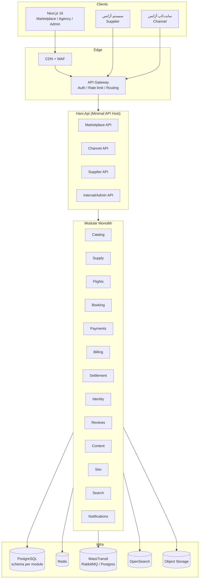
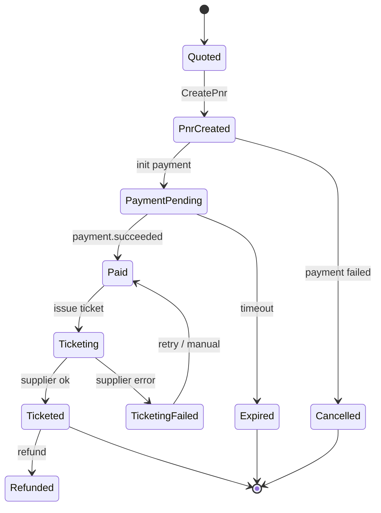
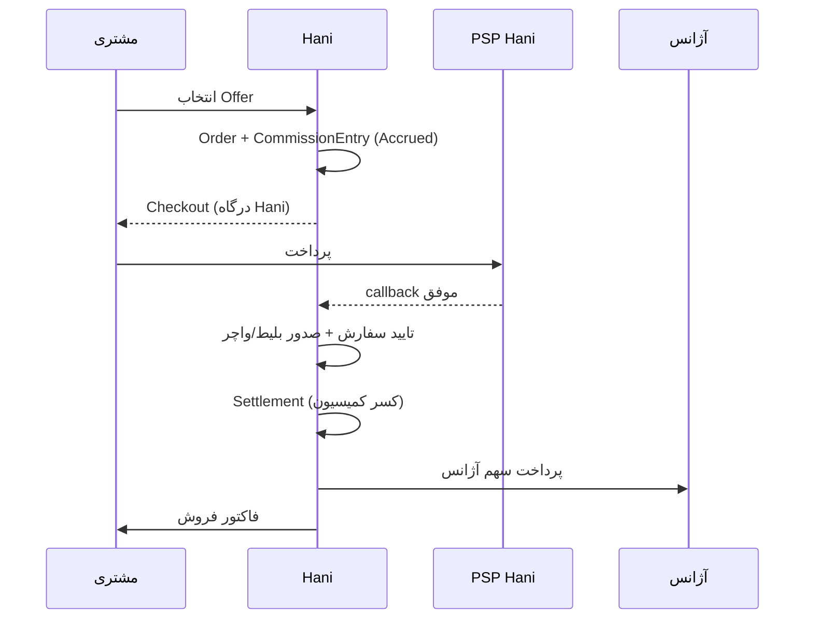

# Hani — برنامه معماری و پیاده‌سازی (نسخه ۱.۴)

> **وضعیت:** قفل‌شده برای شروع پیاده‌سازی
> **مخزن:** https://github.com/mrnikiemami-code/Hani
> **تاریخ:** ۱۹ آبان ۱۴۰۵ / ۱۰ نوامبر ۲۰۲۶
> **مالک سند:** تیم معماری Hani
> **قاعده:** تصمیم‌های این سند تا زمانی که ADR جدیدی تصویب نشود تغییر نمی‌کنند.

---

## تغییرات کلیدی نسخه ۱.۳

1. **پول به حساب Hani می‌رود** → Hani Merchant of Record است؛ مشتری به حساب Hani پرداخت می‌کند و Hani سهم آژانس را بر اساس `SettlementTerms` قرارداد تسویه می‌کند. فاکتور مشتری و فاکتور کمیسیون/تسویه را Hani صادر می‌کند.
2. **مدل درآمد هر سه‌گانه** → Supplier (اشتراک) + Channel (اشتراک/کمیسیون) + Marketplace (کمیسیون/تبلیغات). جزئیات: بخش ۳۰.
3. **دو پلن تجاری Channel**:
   - **Standard:** «Powered by Hani» اجباری.
   - **Professional:** وایت‌لیبل کامل + اشتراک بالاتر + بدون برند Hani.
4. **رزرو بلیط هواپیما** به‌عنوان ماژول مستقل `Flights` اضافه شد. جزئیات: بخش ۲۹.
5. **SEO به یک Workstream مستقل و از فاز ۰** ارتقا یافت؛ نه فاز آخر. جزئیات: بخش ۱۶ و ۳۱.
6. **حاکمیت اجرایی معماری** اضافه شد: قالب واحد ماژول، تست‌های معماری، Analyzer، CI Gate، ADR/Waiver و Drift Report. جزئیات: بخش ۳۳ و `docs/engineering/architecture-governance.md`.
7. **Blueprint صفحه جزئیات تور** بر اساس بررسی واقعی صفحه `g2739` لست‌سکند اضافه شد: آناتومی، داده‌ها، جریان رزرو، نقاط ضعف و نقشه به دامنه Hani. جزئیات: بخش ۳۴ و `docs/product/tour-detail-page.md`.
8. **کمیسیون داینامیک per agency + per ProductType** و **SettlementTerms قابل تنظیم per contract** قفل شد. جزئیات: بخش ۳۰.۸ و ۳۲.
9. **کد و لاگ فنی انگلیسی؛ پیام کاربر چندزبانه** قفل شد. خطاها کد `HANI-...` دارند و در FA/EN/AR ترجمه می‌شوند. جزئیات: بخش ۳۵.

---

## فهرست

1. خلاصه اجرایی
2. تصمیم‌های قفل‌شده
3. اصلاح مهم: `TourProduct` مشترک + `AgencyOffer` مستقل
4. سه مدل کسب‌وکار و مرزهای معماری
5. قابلیت‌های محصول
6. معماری کلان (Modular Monolith + Clean Architecture)
7. ساختار پوشه‌ها (فولدر بندی)
8. CQRS با MediatR 12.5.0
9. BuildingBlocks
10. Logging و Telemetry با قابلیت خاموش/روشن
11. Idempotency (با تمرکز روی پرداخت)
12. Messaging با MassTransit 8.5.12
13. Cache قابل جایگزینی
14. PostgreSQL و مرز داده ماژول‌ها
15. چندزبانه: FA / EN / AR
16. موتور SEO
17. امنیت، انطباق و چندمستأجری
18. تست
19. CI/CD و محیط‌ها
20. Git و همگام‌سازی محلی
21. نقشه راه و فازها
22. بک‌لاگ تسک‌های کوچک (Cursor-friendly)
23. ریسک‌ها
24. سؤالات باز
25. ADRها
26. نسخه‌های پکیج و لایسنس
27. تأیید درک: فولدر بندی و لاگینگ
28. پیوست: درس‌های تحلیل لست‌سکند
29. طراحی تفصیلی رزرو بلیط هواپیما (Flights)
30. مدل درآمد، پلن‌ها و وایت‌لیبل
31. استراتژی و مهندسی SEO (تفصیلی)
32. جریان پول با مرچنت Hani
33. حاکمیت معماری و یکدستی پروژه
34. Blueprint صفحه جزئیات تور (مدل لست‌سکند، بهتر)
35. استاندارد خطا و سیاست لاگینگ (چندزبانه)
36. برنامه فازی، Phase Gate و وضعیت اجرایی

---

## ۱. خلاصه اجرایی

Hani یک **مارکت‌پلیس چندآژانسه سفر** است با سه کانال درآمدی/تعامل مستقل:

1. **Supplier API** — آژانس موجودی، ظرفیت و قیمت را وارد Hani می‌کند.
2. **Channel API** — آژانس از سایت/اپ خودش، تورهای مجاز را با API می‌فروشد.
3. **Marketplace** — مشتری مستقیم وارد Hani می‌شود، پیشنهاد چند آژانس را مقایسه و رزرو می‌کند.

هسته مشترک همه این‌ها یکی است: **کاتالوگ تور مشترک (`TourProduct`) + پیشنهاد مستقل هر آژانس (`AgencyOffer`) + سانس/ظرفیت/قیمت (`TourDeparture`) + رزرو/قرارداد/پرداخت/تسویه**.

علاوه بر تور، **بلیط هواپیما** یک ماژول مستقل با چرخه عمر متفاوت (جستجو، PNR، Ticketing، Refund) دارد و از همان هسته رزرو/پرداخت/کمیسیون استفاده می‌کند.

**مدل پول:** **Hani Merchant of Record است.** مشتری به حساب Hani پرداخت می‌کند؛ Hani پس از کسر کمیسیون، سهم آژانس را بر اساس `SettlementTerms` قرارداد تسویه می‌کند. فاکتور مشتری و فاکتور کمیسیون/تسویه توسط Hani صادر می‌شود.

این سند علاوه بر معماری، **برنامه اجرایی** است: ساختار پوشه‌ها، قواعد وابستگی، الگوی CQRS، BuildingBlocks، لاگینگ، تلمتری، idempotency، messaging، کش، دیتابیس، i18n، SEO، تست، CI/CD، نقشه راه و بک‌لاگ.

**تفاوت کلیدی با لست‌سکند:** لست‌سکند عمدتاً سرنخ (Lead) تولید می‌کند و کاربر را به تماس با آژانس می‌فرستد؛ Hani **رزرو آنلاین واقعی** با قرارداد، پرداخت و تسویه دارد.

---

## ۲. تصمیم‌های قفل‌شده

| بخش | تصمیم | وضعیت |
|---|---|---|
| Backend | ASP.NET Core 10 / Minimal API | 🔒 قفل |
| Frontend | Next.js 16 / React 19 | 🔒 قفل |
| معماری | Modular Monolith + Clean Architecture | 🔒 قفل |
| آمادگی | قابل استخراج به میکروسرویس بدون بازنویسی دامنه | 🔒 قفل |
| Database | PostgreSQL + Schema مستقل برای هر ماژول | 🔒 قفل |
| Cache | Redis با انتزاع قابل جایگزینی | 🔒 قفل |
| زبان‌ها | FA (پیش‌فرض) / EN / AR | 🔒 قفل |
| SEO | Server Components + ماژول SEO مستقل | 🔒 قفل |
| MediatR | 12.5.0 — آخرین نسخه Apache-2.0 | 🔒 قفل |
| MassTransit | 8.5.12 — آخرین نسخه Apache-2.0 | 🔒 قفل |
| Transport | RabbitMQ یا PostgreSQL SQL Transport — قابل سوییچ | 🔒 قفل |
| Merchant of Record | **Hani** — پول مشتری به حساب Hani می‌رسد | 🔒 قفل |
| تسویه با آژانس | `SettlementTerms` قابل تنظیم per contract (پیش/پس‌پرداخت، دوره‌ای/per booking، پس از سفر، ناخالص/خالص، Credit Limit) | 🔒 قفل |
| کمیسیون | داینامیک per agency + per ProductType + بازه اعتبار، snapshot در رزرو | 🔒 قفل |
| مدل درآمد | هر سه: Supplier + Channel + Marketplace | 🔒 قفل |
| پلن‌های Channel | Standard (Powered by) / Professional (White-label) | 🔒 قفل |
| بلیط هواپیما | ماژول مستقل `Flights` — فاز ۴ | 🔒 قفل |
| SEO | Workstream مستقل از فاز ۰ + ماژول `Seo` | 🔒 قفل |
| روش توسعه | Cursor + تسک‌های کوچک + معماری قفل‌شده | 🔒 قفل |

**قاعده تغییر:** هیچ پیشنهاد جدیدی (حتی اگر در گزارش تحلیل لست‌سکند آمده باشد) بدون ADR مصوب، این جدول را تغییر نمی‌دهد.

---

## ۳. اصلاح مهم: `TourProduct` مشترک + `AgencyOffer` مستقل

**«مدل لست‌سکند» = گزینه ۱:** یعنی مدل محصول/تجربه/کسب‌وکار لست‌سکند (مارکت‌پلیس، محتوا، سئو، پنل آژانس، صفحه تور غنی) — نه مدل داده per-agency.

گزارش تحلیل لست‌سکند مدلی پیشنهاد داده بود که در آن `TourProduct` مالک آژانس دارد. **این مدل برای Hani پذیرفته نیست.** مدل قفل‌شده:

```
TourProduct (مشترک، مالک: پلتفرم/تیم کاتالوگ)
   │  تور استانبول ۴ شب و ۳ روز — ۵ ستاره — پرواز مستقیم
   │  مسیر، برنامه سفر، رسانه، مقاصد، سئو
   │
   ├── AgencyOffer (آژانس A)
   │      ├── Departure 1405-09-15 — ظرفیت 20 — قیمت 45,000,000
   │      ├── Departure 1405-09-22 — ظرفیت 16 — قیمت 47,500,000
   │      └── قوانین کنسلی، هتل‌ها، خدمات، کمیسیون
   │
   ├── AgencyOffer (آژانس B)
   │      ├── Departure 1405-09-15 — ظرفیت 12 — قیمت 42,900,000
   │      └── ...
   │
   └── AgencyOffer (آژانس C)
          └── ...
```

### چرا این مدل؟

| دلیل | توضیح |
|---|---|
| مقایسه واقعی | صفحه محصول یکی است؛ کاربر پیشنهاد چند آژانس را کنار هم می‌بیند |
| SEO قوی | یک URL canonical برای «تور استانبول»، نه صدها صفحه تکراری |
| کیفیت داده | تیم کاتالوگ محصول را استاندارد می‌کند؛ آژانس فقط پیشنهاد می‌دهد |
| جلوگیری از تکرار | مشخصات تور (برنامه سفر، مقاصد) یک بار تعریف می‌شود |
| مقیاس | افزودن آژانس جدید = افزودن Offer، نه ساختن محصول جدید |
| تسویه شفاف | هر سفارش به `AgencyOfferId` و در نتیجه به یک آژانس وصل است |

### قواعد مدل

1. `TourProduct` مالک ندارد؛ فقط `Catalog` آن را مدیریت می‌کند.
2. `AgencyOffer` همیشه `AgencyId` دارد و tenant-owned است.
3. `TourDeparture` به `AgencyOfferId` وصل است، نه مستقیم به `TourProduct`.
4. قیمت، ظرفیت و قوانین کنسلی روی Offer/Departure است، نه Product.
5. هنگام رزرو، از Offer و Departure **snapshot** گرفته می‌شود.
6. یک Product می‌تواند ده‌ها Offer از آژانس‌های مختلف داشته باشد.
7. نقشه‌برداری آژانس به Product (mapping) توسط ادمین تایید می‌شود.
8. Product می‌تواند در آینده Variant داشته باشد (مثلاً ۴ شب / ۵ شب)؛ فعلاً ساده نگه می‌داریم.

---

## ۴. سه مدل کسب‌وکار و مرزهای معماری

### ۴.۱. جدول مقایسه

| محور | Supplier API | Channel API | Marketplace |
|---|---|---|---|
| بازیگر | آژانس (تأمین‌کننده) | آژانس (کانال فروش) | مشتری نهایی |
| جهت داده | آژانس → Hani | Hani → سایت/اپ آژانس | دوطرفه (خرید) |
| احراز هویت | API Key + HMAC یا OAuth2 CC | OAuth2 Client Credentials | JWT کاربر / مهمان |
| اسکوپ | `supplier.write`, `supplier.read` | `channel.catalog.read`, `channel.booking.write` | `market.*` (داخلی) |
| مالکیت داده | Offer/Departure آژانس | فقط خواندن Offerهای مجاز | سفارش مشتری |
| سطح API | `/supplier/v1` | `/channel/v1` | `/market/v1` + BFF |
| SLA | ۹۹.۹٪ (Ingestion) | ۹۹.۹۵٪ | ۹۹.۹٪ |
| Rate limit | نوشتن ۳۰ RPM / خواندن ۱۲۰ RPM | ۶۰ RPM خواندن / ۳۰ RPM نوشتن | بر اساس کاربر/IP |
| مدل درآمد | اشتراک/کیفیت داده | کمیسیون/کارمزد | کمیسیون + تبلیغات |

### ۴.۲. قاعده «یک هسته، سه نما»

- **هسته دامنه مشترک:** `Catalog`, `Supply`, `Booking`, `Payments`, `Settlement`.
- هر مدل، **لایه Presentation و Application جدا** دارد؛ DTOها و endpointها قاطی نمی‌شوند.
- هیچ DTO مربوط به Supplier به Channel یا Marketplace نشت نمی‌کند.
- قواعد کسب‌وکار مشترک در Domain می‌ماند؛ سیاست‌های هر کانال در Application همان کانال.
- مجوزها و rate limit در لایه API Gateway/Endpoint Filter اعمال می‌شوند، نه در Domain.

### ۴.۳. Supplier API

**هدف:** آژانس موجودی خود را با API وارد می‌کند.

نمونه Endpointها:

| متد | مسیر | کار |
|---|---|---|
| `PUT` | `/supplier/v1/offers/{externalId}` | Upsert پیشنهاد (Idempotent) |
| `GET` | `/supplier/v1/offers` | لیست پیشنهادهای آژانس |
| `PUT` | `/supplier/v1/offers/{offerId}/departures/{externalId}` | Upsert سانس |
| `PATCH` | `/supplier/v1/departures/{id}/availability` | به‌روزرسانی ظرفیت |
| `POST` | `/supplier/v1/offers/{id}/submit` | ارسال برای تایید |
| `GET` | `/supplier/v1/offers/{id}/status` | وضعیت تایید/رد |
| Webhook | `offer.approved`, `offer.rejected`, `departure.changed` | اطلاع‌رسانی |

**قواعد:**
- `externalId` کلید یکتای آژانس است؛ upsert idempotent.
- نگاشت به `TourProduct` توسط آژانس پیشنهاد و توسط ادمین تایید می‌شود.
- اعتبارسنجی: تاریخ، ظرفیت، قیمت، ارز، قوانین کنسلی، رسانه.
- تغییر قیمت/ظرفیت با `version` و ETag برای جلوگیری از بازنویسی.
- موجودی کهنه‌تر از آستانه → هشدار و در صورت لزوم غیرفعال‌سازی خودکار.

### ۴.۴. Channel API

**هدف:** آژانس روی سایت/اپ خودش تورهای مجاز را می‌فروشد.

| متد | مسیر | کار |
|---|---|---|
| `GET` | `/channel/v1/catalog/products` | محصولات مجاز |
| `GET` | `/channel/v1/offers` | پیشنهادهای مجاز این آژانس |
| `GET` | `/channel/v1/offers/{id}/departures` | سانس‌ها |
| `POST` | `/channel/v1/quotes` | استعلام + hold |
| `POST` | `/channel/v1/bookings` | ثبت سفارش |
| `GET` | `/channel/v1/bookings/{id}` | وضعیت |
| `POST` | `/channel/v1/bookings/{id}/cancel` | لغو |
| `GET` | `/channel/v1/settlements` | تسویه |
| `GET` | `/channel/v1/me/entitlements` | پلن، وایت‌لیبل، سهمیه، نرخ کمیسیون |
| `POST` | `/channel/v1/flights/search` | جستجوی بلیط (فاز ۴) |
| `POST` | `/channel/v1/flights/bookings` | رزرو بلیط (فاز ۴) |

**قواعد:**
- توکن فقط به `AgencyId` خودش دسترسی دارد.
- آژانس فقط Offerهای خودش (یا Offerهای صریحاً مجاز) را می‌بیند.
- `Idempotency-Key` اجباری برای همه POSTها.
- Webhook با HMAC و retry.
- محدودیت IP پیش‌فرض فعال.
- **پلن Standard:** نمایش «Powered by Hani» اجباری است.
- **پلن Professional:** وایت‌لیبل کامل؛ نام/لوگوی Hani در UI، ایمیل، فاکتور و checkout نمایش داده نمی‌شود.
- جزئیات پلن‌ها و اجبار برند: بخش ۳۰.

### ۴.۵. Marketplace

**هدف:** مشتری نهایی وارد Hani می‌شود و مقایسه/رزرو می‌کند.

| صفحه/API | کار |
|---|---|
| جستجو | فیلتر مقصد، تاریخ، مدت، ستاره، قیمت، آژانس |
| صفحه محصول | مشخصات مشترک + جدول مقایسه Offerها |
| انتخاب Offer | مشاهده قیمت/هتل/کنسلی/امتیاز آژانس |
| استعلام/رزرو | Quote → Hold → Booking |
| پرداخت | درگاه، قرارداد، بلیط/واچر |
| داشبورد مسافر | سفارش‌ها، مدارک، لغو |

**قواعد:**
- رتبه‌بندی شفاف: قیمت، امتیاز آژانس، سرعت تایید، کیفیت داده.
- نمایش «پیشنهاد دهنده» و شرایط هر آژانس.
- قرارداد با اسنپ‌شات کامل Offer/Departure.
- در صورت نبود ظرفیت، پیشنهاد جایگزین (همان Product از آژانس دیگر).

### ۴.۶. مدل درآمد سه‌گانه

| مدل | درآمد | مبنا |
|---|---|---|
| Supplier | اشتراک پلن تأمین‌کننده | تعداد Offer، سهمیه API، اولویت moderation |
| Channel | اشتراک پلن + کمیسیون هر رزرو | Standard/Professional + نرخ کمیسیون |
| Marketplace | کمیسیون هر رزرو + تبلیغات | نرخ بر اساس ProductType و پلن آژانس |

**قاعده:** درآمد از اشتراک و کمیسیون است؛ نگهداری و تسویه پول مشتری بخشی از `Settlement` است و با دفتر کل دوطرفه ردیابی می‌شود. جزئیات: بخش ۳۰.

### ۴.۷. مرچنت Hani و جریان پول

- **مشتری → Hani** پرداخت می‌کند (درگاه Hani).
- **Hani → آژانس** سهم آژانس را بر اساس `SettlementTerms` قرارداد تسویه می‌کند.
- **Hani → مشتری** فاکتور فروش صادر می‌کند.
- **Hani → آژانس** فاکتور کمیسیون/اشتراک (و در صورت نیاز صورت‌حساب تسویه) صادر می‌کند.
- Hani پول را تا زمان تسویه نگه می‌دارد؛ دفتر کل، تعهد به آژانس را ثبت می‌کند.
- در Channel، پرداخت نیز به حساب Hani است؛ مگر قرارداد خاصی ترتیب دیگری تعیین کند.
- Split Payment در صورت پشتیبانی PSP؛ در غیر این صورت مدل حساب واحد Hani + تسویه.

جزئیات و ماشین وضعیت: بخش ۳۲.

### ۴.۸. پلن‌ها و وایت‌لیبل

| ویژگی | Standard | Professional |
|---|---|---|
| Channel API | ✓ | ✓ |
| «Powered by Hani» | اجباری | حذف |
| وایت‌لیبل کامل | ✗ | ✓ |
| دامنه اختصاصی | ✗ | ✓ |
| سهمیه API | پایه | بالا |
| نرخ کمیسیون | نرخ پایه (قابل override با قرارداد) | نرخ پایه پایین‌تر (قابل override) |
| SEO canonical | به Hani | قابل تنظیم (با قواعد محتوا) |
| پشتیبانی | استاندارد | اولویت‌دار |
| اشتراک | پایه | بالاتر |

**اجرای برند:** قرارداد + `GET /channel/v1/me/entitlements` + نمایش اجباری در checkout میزبانی‌شده. جزئیات: بخش ۳۰.

---

## ۵. قابلیت‌های محصول

| حوزه | قابلیت‌ها |
|---|---|
| مارکت‌پلیس | مقایسه چند آژانس، رتبه‌بندی، پیشنهاد جایگزین، جستجوی چندزبانه |
| تور | محصول مشترک، برنامه سفر، تاریخ حرکت، ظرفیت، قیمت‌گذاری چندنوعی (دو/یک تخته/کودک/نوزاد) |
| بلیط هواپیما | جستجوی پرواز، Fare Family، PNR، Ticketing، Refund، چند ایرلاین |
| رزرو | Quote، Hold، Order، Contract، Ticket/Voucher، Amendment، Cancellation |
| پرداخت | درگاه آژانس، Idempotency، Webhook، Refund، Reconciliation |
| تسویه | کمیسیون، دفتر کل دوطرفه، فاکتور آژانس، Credit Limit، Dunning |
| پلن‌ها | Standard/Professional، Entitlements، White-label، Usage Metering |
| هتل/مقصد/جاذبه | کاتالوگ محتوایی، نقشه، امکانات، رتبه، نقد |
| ویزا | سرویس، قیمت، مدارک، مراحل، درخواست |
| محتوا | سفرنامه، خاطرات سفر، بلاگ، ویدیو، نویسنده، دسته‌بندی |
| نظرات | نقد چندمعیاره، تایید، پاسخ، گزارش |
| پنل‌ها | پنل مدیریت، پنل آژانس، داشبورد مسافر |
| چندزبانه | FA/EN/AR در UI، محتوا، خطاها، SEO |
| SEO | Slug، متا، Sitemap، JSON-LD، Redirect، hreflang، Route Landing |

---

## ۶. معماری کلان

### ۶.۱. نمای کلی



### ۶.۲. ماژول‌ها و مسئولیت‌ها

| ماژول | مسئولیت | Schema |
|---|---|---|
| Identity | کاربر، آژانس، نقش، ApiClient، توکن | `identity` |
| Catalog | TourProduct، مقصد، هتل، جاذبه، ویزا، رسانه | `catalog` |
| Supply | AgencyOffer، Departure، ظرفیت، قیمت، moderation | `supply` |
| Marketplace | Read model مقایسه، رتبه‌بندی، BFF مصرف‌کننده | `marketplace` |
| Search | ایندکس و کوئری جستجو | `search` (OpenSearch) |
| Booking | Quote، Hold، Order، Contract، Ticket، Cancel (چند ProductType) | `booking` |
| Flights | Airline/Airport، Schedule، Fare، PNR، Ticketing، Refund | `flight` |
| Payments | PaymentIntent، Gateway آژانس، Webhook، Refund | `payment` |
| Billing | Plan، Subscription، Entitlement، CommissionRule، Invoice | `billing` |
| Settlement | Ledger، CommissionEntry، Invoice، Dunning | `settlement` |
| Reviews | نقد، امتیاز، پاسخ، گزارش | `review` |
| Content | سفرنامه، خاطرات، بلاگ، ویدیو | `content` |
| Seo | Slug، Meta، Redirect، Sitemap | `seo` |
| Notifications | ایمیل/پیامک/داخل‌اپ، قالب چندزبانه | `notification` |
| Platform | Outbox، Inbox، Idempotency، Audit، FeatureFlag | `platform` |

### ۶.۳. لایه‌های Clean Architecture

هر ماژول چهار پروژه دارد:

```
Domain          → موجودیت، Value Object، Domain Event، Invariant (بدون وابستگی)
Application     → Command/Query/Handler/Validator/Port/DTO
Infrastructure  → EF Core، Migration، Repository، Adapter (Cache/Messaging/HTTP)
Presentation    → Minimal API Endpoint، Contract، Filter، OpenAPI
```

**قواعد وابستگی:**

```
Domain          → BuildingBlocks.Domain
Application     → Domain + BuildingBlocks.Application + Contracts
Infrastructure  → Application + BuildingBlocks.Infrastructure
Presentation    → Application + BuildingBlocks.AspNetCore
Api Host        → Presentation + Infrastructure همه ماژول‌ها (Composition Root)
```

- Domain به EF Core، ASP.NET، Redis، MassTransit و هیچ کتابخانه خارجی وابسته نیست.
- Application به `DbContext` و `HttpClient` وابسته نیست؛ فقط به Portها.
- ماژول A به Domain/Application ماژول B ارجاع نمی‌دهد.
- ارتباط بین ماژول‌ها: `Contracts` (Integration Event/DTO) یا Read Model.
- ArchitectureTests این قواعد را در CI الزامی می‌کند.

### ۶.۴. آمادگی میکروسرویس

- هر ماژول DbContext و Migration مستقل دارد.
- هیچ Join بین Schemaها در کد وجود ندارد.
- تراکنش بین ماژول‌ها با Outbox/Saga، نه Distributed Transaction.
- Integration Eventها در `Hani.Contracts.*` نسخه‌بندی می‌شوند.
- استخراج هر ماژول = جدا کردن Host + DbContext + Consumers؛ دامنه دست نمی‌خورد.
- ترتیب پیشنهادی استخراج: Notifications → Search → Content → Reviews → Settlement → Payments → Booking → Supply → Catalog.

---

## ۷. ساختار پوشه‌ها (فولدر بندی)

### ۷.۱. نمای ریشه

```
D:\Hani\
├─ .cursor\
│  └─ rules\
│     └─ hani-architecture.mdc
├─ .editorconfig
├─ .gitignore
├─ Directory.Build.props
├─ Directory.Packages.props
├─ global.json
├─ README.md
├─ PLAN.md
├─ Hani.sln
├─ src\
│  ├─ Hani.Api\
│  ├─ Hani.BuildingBlocks\
│  ├─ Hani.Contracts\
│  └─ Modules\
├─ tests\
├─ frontend\
├─ deploy\
├─ docs\
└─ scripts\
```

### ۷.۲. Host

```
src/Hani.Api/
├─ Program.cs
├─ DependencyInjection.cs
├─ Endpoints/
│  ├─ Marketplace/
│  │  ├─ ProductsEndpoints.cs
│  │  ├─ CompareEndpoints.cs
│  │  ├─ BookingEndpoints.cs
│  │  └─ FlightSearchEndpoints.cs
│  ├─ Channel/
│  │  ├─ ChannelCatalogEndpoints.cs
│  │  ├─ ChannelBookingEndpoints.cs
│  │  ├─ ChannelFlightEndpoints.cs
│  │  ├─ ChannelEntitlementsEndpoints.cs
│  │  └─ ChannelSettlementEndpoints.cs
│  ├─ Supplier/
│  │  ├─ SupplierOfferEndpoints.cs
│  │  ├─ SupplierDepartureEndpoints.cs
│  │  └─ SupplierAvailabilityEndpoints.cs
│  └─ Internal/
│     ├─ AdminEndpoints.cs
│     └─ HealthEndpoints.cs
├─ Middleware/
│  ├─ CorrelationIdMiddleware.cs
│  ├─ GlobalExceptionMiddleware.cs
│  └─ RequestLoggingMiddleware.cs
├─ Filters/
│  ├─ IdempotencyFilter.cs
│  └─ PermissionFilter.cs
├─ OpenApi/
│  ├─ OpenApiConfiguration.cs
│  └─ SecuritySchemeTransformer.cs
├─ appsettings.json
├─ appsettings.Development.json
└─ appsettings.Production.json
```

### ۷.۳. BuildingBlocks

```
src/Hani.BuildingBlocks/
├─ Hani.BuildingBlocks.Domain/
│  ├─ Entity.cs
│  ├─ AggregateRoot.cs
│  ├─ ValueObject.cs
│  ├─ StronglyTypedId.cs
│  ├─ DomainEvent.cs
│  ├─ Money.cs
│  ├─ Currency.cs
│  ├─ LocalizedText.cs
│  ├─ DateRange.cs
│  └─ Guard.cs
├─ Hani.BuildingBlocks.Application/
│  ├─ Cqrs/
│  │  ├─ ICommand.cs
│  │  ├─ IQuery.cs
│  │  ├─ ICommandHandler.cs
│  │  ├─ IQueryHandler.cs
│  │  └─ Result.cs
│  ├─ Abstractions/
│  │  ├─ IUnitOfWork.cs
│  │  ├─ ICurrentTenant.cs
│  │  ├─ ICurrentUser.cs
│  │  ├─ IDateTimeProvider.cs
│  │  ├─ ICacheService.cs
│  │  ├─ IIdempotencyStore.cs
│  │  ├─ IOutbox.cs
│  │  ├─ IIntegrationEventPublisher.cs
│  │  └─ ILocalizationService.cs
│  ├─ Behaviors/
│  │  ├─ LoggingBehavior.cs
│  │  ├─ MetricsBehavior.cs
│  │  ├─ ValidationBehavior.cs
│  │  ├─ IdempotencyBehavior.cs
│  │  ├─ TransactionBehavior.cs
│  │  └─ CachingBehavior.cs
│  ├─ Idempotency/
│  │  ├─ IIdempotentCommand.cs
│  │  └─ IdempotencyResult.cs
│  └─ Pagination/
│     ├─ PagedResult.cs
│     └─ Cursor.cs
├─ Hani.BuildingBlocks.Infrastructure/
│  ├─ Persistence/
│  │  ├─ BaseDbContext.cs
│  │  ├─ Outbox/
│  │  └─ Interceptors/
│  ├─ Caching/
│  │  ├─ RedisCacheService.cs
│  │  ├─ MemoryCacheService.cs
│  │  ├─ HybridCacheService.cs
│  │  └─ NullCacheService.cs
│  ├─ Messaging/
│  │  ├─ MassTransitConfiguration.cs
│  │  ├─ RabbitMqTransport.cs
│  │  ├─ PostgresTransport.cs
│  │  └─ OutboxPublisher.cs
│  ├─ Idempotency/
│  │  └─ PostgresIdempotencyStore.cs
│  ├─ Observability/
│  │  ├─ ObservabilityOptions.cs
│  │  ├─ SerilogConfiguration.cs
│  │  ├─ OpenTelemetryConfiguration.cs
│  │  └─ Telemetry.cs
│  └─ Security/
│     ├─ Hashing.cs
│     ├─ HmacSignature.cs
│     └─ TenantContext.cs
├─ Hani.BuildingBlocks.AspNetCore/
│  ├─ ProblemDetails/
│  ├─ ExceptionHandling/
│  ├─ Localization/
│  ├─ Versioning/
│  ├─ RateLimiting/
│  └─ EndpointFilters/
│     └─ IdempotencyEndpointFilter.cs
└─ Hani.BuildingBlocks.Testing/
   ├─ Testcontainers/
   ├─ Fakes/
   └─ Assertions/
```

### ۷.۴. قراردادهای بین ماژول‌ها

```
src/Hani.Contracts/
├─ Hani.Contracts.Catalog/
│  ├─ TourProductCreatedIntegrationEvent.cs
│  ├─ TourProductUpdatedIntegrationEvent.cs
│  └─ CatalogReadDtos.cs
├─ Hani.Contracts.Supply/
│  ├─ OfferPublishedIntegrationEvent.cs
│  ├─ DepartureChangedIntegrationEvent.cs
│  └─ AvailabilityChangedIntegrationEvent.cs
├─ Hani.Contracts.Booking/
│  ├─ BookingCreatedIntegrationEvent.cs
│  ├─ BookingConfirmedIntegrationEvent.cs
│  └─ BookingCancelledIntegrationEvent.cs
├─ Hani.Contracts.Payments/
│  ├─ PaymentSucceededIntegrationEvent.cs
│  ├─ PaymentFailedIntegrationEvent.cs
│  └─ RefundIssuedIntegrationEvent.cs
├─ Hani.Contracts.Flights/
│  ├─ FlightBookingConfirmedIntegrationEvent.cs
│  ├─ FlightTicketedIntegrationEvent.cs
│  └─ FlightRefundedIntegrationEvent.cs
├─ Hani.Contracts.Billing/
│  ├─ SubscriptionRenewedIntegrationEvent.cs
│  ├─ CommissionChargedIntegrationEvent.cs
│  └─ InvoiceOverdueIntegrationEvent.cs
└─ Hani.Contracts.Settlement/
   ├─ SettlementPaidIntegrationEvent.cs
   └─ CommissionInvoicedIntegrationEvent.cs
```

### ۷.۵. قالب هر ماژول (مثال: Supply)

```
src/Modules/Supply/
├─ Hani.Modules.Supply.Domain/
│  ├─ AgencyOffers/
│  │  ├─ AgencyOffer.cs
│  │  ├─ AgencyOfferId.cs
│  │  ├─ AgencyOfferStatus.cs
│  │  └─ OfferPolicy.cs
│  ├─ Departures/
│  │  ├─ TourDeparture.cs
│  │  ├─ TourDepartureId.cs
│  │  ├─ DeparturePrice.cs
│  │  └─ Capacity.cs
│  ├─ Events/
│  │  ├─ OfferPublishedDomainEvent.cs
│  │  └─ DepartureCapacityChangedDomainEvent.cs
│  └─ ValueObjects/
│     ├─ PriceRule.cs
│     └─ CancellationPolicy.cs
├─ Hani.Modules.Supply.Application/
│  ├─ Abstractions/
│  │  ├─ IAgencyOfferRepository.cs
│  │  ├─ IDepartureRepository.cs
│  │  └─ IOfferReadService.cs
│  ├─ Commands/
│  │  ├─ CreateAgencyOffer/
│  │  │  ├─ CreateAgencyOfferCommand.cs
│  │  │  ├─ CreateAgencyOfferCommandHandler.cs
│  │  │  ├─ CreateAgencyOfferCommandValidator.cs
│  │  │  └─ CreateAgencyOfferResult.cs
│  │  ├─ UpdateAgencyOffer/
│  │  ├─ PublishAgencyOffer/
│  │  └─ SetDepartureAvailability/
│  ├─ Queries/
│  │  ├─ GetAgencyOffers/
│  │  │  ├─ GetAgencyOffersQuery.cs
│  │  │  ├─ GetAgencyOffersQueryHandler.cs
│  │  │  ├─ GetAgencyOffersQueryValidator.cs
│  │  │  └─ AgencyOfferListItemDto.cs
│  │  └─ GetOfferComparison/
│  ├─ Common/
│  │  ├─ Dtos/
│  │  └─ Mappings/
│  └─ DependencyInjection.cs
├─ Hani.Modules.Supply.Infrastructure/
│  ├─ Persistence/
│  │  ├─ SupplyDbContext.cs
│  │  ├─ Configurations/
│  │  │  ├─ AgencyOfferConfiguration.cs
│  │  │  └─ TourDepartureConfiguration.cs
│  │  └─ Migrations/
│  ├─ Repositories/
│  │  ├─ AgencyOfferRepository.cs
│  │  └─ DepartureRepository.cs
│  ├─ ReadServices/
│  │  └─ OfferReadService.cs
│  └─ DependencyInjection.cs
└─ Hani.Modules.Supply.Presentation/
   ├─ Supplier/
   │  ├─ UpsertOfferEndpoint.cs
   │  ├─ SetAvailabilityEndpoint.cs
   │  └─ Contracts/
   ├─ Channel/
   │  ├─ GetAuthorizedOffersEndpoint.cs
   │  └─ Contracts/
   ├─ Marketplace/
   │  ├─ CompareOffersEndpoint.cs
   │  └─ Contracts/
   └─ DependencyInjection.cs
```

### ۷.۶. قواعد نام‌گذاری

| مورد | قاعده | مثال |
|---|---|---|
| Command | `{Verb}{Entity}Command` | `CreateAgencyOfferCommand` |
| Query | `Get{Entity}Query` یا `Search{Entity}Query` | `GetAgencyOffersQuery` |
| Handler | `{Command/Query}Handler` | `CreateAgencyOfferCommandHandler` |
| Validator | `{Command/Query}Validator` | `CreateAgencyOfferCommandValidator` |
| Endpoint | `{Action}{Entity}Endpoint` | `UpsertOfferEndpoint` |
| DTO | `{Entity}Dto` / `{Entity}ListItemDto` | `AgencyOfferListItemDto` |
| Integration Event | `{Entity}{PastTense}IntegrationEvent` | `OfferPublishedIntegrationEvent` |
| Domain Event | `{Entity}{PastTense}DomainEvent` | `OfferPublishedDomainEvent` |
| جدول | snake_case جمع | `agency_offers` |
| Schema | نام ماژول | `supply` |
| Cache key | `tc:{env}:{module}:{entity}:{id}:{locale}` | `tc:prod:supply:offer:42:fa` |

**ممنوع:** `Helper`، `Manager`، `Service` عمومی، `Utils`، پوشه `Common` با کد نامرتبط. هر فایل یک نوع اصلی.

---

## ۸. CQRS با MediatR 12.5.0

### ۸.۱. چرا 12.5.0؟

- `MediatR 12.5.0` آخرین نسخه با لایسنس **Apache-2.0** است.
- از `13.x` به بعد لایسنس تجاری دارد.
- نسخه در `Directory.Packages.props` قفل می‌شود و ارتقا فقط با بررسی لایسنس.

### ۸.۲. قراردادها

```csharp
public interface ICommand<TResponse> : IRequest<Result<TResponse>>;
public interface IQuery<TResponse> : IRequest<Result<TResponse>>;

public sealed record Result<T>
{
    public bool IsSuccess { get; init; }
    public T? Value { get; init; }
    public Error? Error { get; init; }

    public static Result<T> Success(T value) => new() { IsSuccess = true, Value = value };
    public static Result<T> Failure(Error error) => new() { IsSuccess = false, Error = error };
}
```

### ۸.۳. نمونه Command + Validator + Handler

```csharp
public sealed record CreateAgencyOfferCommand(
    Guid AgencyId,
    Guid TourProductId,
    string Title,
    decimal BasePrice,
    string Currency) : ICommand<Guid>;

public sealed class CreateAgencyOfferCommandValidator
    : AbstractValidator<CreateAgencyOfferCommand>
{
    public CreateAgencyOfferCommandValidator()
    {
        RuleFor(x => x.AgencyId).NotEmpty();
        RuleFor(x => x.TourProductId).NotEmpty();
        RuleFor(x => x.Title).NotEmpty().MaximumLength(200);
        RuleFor(x => x.BasePrice).GreaterThan(0);
        RuleFor(x => x.Currency).Must(c => Currency.IsSupported(c));
    }
}

internal sealed class CreateAgencyOfferCommandHandler
    : ICommandHandler<CreateAgencyOfferCommand, Guid>
{
    private readonly IAgencyOfferRepository _offers;
    private readonly IUnitOfWork _uow;

    public CreateAgencyOfferCommandHandler(
        IAgencyOfferRepository offers,
        IUnitOfWork uow)
    {
        _offers = offers;
        _uow = uow;
    }

    public async Task<Result<Guid>> Handle(
        CreateAgencyOfferCommand request,
        CancellationToken ct)
    {
        var offer = AgencyOffer.Create(
            new AgencyOfferId(Guid.CreateVersion7()),
            request.AgencyId,
            request.TourProductId,
            request.Title,
            new Money(request.BasePrice, request.Currency));

        await _offers.AddAsync(offer, ct);
        await _uow.SaveChangesAsync(ct);

        return Result<Guid>.Success(offer.Id.Value);
    }
}
```

### ۸.۴. نمونه Query

```csharp
public sealed record GetAgencyOffersQuery(
    Guid AgencyId,
    int Page = 1,
    int PageSize = 20) : IQuery<PagedResult<AgencyOfferListItemDto>>;

internal sealed class GetAgencyOffersQueryHandler
    : IQueryHandler<GetAgencyOffersQuery, PagedResult<AgencyOfferListItemDto>>
{
    private readonly IOfferReadService _read;

    public GetAgencyOffersQueryHandler(IOfferReadService read) => _read = read;

    public Task<PagedResult<AgencyOfferListItemDto>> Handle(
        GetAgencyOffersQuery request,
        CancellationToken ct)
        => _read.GetPagedAsync(request.AgencyId, request.Page, request.PageSize, ct);
}
```

**قاعده:** Queryها از Read Model/ projection می‌خوانند؛ برای کارهای سنگین از Dapper/EF `AsNoTracking` استفاده می‌شود. Commandها از Domain عبور می‌کنند.

### ۸.۵. ترتیب Pipeline Behaviors

```
1. CorrelationBehavior
2. LoggingBehavior
3. MetricsBehavior
4. ValidationBehavior
5. IdempotencyBehavior      (فقط IIdempotentCommand)
6. TransactionBehavior      (فقط Command)
7. Handler
8. DomainEvents → Outbox
9. CacheInvalidationBehavior
```

- `ValidationBehavior` خطاها را به `Result.Failure(Error.Validation(...))` تبدیل می‌کند؛ Exception برای خطای غیرمنتظره می‌ماند.
- `TransactionBehavior` فقط Commandها را در تراکنش اجرا می‌کند.
- `CachingBehavior` فقط برای Queryهای `ICacheableQuery`.
- تمام Behaviorها با `IPipelineBehavior<TRequest,TResponse>` و ثبت Assembly Scan.

---

## ۹. BuildingBlocks

BuildingBlocks باید **مستقل از دامنه Hani** و قابل استفاده در پروژه‌های دیگر باشد.

| پروژه | مسئولیت | وابستگی مجاز |
|---|---|---|
| `BuildingBlocks.Domain` | Entity, AggregateRoot, ValueObject, Money, LocalizedText, DomainEvent | هیچ |
| `BuildingBlocks.Application` | CQRS contracts, Result, Ports, Behaviors, Pagination | Domain |
| `BuildingBlocks.Infrastructure` | EF Base, Outbox, Cache, Messaging, Observability, Security | Application |
| `BuildingBlocks.AspNetCore` | ProblemDetails, Exception Handler, Localization, Versioning, RateLimit, Filters | Application |
| `BuildingBlocks.Testing` | Fixtures, Fakes, Assertions, Testcontainers helpers | همه |

**قواعد:**
- هیچ کد مربوط به تور/هتل/رزرو داخل BuildingBlocks نرود.
- نسخه‌بندی SemVer؛ در آینده قابل انتشار به‌صورت NuGet داخلی.
- API عمومی کوچک نگه داشته شود؛ `internal` پیش‌فرض.
- هر قابلیت جدید فقط با تست واحد و مستندات کوتاه اضافه شود.

---

## ۱۰. Logging و Telemetry با قابلیت خاموش/روشن

### ۱۰.۱. اصول

- **Structured Logging** با Serilog.
- **OpenTelemetry** برای Trace + Metric + Log.
- **Audit Log** جدا از لاگ تشخیصی؛ غیرقابل خاموش‌شدن در محیط تولید.
- **PII Redaction** اجباری: موبایل، ایمیل، کد ملی، پاسپورت، شماره کارت.
- **Correlation** با `X-Correlation-Id` + W3C `traceparent`.
- **زبان لاگ: انگلیسی ثابت.** پیام‌های لاگ هرگز ترجمه نمی‌شوند.
- هر لاگ باید `TraceId`, `SpanId`, `TenantId`, `AgencyId`, `UserId`, `Module`, `Locale` داشته باشد.
- خطاها با `ErrorCode` + `MessageKey` لاگ می‌شوند؛ متن ترجمه‌شده فقط در پاسخ کاربر/Notification است.
- **Audit Log** کد + locale + actor را ثبت می‌کند، نه متن ترجمه‌شده در لاگ فنی.

### ۱۰.۲. تنظیمات با Toggle

```json
{
  "Observability": {
    "ServiceName": "Hani.Api",
    "Environment": "Production",
    "Logging": {
      "Enabled": true,
      "MinimumLevel": "Information",
      "Sinks": ["Console", "Seq"],
      "SeqUrl": "http://seq:5341",
      "IncludeScopes": true,
      "IncludeRequestBody": false,
      "RedactPii": true,
      "Sampling": { "Enabled": true, "Ratio": 0.2 }
    },
    "Tracing": {
      "Enabled": true,
      "Exporter": "Otlp",
      "Endpoint": "http://otel-collector:4317",
      "SamplingRatio": 0.2,
      "RecordSql": false
    },
    "Metrics": {
      "Enabled": true,
      "Exporter": "Otlp",
      "Endpoint": "http://otel-collector:4317"
    },
    "Audit": {
      "Enabled": true,
      "Store": "Postgres"
    }
  },
  "Modules": {
    "Supply": { "Logging": { "Level": "Debug" }, "Tracing": { "Enabled": true } },
    "Payments": { "Logging": { "Level": "Information" }, "Tracing": { "Enabled": true } },
    "Notifications": { "Logging": { "Level": "Warning" } }
  }
}
```

- `Enabled=false` → پیاده‌سازی Null/No-op تزریق می‌شود؛ کد دامنه تغییر نمی‌کند.
- تغییر در زمان اجرا با `IOptionsMonitor<ObservabilityOptions>`.
- Toggle در سطح هر ماژول و هر Exporter.
- در محیط توسعه: Console + Seq + OTLP محلی.
- در تولید: OTLP → Grafana/Tempo/Loki/Prometheus؛ بدون لاگ حساس.

### ۱۰.۳. کد راه‌اندازی

```csharp
builder.Host.UseSerilog((context, services, configuration) =>
{
    var options = context.Configuration
        .GetSection("Observability")
        .Get<ObservabilityOptions>()!;

    if (!options.Logging.Enabled)
    {
        configuration.MinimumLevel.Fatal();
        return;
    }

    configuration
        .ReadFrom.Configuration(context.Configuration)
        .Enrich.FromLogContext()
        .Enrich.WithProperty("service", options.ServiceName)
        .Enrich.WithProperty("environment", options.Environment)
        .Destructure.ByTransforming<Money>(m => new { m.Amount, m.Currency })
        .WriteTo.Console()
        .WriteTo.Seq(options.Logging.SeqUrl);
});
```

```csharp
builder.Services.AddOpenTelemetry()
    .WithTracing(tracing =>
    {
        if (!options.Tracing.Enabled) return;

        tracing
            .AddAspNetCoreInstrumentation()
            .AddHttpClientInstrumentation()
            .AddEntityFrameworkCoreInstrumentation()
            .AddRedisInstrumentation()
            .AddSource("Hani.*")
            .SetSampler(new ParentBasedSampler(
                new TraceIdRatioBasedSampler(options.Tracing.SamplingRatio)))
            .AddOtlpExporter(o => o.Endpoint = new Uri(options.Tracing.Endpoint));
    })
    .WithMetrics(metrics =>
    {
        if (!options.Metrics.Enabled) return;

        metrics
            .AddAspNetCoreInstrumentation()
            .AddHttpClientInstrumentation()
            .AddRuntimeInstrumentation()
            .AddMeter("Hani.*")
            .AddOtlpExporter(o => o.Endpoint = new Uri(options.Metrics.Endpoint));
    });
```

### ۱۰.۴. Telemetry هر ماژول

```csharp
public static class SupplyTelemetry
{
    public static readonly ActivitySource ActivitySource = new("Hani.Supply");
    public static readonly Meter Meter = new("Hani.Supply");

    public static readonly Counter<long> OffersCreated =
        Meter.CreateCounter<long>("supply.offers.created");

    public static readonly Histogram<double> AvailabilityUpdateMs =
        Meter.CreateHistogram<double>("supply.availability.update.ms");
}
```

### ۱۰.۵. داشبورد و هشدار

| متریک | هشدار |
|---|---|
| نرخ 5xx | > 1٪ در ۵ دقیقه |
| p95 API | > 1s |
| Outbox lag | > 60s |
| DLQ count | > 0 |
| Payment failure rate | > 5٪ |
| Cache hit ratio | < 70٪ (برای کلیدهای پرترافیک) |
| Booking conversion | افت > 20٪ نسبت به میانگین |

**Audit Log:** چه کسی، چه زمانی، چه چیزی را تغییر داد (قیمت، ظرفیت، سفارش، کلید API) با before/after. این لاگ قابل خاموش‌شدن نیست.

---

## ۱۱. Idempotency (با تمرکز روی پرداخت)

### ۱۱.۱. دامنه

- همه `POST`های مالی و رزرو: `bookings`, `payments`, `refunds`, `settlements`.
- Webhookهای درگاه پرداخت.
- Supplier upsertها (با `externalId` + نسخه).
- Consumerهای MassTransit (Inbox).

### ۱۱.۲. قرارداد

```csharp
public interface IIdempotentCommand
{
    string IdempotencyKey { get; }
}
```

هدر اجباری: `Idempotency-Key` (UUID توصیه‌شده).

### ۱۱.۳. جدول

```sql
CREATE TABLE platform.idempotency_keys (
    key             text        NOT NULL,
    tenant_id       uuid        NULL,
    client_id       text        NULL,
    request_hash    text        NOT NULL,
    status          text        NOT NULL, -- InProgress | Completed
    response_status integer     NULL,
    response_body   jsonb       NULL,
    locked_until    timestamptz NULL,
    created_at      timestamptz NOT NULL DEFAULT now(),
    expires_at      timestamptz NOT NULL,
    PRIMARY KEY (key, tenant_id)
);

CREATE INDEX ix_idempotency_expires
    ON platform.idempotency_keys (expires_at);
```

### ۱۱.۴. الگوریتم

1. کلید + fingerprint (متد + مسیر + tenant + hash بدنه) را بگیر.
2. اگر رکورد `Completed` بود:
   - fingerprint یکسان → همان پاسخ قبلی را برگردان.
   - متفاوت → `409 IDEMPOTENCY_CONFLICT`.
3. اگر `InProgress` بود → `409 REQUEST_IN_PROGRESS` یا انتظار کوتاه.
4. در غیر این صورت `InProgress` ثبت کن + قفل Redis با TTL.
5. عملیات را اجرا کن + نتیجه را در همان تراکنش ذخیره کن.
6. TTL: ۲۴ ساعت (پرداخت: ۷ روز).

### ۱۱.۵. پرداخت

```
PaymentIntent:
  Id, OrderId, AgencyId, Amount, Currency, Status,
  MerchantScope = Agency, PspAccountRef,
  Provider, ProviderRef, IdempotencyKey,
  CreatedAt, UpdatedAt, Version

Status: Created → Pending → Succeeded | Failed | Expired
                          ↘ Refunded
```

- درخواست پرداخت با `Idempotency-Key` داخلی `payment:{intentId}:initiate`.
- تایید (verify) با `payment:{intentId}:verify`.
- Webhook: `provider_event_id` یکتا در `payment_webhook_events`؛ اگر تکراری بود، نادیده بگیر.
- اثر هر رویداد یک بار: Outbox + Inbox + وضعیت ماشین.
- تطبیق روزانه (Reconciliation) بین درگاه و دفتر کل.
- Refund هم idempotent است (`refund:{paymentId}:{requestId}`).
- **پول در حساب Hani نگه داشته نمی‌شود؛ `PspAccountRef` به حساب آژانس اشاره می‌کند.**

### ۱۱.۵.۱. Idempotency بلیط هواپیما

| عملیات | کلید |
|---|---|
| Search | بدون کلید (کش کوتاه) |
| Quote/Hold | `flight-quote:{supplierId}:{itineraryHash}` |
| Create PNR | `flight-pnr:{quoteId}` |
| Issue Ticket | `flight-ticket:{pnrId}:{passengerHash}` |
| Cancel PNR | `flight-cancel:{pnrId}` |
| Refund | `flight-refund:{ticketId}:{requestId}` |

- PNR و Ticket در جدول‌های جدا با `supplier_ref` یکتا ذخیره می‌شوند.
- اگر پاسخ Supplier گم شد، قبل از retry وضعیت PNR را query کن.
- Ticketing deadline با Job پایش می‌شود؛ اگر پرداخت نرسید → Cancel PNR.

### ۱۱.۶. پاکسازی

Job روزانه رکوردهای منقضی را حذف می‌کند؛ لاگ آماری نگه می‌دارد.

---

## ۱۲. Messaging با MassTransit 8.5.12

### ۱۲.۱. لایسنس

- `8.5.12` آخرین نسخه **Apache-2.0** است.
- `9.x` به بعد لایسنس تجاری دارد.
- نسخه در `Directory.Packages.props` قفل می‌شود.

### ۱۲.۲. انتزاع

```csharp
public interface IIntegrationEventPublisher
{
    Task PublishAsync<T>(T @event, CancellationToken ct) where T : class;
}
```

- Application فقط این interface را می‌شناسد.
- Infrastructure پیاده‌سازی MassTransit را تزریق می‌کند.
- تغییر Transport فقط تنظیمات است، نه کد دامنه.

### ۱۲.۳. سوییچ Transport

```json
{
  "Messaging": {
    "Transport": "Postgres",
    "RabbitMq": {
      "Host": "rabbitmq://localhost",
      "Username": "guest",
      "Password": "guest"
    },
    "Postgres": {
      "ConnectionString": "Host=localhost;Database=hani;Username=postgres;Password=..."
    },
    "Outbox": { "Enabled": true },
    "Retry": { "Limit": 5, "IntervalSeconds": 2, "UseExponentialBackoff": true }
  }
}
```

```csharp
services.AddMassTransit(x =>
{
    x.SetKebabCaseEndpointNameFormatter();
    x.AddEntityFrameworkOutbox<SupplyDbContext>(o =>
    {
        o.UsePostgres();
        o.UseBusOutbox();
    });

    if (options.Transport == "RabbitMq")
    {
        x.UsingRabbitMq((ctx, cfg) =>
        {
            cfg.Host(new Uri(options.RabbitMq.Host), h =>
            {
                h.Username(options.RabbitMq.Username);
                h.Password(options.RabbitMq.Password);
            });
            cfg.ConfigureEndpoints(ctx);
        });
    }
    else
    {
        x.UsingPostgres((ctx, cfg) =>
        {
            cfg.Host(options.Postgres.ConnectionString);
            cfg.ConfigureEndpoints(ctx);
        });
    }
});
```

### ۱۲.۴. قواعد

- **Outbox** برای هر DbContext که رویداد منتشر می‌کند.
- **Inbox** برای Consumerها (EF Inbox) برای حذف تکرار.
- Retry نمایی + DLQ + داشبورد.
- پیام‌ها immutable و نسخه‌دار.
- نام‌گذاری: `hani.{module}.{event}.v1`.
- Saga برای `Booking → Payment → Settlement` (در صورت نیاز).
- Transport Postgres برای شروع ساده‌تر؛ RabbitMQ وقتی حجم/تیم افزایش یافت.
- تفاوت: Postgres = بدون زیرساخت اضافه، throughput کمتر؛ RabbitMQ = throughput و ابزار بهتر.

---

## ۱۳. Cache قابل جایگزینی

### ۱۳.۱. انتزاع

```csharp
public interface ICacheService
{
    Task<T?> GetAsync<T>(string key, CancellationToken ct = default);
    Task SetAsync<T>(string key, T value, CacheEntryOptions options, CancellationToken ct = default);
    Task<T> GetOrCreateAsync<T>(
        string key,
        Func<CancellationToken, Task<T>> factory,
        CacheEntryOptions options,
        CancellationToken ct = default);
    Task RemoveAsync(string key, CancellationToken ct = default);
    Task RemoveByTagAsync(string tag, CancellationToken ct = default);
}
```

### ۱۳.۲. Providerها

| Provider | کاربرد |
|---|---|
| `RedisCacheService` | تولید و استیجینگ |
| `MemoryCacheService` | تست/تک‌نود |
| `HybridCacheService` | L1 حافظه + L2 Redis |
| `NullCacheService` | خاموش کردن کش بدون تغییر کد |

```json
{
  "Cache": {
    "Provider": "Redis",
    "Redis": { "Configuration": "localhost:6379", "InstanceName": "tc:" },
    "DefaultTtlSeconds": 300,
    "EnableMetrics": true
  }
}
```

### ۱۳.۳. قواعد

- کلید: `tc:{env}:{module}:{entity}:{id}:{locale}`.
- Tag برای invalidation گروهی: `offer:42`, `product:istanbul`.
- کش فقط برای داده غیرحساس و قابل بازسازی.
- قیمت/ظرفیت لحظه‌ای: TTL کوتاه (۱۰–۳۰ ثانیه) + نسخه.
- Invalidation با Domain Event → `CacheInvalidationConsumer`.
- هرگز داده کاربر/پرداخت را در کش عمومی نگذار.

---

## ۱۴. PostgreSQL و مرز داده ماژول‌ها

### ۱۴.۱. اصول

- PostgreSQL 16+.
- یک دیتابیس، **Schema مستقل برای هر ماژول**.
- هر ماژول `DbContext` و Migration مستقل دارد.
- `MigrationsHistoryTable` در همان Schema.
- هیچ Join بین Schemaها در کد ماژول وجود ندارد.
- گزارش‌ها از Read Model/Materialized View جدا.

### ۱۴.۲. Schemaها

```
identity, catalog, supply, flight, marketplace, booking, payment,
billing, settlement, review, content, seo, notification, platform, transport
```

### ۱۴.۳. انواع داده

| مفهوم | نوع |
|---|---|
| شناسه | `uuid` (UUIDv7) |
| پول | `bigint` (minor units) + `char(3)` currency |
| زمان | `timestamptz` |
| متن چندزبانه | `jsonb` (`{"fa":"...","en":"...","ar":"..."}`) |
| وضعیت | `varchar(32)` + Check Constraint |
| نسخه | `bigint` (Concurrency) |
| حذف نرم | `deleted_at timestamptz NULL` |

### ۱۴.۴. جدول‌های کلیدی

| Schema | جدول‌ها |
|---|---|
| identity | `users`, `agencies`, `agency_users`, `roles`, `user_roles`, `api_clients`, `api_client_scopes` |
| catalog | `tour_products`, `tour_product_translations`, `destinations`, `hotels`, `hotel_translations`, `attractions`, `visa_services`, `media_assets` |
| supply | `agency_offers`, `departures`, `departure_prices`, `departure_capacity`, `offer_hotels`, `offer_rules`, `moderation_queue` |
| marketplace | `product_read_models`, `offer_compare_views`, `ranking_scores` |
| flight | `airlines`, `airports`, `routes`, `schedules`, `instances`, `fare_offers`, `fare_rules`, `flight_orders`, `pnrs`, `tickets`, `refunds`, `supplier_configs` |
| booking | `quotes`, `quote_lines`, `holds`, `orders`, `order_items`, `travelers`, `contracts`, `tickets`, `cancellations` |
| payment | `payment_intents`, `payment_transactions`, `payment_webhook_events`, `refunds` |
| billing | `plans`, `subscriptions`, `entitlements`, `usage_meters`, `commission_rules`, `commission_entries`, `invoices`, `dunning` |
| settlement | `ledger_accounts`, `ledger_entries`, `settlements`, `settlement_lines`, `payouts` |
| review | `reviews`, `review_scores`, `review_replies`, `review_reports` |
| content | `posts`, `post_translations`, `stories`, `memories`, `videos`, `authors`, `categories` |
| seo | `slugs`, `redirects`, `meta_templates`, `sitemap_entries` |
| notification | `templates`, `messages`, `deliveries` |
| platform | `outbox_messages`, `inbox_messages`, `idempotency_keys`, `audit_logs`, `feature_flags` |

### ۱۴.۵. چندمستأجری

- `tenant_id` در جدول‌های آژانس‌محور: `agency_offers`, `departures`, `orders`, `settlements`, `api_clients`.
- `TenantContext` از توکن/کلید استخراج می‌شود.
- RLS اختیاری به‌عنوان لایه دفاعی دوم.
- تست ایزولاسیون: درخواست tenant A نباید رکورد tenant B را ببیند.

---

## ۱۵. چندزبانه: FA / EN / AR

### ۱۵.۱. Backend

- Cultureهای پشتیبانی‌شده: `fa-IR` (پیش‌فرض)، `en-US`، `ar-SA`.
- `RequestLocalization` بر اساس `Accept-Language` + `?locale=` + مسیر.
- خطاها با کد استاندارد (`HANI-SUPPLY-1001`) و ترجمه در Resource.
- `LocalizedText` برای فیلدهای محتوایی:

```csharp
public sealed record LocalizedText(
    IReadOnlyDictionary<string, string> Values)
{
    public string Get(string culture, string fallback = "fa")
        => Values.TryGetValue(culture, out var v)
            ? v
            : Values.TryGetValue(fallback, out var f)
                ? f
                : string.Empty;
}
```

- تاریخ: ذخیره UTC؛ نمایش جلالی برای FA و میلادی برای EN؛ عربی با تقویم میلادی/هجری قابل تنظیم.
- ارز: `Money` + فرمت locale.
- اعداد: جداکننده هزارگان بر اساس Culture.
- محتوا: جدول Translation با وضعیت `Draft/Translated/Published` و fallback به FA.

### ۱۵.۲. Frontend

- Next.js App Router با `[locale]`.
- `next-intl` برای پیام‌ها.
- `dir="rtl"` برای FA/AR و `ltr` برای EN.
- فونت: Vazirmatn (FA)، Inter (EN)، Noto Kufi Arabic (AR).
- `messages/fa.json`, `messages/en.json`, `messages/ar.json`.
- مسیرها: `/fa/...`, `/en/...`, `/ar/...` (locale prefix همیشه).
- Slugهای ترجمه‌شده در جدول `seo.slugs`.
- `hreflang` و canonical برای هر زبان.

### ۱۵.۳. زبان لاگ در برابر زبان پیام

| لایه | زبان |
|---|---|
| کد | انگلیسی |
| لاگ فنی | **انگلیسی ثابت** |
| کد خطا | انگلیسی (`HANI-...`) |
| پیام کاربر | FA/EN/AR |
| Audit | کد + locale + actor (بدون متن ترجمه‌شده در لاگ فنی) |

- لاگ‌ها هرگز چندزبانه نمی‌شوند.
- ترجمه فقط در لایه Presentation/UI انجام می‌شود.
- جزئیات: بخش ۳۵ و `ADR-0017`.

### ۱۵.۴. چک‌لیست QA چندزبانه

- [ ] جهت و چیدمان RTL/LTR
- [ ] فونت و line-height
- [ ] تاریخ جلالی/میلادی
- [ ] اعداد و ارز
- [ ] ترجمه خطاها و ایمیل/پیامک
- [ ] Slug و canonical
- [ ] Sitemap هر زبان
- [ ] محتوای fallback

---

## ۱۶. موتور SEO

> SEO برای Hani یک **Workstream مستقل** است، نه یک فاز پایانی. از فاز ۰ شروع می‌شود و در هر فاز گسترش می‌یابد. جزئیات مهندسی: بخش ۳۱.

### ۱۶.۱. اصول

1. **SSR/ISR واقعی:** محتوای اصلی در HTML اولیه؛ کلاینت فقط برای تعامل.
2. **یک URL canonical برای هر موجودیت:** Product/Route/Hotel/Article، نه هر Offer.
3. **کیفیت بر کمیت:** صفحه برنامه‌ای فقط با محتوای یکتا و ارزش جستجو.
4. **کنترل خزش:** faceted navigation، پارامترها، صفحه‌بندی و صفحات خالی.
5. **چندزبانه از روز اول:** FA/EN/AR با hreflang و Slug مستقل.
6. **پایداری URL:** Slug registry + redirect 301.
7. **سنجش:** GSC/GA4/CI؛ بدون داده، تصمیم SEO ممنوع.

### ۱۶.۲. ماتریس رندر و کش

| نوع صفحه | رندر | کش | ایندکس |
|---|---|---|---|
| خانه | ISR | CDN 60s | ✓ |
| Product تور | ISR + on-demand | CDN 60s | ✓ |
| مقصد/شهر | ISR | CDN 5m | ✓ |
| هتل/جاذبه/رستوران | ISR | CDN 5m | ✓ |
| ویزا | ISR | CDN 10m | ✓ |
| مسیر پرواز | ISR (قیمت از) + fetch قیمت | CDN 30–60s | ✓ |
| نتایج جستجو | SSR | no-store | `noindex,follow` |
| فیلتر/تاریخ/قیمت | SSR/Client | no-store | `noindex` |
| مقاله/سفرنامه | ISR | CDN 10m | ✓ |
| پنل/سبد/پرداخت | CSR/SSR | no-store | `noindex` |

### ۱۶.۳. URL و Slug

```
/fa/tours/{slug}
/en/tours/{slug}
/ar/tours/{slug}

/fa/flights/{origin}-{destination}
/fa/hotels/{city}/{slug}
/fa/visa/{country}
/fa/blog/{slug}
```

- Slug در جدول `seo.slugs` با `(EntityType, EntityId, Locale)` یکتا.
- تغییر Slug → رکورد `redirects` با 301.
- Slug تکراری/خالی ممنوع.
- حداکثر طول ۷۵ کاراکتر؛ فقط حروف، عدد و خط تیره.
- برای FA از حروف فارسی در Slug استفاده نکنید (URL encode و اشتراک‌گذاری سخت)؛ از ترانویسی لاتین یا Slug انگلیسی پایدار.

### ۱۶.۴. Metadata

- `generateMetadata` در Server Component.
- Template: `{Title} | Hani` (در پلن Standard) / `{Title} | {AgencyBrand}` (در Professional).
- Description یکتا ۱۲۰–۱۶۰ کاراکتر؛ بدون تکرار.
- OG image داینامیک (Next.js `ImageResponse`).
- `alternates.languages` برای FA/EN/AR + `x-default`.
- `robots` بر اساس نوع صفحه و پلن.
- Canonical:
  - Product/Route/Hotel/Article → self.
  - Offer → Product.
  - Facet/Date → Product/Route.
  - Channel Standard → Hani.
  - Channel Professional → قابل تنظیم (بخش ۱۶.۸).

### ۱۶.۵. Structured Data

| موجودیت | Schema |
|---|---|
| تور | `TouristTrip` + `Offer` + `Product` + `AggregateOffer` |
| مسیر پرواز | `Product` + `Offer` + `FAQPage` (اگر FAQ دارد) |
| هتل | `Hotel` + `AggregateRating` |
| جاذبه/رستوران | `TouristAttraction` / `Restaurant` |
| مقاله/سفرنامه | `Article` / `BlogPosting` |
| ویزا | `Service` + `FAQPage` |
| عمومی | `Organization`, `WebSite` + `SearchAction`, `BreadcrumbList` |

- `Offer` باید `price`, `priceCurrency`, `availability`, `validFrom` داشته باشد.
- `AggregateRating` فقط با نظرات واقعی.
- JSON-LD در Server Component تزریق شود؛ نه با JS کلاینت.
- اعتبارسنجی در CI با Schema Validator.

### ۱۶.۶. Sitemap و Robots

- `sitemap.xml` (index) → `sitemap-tours-{locale}.xml`, `sitemap-flights-{locale}.xml`, `sitemap-hotels-{locale}.xml`, `sitemap-content-{locale}.xml`.
- حداکثر ۵۰٬۰۰۰ URL و ۵۰MB per file.
- فقط صفحات `indexable` و 200.
- `lastmod` واقعی از `updated_at`.
- robots.txt:
  - Allow عمومی.
  - Disallow `/api`, `/panel`, `/admin`, `/checkout`, `/booking`, پارامترهای حساس.
  - Sitemap declaration.
- صفحات facet: لینک داخلی کنترل‌شده + `noindex` برای ترکیب‌های بی‌ارزش.
- صفحه‌بندی: `?page=2` با canonical به صفحه اصلی یا self با `noindex` بسته به استراتژی؛ برای لیست تور، self canonical + محتوای یکتا.

### ۱۶.۷. تولید محتوا و SEO برنامه‌ای

- **Hub:** مقصد → تورها، هتل‌ها، جاذبه‌ها، ویزا، سفرنامه.
- **Route pages پرواز:** هر مسیر پرتقاضا با محتوای یکتا (فرودگاه، ایرلاین‌ها، زمان، بار، ویزا، بهترین زمان).
- **Tour product:** توضیح یکتا، برنامه روزبه‌روز، FAQ، مدارک، کنسلی.
- **Hotel/Attraction:** توضیح، امکانات، دسترسی، اطراف.
- **Content:** سفرنامه/راهنما با نویسنده واقعی و تاریخ به‌روزرسانی.
- **ممنوع:** صفحه نازک، ترجمه ماشینی بدون ویرایش، تکرار توضیح آژانس، صفحات تاریخ بی‌نهایت.
- **قاعده کیفیت:** حداقل ۳۰۰ کلمه محتوای یکتا برای صفحات برنامه‌ای؛ در غیر این صورت `noindex`.

### ۱۶.۸. SEO و پلن‌های Channel

| موضوع | Standard | Professional |
|---|---|---|
| Canonical | Hani | قابل تنظیم (Agency/Self) |
| برند | Powered by Hani | White-label |
| محتوا | Syndicated | License + Unique Content |
| Sitemap | فقط Hani | Agency مسئول است |
| hreflang | Hani | Agency مسئول است |

**سیاست پیشنهادی:**
- Standard: محتوای محصول با canonical به Hani؛ آژانس می‌تواند index کند ولی اعتبار به Hani می‌رسد.
- Professional: آژانس می‌تواند self-canonical کند **فقط اگر** محتوای یکتا اضافه کند (حداقل آستانه). در غیر این صورت `noindex` روی نسخه آژانس.
- دو دامنه با محتوای یکسان = رقابت داخلی؛ با محتوای یکتا + لینک داخلی مدیریت می‌شود.
- `SeoPolicy` در `GET /channel/v1/me/entitlements` برگردانده می‌شود.

### ۱۶.۹. Core Web Vitals

| شاخص | بودجه |
|---|---|
| LCP | < 2.5s (p75 موبایل) |
| INP | < 200ms |
| CLS | < 0.1 |
| JS اولیه | < 200KB gzip |
| تصویر | AVIF/WebP + srcset |
| فونت | subset + `font-display: swap` |

- Server Components پیش‌فرض؛ `use client` فقط برای تعامل.
- تصاویر `next/image` + CDN.
- کش CDN + `stale-while-revalidate`.
- حذف کتابخانه‌های سنگین از مسیر بحرانی.

### ۱۶.۱۰. سنجش و CI

- Google Search Console + Bing Webmaster.
- GA4 + رویدادهای سرور-side.
- گزارش ماهانه: Impressions, CTR, Position, Indexed, Crawl errors.
- CI:
  - Lighthouse (SEO/Performance/A11y) با آستانه.
  - Schema validation.
  - Broken link check.
  - Sitemap validation.
  - Canonical/hreflang check.
  - Duplicate title/description check.
- هشدار افت ترافیک/خطای خزش.

---

## ۱۷. امنیت، انطباق و چندمستأجری

| موضوع | تصمیم |
|---|---|
| احراز هویت کاربر | JWT + Refresh Token (HttpOnly) |
| احراز هویت آژانس | OAuth2 Client Credentials |
| Supplier | API Key + HMAC + IP allowlist |
| مجوز | RBAC + Scopes + Tenant check |
| PII | رمزنگاری at-rest، ماسک لاگ، دسترسی حداقلی |
| پرداخت | عدم ذخیره PAN؛ درگاه داخلی؛ PCI در حد SAQ |
| Rate limit | per client/user/IP + endpoint |
| WAF | CDN/WAF داخلی |
| Audit | تغییر قیمت/ظرفیت/سفارش/کلید |
| مجوز آژانس | اعتبارسنجی بند ب + تاریخ انقضا |
| انطباق | Enamad، فاکتور رسمی، مالیات، نگهداری داده در ایران |

> این بخش الزامات فنی را تعریف می‌کند؛ تأیید حقوقی/مالیاتی نهایی با مشاور قانونی است.

---

## ۱۸. تست

| نوع | ابزار | دامنه |
|---|---|---|
| Unit | xUnit + Shouldly | Domain/Application |
| Integration | Testcontainers (Postgres, Redis, RabbitMQ) | Repository, Outbox, Idempotency |
| Architecture | NetArchTest | قواعد وابستگی |
| Contract | OpenAPI diff | Channel/Supplier API |
| E2E | Playwright | Marketplace/پنل |
| Load | k6 | Search/Booking |
| Security | OWASP ZAP | API/Web |

**تست‌های طلایی:** قیمت‌گذاری (کودک/نوزاد/ارز)، idempotency پرداخت، oversell، تسویه.

---

## ۱۹. CI/CD و محیط‌ها

- محیط‌ها: Local → Dev → Staging → Production.
- GitHub Actions:
  - Build + Test + ArchitectureTests
  - OpenAPI diff
  - Docker build/push
  - Migration dry-run
  - Deploy staging (auto) / production (manual approval)
- Docker Compose محلی: Postgres, Redis, RabbitMQ (اختیاری), Seq, OTel Collector, OpenSearch.
- Migrationها در CI اجرا و در استقرار با Job جدا.
- Feature Flag برای انتشار تدریجی.
- Backup/PITR + تست بازیابی.

---

## ۲۰. Git و همگام‌سازی محلی

### ۲۰.۱. مخزن

- Remote: `https://github.com/mrnikiemami-code/Hani`
- Branch اصلی: `main`
- این سند و همه تصمیم‌ها در همین مخزن نگهداری می‌شوند.

### ۲۰.۲. قواعد

- قبل از هر کار: `git pull --rebase`
- شاخه‌ها: `main`, `feat/...`, `fix/...`, `docs/...`, `chore/...`
- Commit: Conventional Commits (`feat(supply): add offer upsert endpoint`)
- PR برای هر تغییر؛ CI سبز؛ حداقل یک بازبینی.
- `main` محافظت‌شده؛ force push ممنوع.
- هیچ Secret/Connection String در مخزن نباشد.
- بعد از هر تغییر: `git add` → `git commit` → `git push`.

### ۲۰.۳. همگام‌سازی

```powershell
git pull --rebase
# کار
git add -A
git commit -m "feat(...): ..."
git push
```

---

## ۲۱. نقشه راه و فازها

> **وضعیت زنده، تسک‌ها و Phase Gate در [`docs/plan/`](docs/plan/) نگهداری می‌شود:**
> - [`ROADMAP.md`](docs/plan/ROADMAP.md) — فازها و معیار پذیرش
> - [`STATUS.md`](docs/plan/STATUS.md) — انجام‌شده / در حال انجام / بعدی
> - [`TASKS.md`](docs/plan/TASKS.md) — بک‌لاگ با ID و DoD
>
> این جدول برنامه اولیه است؛ منبع حقیقت وضعیت، `STATUS.md` است.

| فاز | مدت | خروجی | معیار خروج |
|---|---|---|---|
| ۰. Bootstrap | ۲ هفته | Solution، BuildingBlocks، Docker، CI، Observability، Idempotency، Cache، Messaging، i18n پایه، **SEO foundation** | تست‌ها سبز؛ endpoint نمونه + sitemap/meta پایه |
| ۱. Core Supply | ۴ هفته | Identity، Catalog، Supply، Supplier API، moderation | آژانس بتواند Offer/Departure ثبت کند |
| ۲. Marketplace | ۵ هفته | Search، Compare، Quote/Hold، Booking، Contract، Payment (مرچنت Hani) | یک رزرو کامل با پرداخت Hani |
| ۳. Channel + Billing | ۴ هفته | Channel API، Webhook، Plans/Entitlements، White-label، Commission Ledger، پنل آژانس | یک کانال Standard و یک Professional + اولین فاکتور کمیسیون |
| ۴. Flights | ۵ هفته | جستجو، PNR، Ticketing، Refund، یک Supplier پایلوت، صفحه مسیرها | یک بلیط داخلی end-to-end + صفحه SEO مسیر |
| ۵. Content + SEO Scale + i18n | ۳ هفته | محتوا، نظرات، Sitemap کامل، JSON-LD، FA/EN/AR | ایندکس شدن صفحات سه‌زبانه |
| ۶. Hardening | مستمر | Load test، DR، Security، استخراج میکروسرویس | SLO و آمادگی مقیاس |

> **SEO یک Workstream است، نه فاز:** از فاز ۰ شروع می‌شود، در فاز ۲ (صفحات محصول/مقایسه)، فاز ۴ (مسیر پرواز) و فاز ۵ (محتوا) عمیق‌تر می‌شود.

**تیم حداقلی:** ۱ معمار، ۴–۶ بک‌اند، ۲–۳ فرانت، ۱ DevOps، ۱ QA، ۱ طراح، ۱ محصول/عملیات سفر، ۱ سئو/محتوا.

---

## ۲۲. بک‌لاگ تسک‌های کوچک (Cursor-friendly)

> **منبع حقیقت وضعیت:** [`docs/plan/TASKS.md`](docs/plan/TASKS.md)
> تسک‌های Done/Partial با commit در همان سند ثبت شده‌اند.

| ID | ماژول | تسک | اندازه | DoD |
|---|---|---|---|---|
| TC-001 | Infra | ساخت Solution و پوشه‌ها | S | build سبز |
| TC-002 | Infra | `Directory.Build.props` + قفل پکیج‌ها | S | نسخه‌ها ثابت |
| TC-003 | Infra | Docker Compose محلی | S | Postgres/Redis/Seq بالا |
| TC-004 | BB | Domain primitives | M | تست واحد |
| TC-005 | BB | Result/Error | S | تست واحد |
| TC-006 | BB | CQRS contracts | S | تست واحد |
| TC-007 | BB | ValidationBehavior | S | تست واحد |
| TC-008 | BB | LoggingBehavior + Serilog | M | لاگ ساختاریافته |
| TC-009 | BB | OpenTelemetry | M | trace در Seq/Tempo |
| TC-010 | BB | Idempotency store + filter | L | تست همزمانی |
| TC-011 | BB | Cache abstraction + Redis | M | تست جایگزینی provider |
| TC-012 | BB | MassTransit + Outbox | L | پیام end-to-end |
| TC-013 | BB | TenantContext | S | تست ایزولاسیون |
| TC-014 | BB | Localization foundation | M | پیام سه‌زبانه |
| TC-015 | Identity | User/Agency/Role | M | CRUD + تست |
| TC-016 | Identity | ApiClient + scope | M | توکن و اسکوپ |
| TC-017 | Identity | JWT + Refresh | M | ورود/تمدید |
| TC-018 | Catalog | TourProduct + ترجمه | L | CRUD + slug |
| TC-019 | Catalog | Destination/Hotel/Attraction/Visa | L | CRUD + media |
| TC-020 | Supply | AgencyOffer CRUD | L | تست دامنه |
| TC-021 | Supply | Departure + price + capacity | L | تست ظرفیت |
| TC-022 | Supply | Supplier upsert API | L | idempotent |
| TC-023 | Supply | Moderation workflow | M | approve/reject |
| TC-024 | Search | Index projection | L | جستجوی فارسی |
| TC-025 | Marketplace | Compare API/UI | L | مقایسه چند آژانس |
| TC-026 | Booking | Quote + Hold | L | TTL و release |
| TC-027 | Booking | Order + Contract snapshot | L | قرارداد immutable |
| TC-028 | Payments | PaymentIntent + gateway adapter | L | idempotent initiate |
| TC-029 | Payments | Webhook + verify | L | dedupe |
| TC-030 | Settlement | Ledger + commission | L | تسویه دوطرفه |
| TC-031 | Channel | OAuth2 + scopes | M | توکن آژانس |
| TC-032 | Channel | Catalog/Availability | M | فقط Offer مجاز |
| TC-033 | Channel | Booking + webhook | L | end-to-end |
| TC-034 | Panel | Agency dashboard | M | مدیریت Offer/Departure |
| TC-035 | Panel | Admin dashboard | M | moderation/settlement |
| TC-036 | Panel | Traveler dashboard | M | سفارش/لغو |
| TC-037 | Reviews | نقد چندمعیاره | M | تایید/پاسخ |
| TC-038 | Content | بلاگ/سفرنامه/ویدیو | L | ترجمه |
| TC-039 | Seo | Slug/Redirect/Sitemap | L | سه‌زبانه |
| TC-040 | Web | App shell + i18n + RTL | M | سه زبان |
| TC-041 | Web | صفحات Marketplace | L | SSR/SEO |
| TC-042 | Web | پنل آژانس/ادمین | L | RBAC |
| TC-043 | QA | E2E رزرو | M | Playwright |
| TC-044 | CI | Pipeline build/test/deploy | M | سبز |
| TC-045 | Ops | Load test + SLO | M | گزارش |
| TC-046 | Ops | Backup/DR drill | S | RTO/RPO |
| TC-047 | Sec | Security review | M | رفع Highها |
| TC-048 | Arch | نقشه استخراج میکروسرویس | S | ADR |
| TC-049 | Billing | Plan/Subscription/Entitlement | L | دو پلن قابل تخصیص |
| TC-050 | Billing | White-label + Attribution | L | نمایش/عدم نمایش برند |
| TC-051 | Billing | CommissionRule + CommissionEntry | L | محاسبه بر اساس ProductType/Plan |
| TC-052 | Billing | فاکتور آژانس + Dunning | M | فاکتور دوره‌ای و یادآوری |
| TC-053 | Flights | Airline/Airport/Route/Schedule | M | CRUD + seed |
| TC-054 | Flights | FlightSupplier adapter + Mock | L | جستجو/Quote/Pnr |
| TC-055 | Flights | Search fan-out + cache | L | چند Supplier + timeout |
| TC-056 | Flights | Booking Saga + PNR + Ticketing | L | end-to-end + deadline |
| TC-057 | Flights | Refund/Cancel | M | refund quote |
| TC-058 | Seo | Route pages + JSON-LD پرواز | L | صفحه مسیر ایندکس‌شدنی |
| TC-059 | Seo | Slug/Meta/Sitemap/Redirect | L | سه‌زبانه + CI |
| TC-060 | Seo | CI Lighthouse/Schema/Link | M | آستانه‌ها |
| TC-061 | Channel | SEO Payload + SeoPolicy | M | Standard/Professional |
| TC-062 | Checkout | Attribution badge در checkout میزبانی‌شده | S | enforceable |

> هر تسک باید حداکثر ۱ روز کاری باشد؛ اگر بزرگ‌تر شد، به زیرتسک شکسته شود. هیچ تسکی نباید مرز ماژول را بشکند.

---

## ۲۳. ریسک‌ها

| ریسک | اثر | کاهش |
|---|---|---|
| کیفیت پایین Offerهای آژانس | مقایسه بی‌معنی | moderation + امتیاز کیفیت |
| موجودی کهنه | oversell | hold + freshness + هشدار |
| پیچیدگی تسویه | اختلاف مالی | دفتر کل دوطرفه + گزارش شفاف |
| حجم ترجمه EN/AR | تأخیر محتوا | fallback + workflow ترجمه |
| وابستگی به پکیج‌های رایگان | ریسک امنیتی/ارتقا | قفل نسخه + بازبینی دوره‌ای + بودجه لایسنس |
| .NET 10 / Next 16 جدید | ناسازگاری اکوسیستم | تست سازگاری در فاز ۰ |
| گسترش دامنه | تأخیر | MVP باریک؛ Flights در فاز ۴ با یک Supplier |
| تمرکز روی UI | غفلت از موجودی/تسویه | Definition of Done دامنه‌محور |
| **پیچیدگی GDS/Consolidator** | تأخیر و ناپایداری جستجو | Adapter + Mock + یک Supplier پایلوت + circuit breaker |
| **Ticketing Deadline** | از دست رفتن PNR | Job پایش + هشدار + cancel خودکار |
| **وصول کمیسیون از آژانس** | ریسک نقدینگی | Prepaid wallet + Credit Limit + تعلیق API |
| **Duplicate Content وایت‌لیبل** | افت SEO | سیاست canonical + محتوای یکتا + پایش GSC |
| **اجرای Attribution** | نقض قرارداد | checkout میزبانی‌شده + entitlements + بازبینی دوره‌ای |

---

## ۲۴. سؤالات و تصمیم‌ها

1. Merchant of Record کیست؟ پول به حساب پلتفرم یا آژانس؟ ✅ حل شد: **Hani**.
2. مدل درآمد: کمیسیون، اشتراک، فی به‌ازای رزرو؟ ✅ حل شد: هر سه مدل.
3. آیا Channel API وایت‌لیبل کامل است؟ ✅ حل شد: Standard (Powered by) / Professional (White-label).
3.1. بلیط هواپیما در دامنه است؟ ✅ حل شد: بله، ماژول `Flights` — فاز ۴.
4. حداقل قیمت/قیمت‌گذاری کانال توسط آژانس آزاد است؟
5. کدام درگاه‌های پرداخت؟ (زرین‌پال، آیدی‌پی، سداد، ...)
6. مالکیت محتوا و ترجمه EN/AR با کیست؟
7. SLA و جریمه عدم‌موجودی؟
8. مقاصد و آژانس‌های پایلوت؟
9. نیاز به اپ موبایل در فاز اول؟
10. الزامات مالیاتی/فاکتور رسمی و مسئول صدور فاکتور مشتری؟
11. کدام PSP برای جمع‌آوری به حساب Hani + تسویه به آژانس مناسب است؟ آیا Split Payment پشتیبانی می‌شود؟
12. نرخ کمیسیون هر آژانس و هر ProductType چقدر است؟ (داینامیک، per contract)
12.1. حالت تسویه پیش‌فرض هر آژانس چیست؟ (پیش/پس‌پرداخت، دوره‌ای/per booking، پس از سفر، ناخالص/خالص، Credit Limit)
13. مکان و متن «Powered by Hani» در پلن Standard کجاست؟ (فوتر، checkout، هر دو)
14. سیاست canonical در پلن Professional: آژانس یا Hani؟ آستانه محتوای یکتا؟
15. Flights: ✅ داخلی + بین‌المللی. باقی: GDS/NDC یا Consolidator ایرانی؟ Ticketing توسط کی؟
16. SLA و جریمه عدم‌موجودی/تأخیر Ticketing؟

---

## ۲۵. ADRها

| ADR | موضوع |
|---|---|
| ADR-0001 | Modular Monolith + Clean Architecture |
| ADR-0002 | TourProduct مشترک + AgencyOffer مستقل |
| ADR-0003 | جداسازی سه مدل Supplier/Channel/Marketplace |
| ADR-0004 | MediatR 12.5.0 (آخرین Apache-2.0) |
| ADR-0005 | MassTransit 8.5.12 + Transport قابل سوییچ |
| ADR-0006 | انتزاع Cache |
| ADR-0007 | Observability با Toggle |
| ADR-0008 | Idempotency در پرداخت |
| ADR-0009 | PostgreSQL Schema per Module |
| ADR-0010 | i18n سه‌زبانه و SEO |
| ADR-0011 | مرچنت Hani، تسویه و کمیسیون داینامیک |
| ADR-0012 | پلن‌های Standard/Professional و وایت‌لیبل |
| ADR-0013 | ماژول Flights و چرخه PNR/Ticketing |
| ADR-0014 | استراتژی SEO و سیاست canonical کانال |
| ADR-0015 | حاکمیت اجرایی معماری و یکدستی ماژول‌ها |
| ADR-0016 | استاندارد خطای کددار و ترجمه‌شده |
| ADR-0017 | سیاست زبان لاگ: انگلیسی ثابت |

مسیر: `docs/adr/`

---

## ۲۶. نسخه‌های پکیج و لایسنس

| پکیج | نسخه | لایسنس | نکته |
|---|---|---|---|
| .NET SDK | 10.0.x | MIT | LTS |
| MediatR | **12.5.0** | Apache-2.0 | 13+ تجاری |
| MassTransit | **8.5.12** | Apache-2.0 | 9+ تجاری |
| MassTransit.RabbitMQ | 8.5.12 | Apache-2.0 | — |
| MassTransit.SqlTransport.PostgreSql | 8.5.12 | Apache-2.0 | — |
| MassTransit.EntityFrameworkCore | 8.5.12 | Apache-2.0 | Outbox/Inbox |
| FluentValidation | 12.x | Apache-2.0 | — |
| Serilog.AspNetCore | 9.x | Apache-2.0 | — |
| OpenTelemetry.* | 1.x | Apache-2.0 | — |
| Npgsql.EntityFrameworkCore.PostgreSQL | 10.x | PostgreSQL | — |
| StackExchange.Redis | 2.x | MIT | — |
| Testcontainers | 4.x | MIT | — |
| xUnit | 2.x | Apache-2.0 | — |
| Shouldly | 4.x | BSD-3 | جایگزین FluentAssertions 8 |
| Next.js | 16.4.x | MIT | — |
| React | 19.3.x | MIT | — |
| next-intl | 4.x | MIT | — |

**هشدار لایسنس:** `FluentAssertions 8+` و `AutoMapper 15+` و `MediatR 13+` و `MassTransit 9+` شرایط تجاری دارند. استفاده نکنید مگر با تأیید حقوقی.

---

## ۲۷. تأیید درک: فولدر بندی و لاگینگ

### فولدر بندی — بله، دقیقاً این‌طور:

- هر ماژول **۴ پروژه** دارد: `Domain`, `Application`, `Infrastructure`, `Presentation`.
- داخل `Application`، پوشه‌های `Commands` و `Queries` و برای هر use case یک پوشه با `Command/Handler/Validator`.
- `Presentation` به سه زیرپوشه `Supplier`, `Channel`, `Marketplace` تقسیم می‌شود تا سه مدل قاطی نشوند.
- `BuildingBlocks` پنج پروژه مستقل و قابل استفاده مجدد دارد.
- `Contracts` برای Integration Eventها و DTOهای بین ماژولی است.
- `frontend` با `app/[locale]/(market|agency|admin)` و `messages/{fa,en,ar}.json`.
- هیچ ماژولی به ماژول دیگر ارجاع پروژه‌ای ندارد؛ فقط Contracts.

### لاگینگ — بله، دقیقاً این‌طور:

- Serilog + OpenTelemetry.
- Toggle برای `Logging`, `Tracing`, `Metrics` و در سطح هر ماژول.
- `Enabled=false` یعنی No-op، بدون تغییر کد دامنه.
- Enricherها: TraceId, SpanId, TenantId, AgencyId, UserId, Module.
- PII Redaction اجباری.
- Audit Log جدا و غیرقابل خاموش‌شدن.
- خروجی: Console/Seq در توسعه، OTLP → Grafana/Tempo/Loki در تولید.
- هشدارها: 5xx، p95، Outbox lag، DLQ، Payment failure.

### پول و پلن‌ها — بله، دقیقاً این‌طور:

- **Hani Merchant of Record است؛** پول مشتری به حساب Hani می‌رسد و Hani به آژانس تسویه می‌کند.
- فاکتور مشتری و فاکتور کمیسیون/تسویه توسط Hani صادر می‌شود.
- `SettlementTerms` هر قرارداد تعیین می‌کند چه زمانی و چگونه تسویه شود.
- هر سه مدل درآمد فعال است: Supplier، Channel، Marketplace.
- Standard = «Powered by Hani» اجباری؛ Professional = وایت‌لیبل کامل.
- `Entitlements` منبع حقیقت برای برند، سهمیه و canonical است؛ **نرخ کمیسیون در `AgencyCommissionRule` (per agency + per ProductType) است.**

### بلیط هواپیما — بله:

- ماژول مستقل `Flights` با دامنه جدا (`flight` schema).
- چرخه: Search → Quote/Hold → PNR → Payment → Ticketing → Refund.
- Supplier Adapter + Mock + circuit breaker + ticketing deadline job.
- SEO مسیرها: `/flights/{origin}-{destination}` با محتوای یکتا.
- فاز ۴ با یک Supplier پایلوت.

---

## ۲۸. پیوست: درس‌های تحلیل لست‌سکند

تحلیل کامل: `docs/research/lastsecond-architecture-report.md`

**چه چیزی را بگیریم:**
- سئوی قوی + محتوای عمیق + JSON-LD
- نقشه کامل محصول (تور، هتل، ویزا، محتوا، نظرات)
- پنل آژانس و ادمین
- چندزبانه و RTL

**چه چیزی را تکرار نکنیم:**
- مدل «تماس با آژانس» به‌جای رزرو آنلاین
- `TourProduct` متعلق به آژانس
- نبود sitemap
- دسترس‌پذیری ضعیف (کنتراست، zoom)
- وابستگی زیاد به سئو بدون کانال API

---

## ۲۹. طراحی تفصیلی رزرو بلیط هواپیما (Flights)

### ۲۹.۱. دامنه و فرض‌ها

- **در دامنه محصول است**؛ فاز ۴.
- **پرواز داخلی + بین‌المللی** هر دو در دامنه.
- داخلی: ایرلاین/Consolidator داخلی؛ بین‌المللی: GDS/NDC یا Consolidator بین‌المللی.
- شروع با **یک Supplier پایلوت برای داخلی + یک Supplier پایلوت برای بین‌المللی**.
- یک‌طرفه و رفت‌وبرگشت در MVP؛ چندمسیره (Multi-city) فاز بعد.
- انتخاب صندلی/بار اضافه/Ancillary در فاز بعد.
- PNR و Ticketing توسط Supplier انجام می‌شود؛ Hani orchestrator است.
- **پول به حساب Hani می‌رسد؛** Hani سهم آژانس/Supplier را تسویه و کمیسیون را کسر می‌کند.

### ۲۹.۲. مدل دامنه

| موجودیت | فیلدهای کلیدی |
|---|---|
| `Airline` | IATA, ICAO, Name, Logo, Active |
| `Airport` | IATA, Name, City, Country, Timezone, Coordinates |
| `Route` | OriginAirportId, DestinationAirportId, Slug |
| `FlightSchedule` | AirlineId, FlightNo, RouteId, DepartureTime, ArrivalTime, Duration, Aircraft, DaysOfWeek, ValidFrom, ValidTo |
| `FlightInstance` | ScheduleId, Date, Status, DepartedAt, ArrivedAt |
| `FareFamily` | Code, Cabin, Baggage, ChangeRule, RefundRule, SeatSelection |
| `FareOffer` | InstanceId, SupplierId, FareFamilyId, BaseFare, Taxes, Currency, SeatsLeft, ExpiresAt, FareBasis |
| `Itinerary` | Segments[], Direction, TotalDuration, Stops |
| `Passenger` | Type (ADT/CHD/INF), FirstName, LastName, NationalId, PassportNo, DOB |
| `Pnr` | SupplierRef, OrderId, Status, TimeLimit, Segments[], Passengers[] |
| `Ticket` | PnrId, TicketNumber, PassengerId, Coupons[], Status, IssuedAt |
| `RefundQuote` | TicketId, Penalty, TaxRefund, NetRefund, ExpiresAt |
| `FlightOrder` | OrderId, ItinerarySnapshot, FareSnapshot, PnrId, TicketingDeadline |

**قاعده:** موجودی پرواز در Supplier است؛ دیتابیس محلی فقط cache/نمایش است و منبع حقیقت نیست.

### ۲۹.۳. جستجو

```
Client → FlightSearchService
          ├─ Supplier A (parallel, timeout 3s)
          ├─ Supplier B (parallel, timeout 3s)
          └─ Supplier C (parallel, timeout 3s)
                ↓
        Normalize → Dedupe → Rank → Cache 30–60s
```

- Fan-out موازی با `Task.WhenAll` + timeout + `CancellationToken`.
- Circuit Breaker و Bulkhead برای هر Supplier.
- نتیجه ناقص بهتر از خطای کامل: `partialResults: true`.
- نرمال‌سازی: ارز، بار، قوانین تغییر/استرداد، تعداد توقف.
- رتبه‌بندی: قیمت، مدت، توقف، بار، امتیاز ایرلاین.
- کش: جستجو ۳۰–۶۰ ثانیه، Schedule ۱ ساعت، Airport/Airline ۲۴ ساعت.
- قیمت تا لحظه PNR/Hold تضمینی نیست؛ در UI شفاف باشد.

### ۲۹.۴. چرخه رزرو (Saga)



- `TicketingDeadline` از Supplier گرفته می‌شود و Job آن را پایش می‌کند.
- اگر پرداخت نرسید → `CancelPnr`.
- اگر Ticketing شکست خورد → retry + هشدار + بازپرداخت.
- Idempotency: `flight-pnr:{quoteId}`, `flight-ticket:{pnrId}:{passengerHash}`.
- قبل از retry، وضعیت PNR را از Supplier query کن.

### ۲۹.۵. Adapterهای Supplier

```csharp
public interface IFlightSupplier
{
    Task<FlightSearchResult> SearchAsync(FlightSearchRequest request, CancellationToken ct);
    Task<FareQuote> QuoteAsync(FareOfferRef offer, CancellationToken ct);
    Task<PnrResult> CreatePnrAsync(PnrRequest request, CancellationToken ct);
    Task<TicketResult> IssueTicketAsync(TicketRequest request, CancellationToken ct);
    Task CancelPnrAsync(PnrRef pnr, CancellationToken ct);
    Task<RefundQuote> GetRefundQuoteAsync(TicketRef ticket, CancellationToken ct);
    Task<RefundResult> RefundAsync(RefundRequest request, CancellationToken ct);
    Task<PnrStatus> GetPnrStatusAsync(PnrRef pnr, CancellationToken ct);
}
```

- Adapterها: `MockFlightSupplier`, `ConsolidatorAFlightSupplier`, `GdsFlightSupplier`.
- Credential در Vault؛ هر Supplier rate limit و timeout جدا.
- Sandbox با داده ثابت برای تست.

### ۲۹.۶. API

| مدل | مسیر | کار |
|---|---|---|
| Marketplace | `POST /market/v1/flights/search` | جستجو |
| Marketplace | `POST /market/v1/flights/quotes` | قیمت/Hold |
| Marketplace | `POST /market/v1/flights/bookings` | PNR + پرداخت |
| Channel | `POST /channel/v1/flights/search` | جستجو برای آژانس |
| Channel | `POST /channel/v1/flights/bookings` | رزرو |
| Internal | `GET /internal/flights/suppliers/health` | سلامت |

### ۲۹.۷. جدول‌ها

`flight.airlines`, `flight.airports`, `flight.routes`, `flight.schedules`, `flight.instances`, `flight.fare_offers`, `flight.fare_rules`, `flight.orders`, `flight.pnrs`, `flight.tickets`, `flight.refunds`, `flight.supplier_configs`.

### ۲۹.۸. کمیسیون و تسویه

- کمیسیون پرواز بر اساس `AgencyCommissionRule` (AgencyId + ProductType=FLIGHT_DOMESTIC/FLIGHT_INTERNATIONAL + Airline/Route + EffectiveFrom/To).
- پرداخت مشتری به **Hani**؛ Hani پس از کسر کمیسیون، سهم آژانس را تسویه می‌کند.
- تسویه با ایرلاین/Consolidator بر اساس قرارداد Hani یا آژانس (بسته به مدل) انجام می‌شود.
- کمیسیون در لحظه رزرو snapshot می‌شود.
- گزارش Reconciliation از فایل Supplier + دفتر کل.

### ۲۹.۹. SEO پرواز

- `/fa/flights/{origin}-{destination}` با محتوای یکتا.
- `/fa/flights/airlines/{iata}` و `/fa/flights/airports/{iata}`.
- قیمت «از» با کش ۳۰–۶۰ ثانیه؛ تاریخ/فیلتر `noindex`.
- JSON-LD: `Product` + `Offer` + `FAQPage` + `BreadcrumbList`.
- محتوا: بار مجاز، زمان پرواز، فرودگاه، ویزا، بهترین زمان، ایرلاین‌ها.
- لینک داخلی: مسیر ↔ مقصد ↔ هتل ↔ تور.

### ۲۹.۱۰. فازبندی Flights

| مرحله | خروجی |
|---|---|
| F1 | دامنه + Mock Supplier + Search/Quote |
| F2 | PNR + Ticketing + Payment Saga |
| F3 | Refund/Cancel + Reconciliation |
| F4 | Supplier دوم + Multi-city + Ancillary |

---

## ۳۰. مدل درآمد، پلن‌ها و وایت‌لیبل

### ۳۰.۱. اصل

Hani **Merchant of Record** است: پول مشتری را جمع می‌کند، فاکتور صادر می‌کند و بر اساس قرارداد به آژانس تسویه می‌کند. درآمد از اشتراک، کمیسیون و تبلیغات است. این مدل نیازمند PSP مناسب (و در صورت لزوم مجوز/ساختار حقوقی) است.

### ۳۰.۲. جریان‌های درآمد

| # | جریان | پرداخت‌کننده | مبنا | زمان |
|---|---|---|---|---|
| ۱ | اشتراک Supplier | آژانس → Hani | پلن/تعداد Offer/سهمیه API | ماهانه |
| ۲ | اشتراک Channel | آژانس → Hani | Standard/Professional | ماهانه |
| ۳ | کمیسیون Channel | کسر از سهم آژانس | هر رزرو (Agency + ProductType) | در تسویه |
| ۴ | کمیسیون Marketplace | کسر از سهم آژانس | هر رزرو | در تسویه |
| ۵ | کمیسیون Flights | کسر از سهم آژانس | هر بلیط (داخلی/خارجی) | در تسویه |
| ۶ | تبلیغات/جایگاه | آژانس/برند → Hani | کمپین | پیش‌پرداخت |
| ۷ | راه‌اندازی/یکپارچه‌سازی | آژانس → Hani | پروژه | یک‌بار |
| ۸ | کارمزد تسویه/درگاه | کسر از سهم آژانس | قرارداد/PSP | در تسویه |

### ۳۰.۳. ماتریس پلن

| ویژگی | Standard | Professional |
|---|---|---|
| Channel API | ✓ | ✓ |
| Marketplace presence | ✓ | ✓ |
| «Powered by Hani» | اجباری | حذف |
| وایت‌لیبل | ✗ | ✓ |
| دامنه اختصاصی | ✗ | ✓ |
| برند در ایمیل/UI | Hani | آژانس |
| فاکتور رسمی | Hani | Hani (نام حقوقی) + برند آژانس در حد مجاز قانونی |
| سهمیه API | ۶۰ RPM | ۳۰۰ RPM |
| حداکثر Offer فعال | ۵۰۰ | ۱۰٬۰۰۰ |
| نرخ کمیسیون | نرخ پایه (قابل override با قرارداد آژانس) | نرخ پایه پایین‌تر (قابل override) |
| SEO canonical | Hani | Agency/Self (با قواعد) |
| پشتیبانی | استاندارد | اولویت‌دار |
| SLA | ۹۹.۹٪ | ۹۹.۹۵٪ |
| اشتراک ماهانه | پایه | بالاتر |

> اعداد قابل تنظیم‌اند؛ ساختار ثابت است.

### ۳۰.۴. Entitlements

منبع حقیقت قابلیت‌های هر آژانس:

```json
{
  "plan": "PROFESSIONAL",
  "whiteLabel": true,
  "attributionRequired": false,
  "customDomain": true,
  "maxOffers": 10000,
  "apiRateLimitPerMinute": 300,
  "commissionProfileId": "cmp_2265",
  "seoCanonicalMode": "AGENCY",
  "supportSla": "PRIORITY"
}
```

> نرخ کمیسیون در Entitlements نیست؛ در `AgencyCommissionRule` (per agency + per ProductType) است و در پاسخ سفارش snapshot می‌شود.

- در `GET /channel/v1/me/entitlements`.
- در توکن/کش با TTL کوتاه.
- تغییر پلن → invalidate entitlement cache.

### ۳۰.۵. اجرای Attribution

- **قرارداد:** در پلن Standard نمایش «Powered by Hani» با لینک اجباری است.
- **فنی:** 
  - checkout میزبانی‌شده Hani → badge خودکار.
  - سایت آژانس → snippet آماده + بازبینی دوره‌ای.
  - `attributionRequired=true` در entitlements.
- **نقض:** هشدار → تعلیق ویژگی‌های حرفه‌ای → بررسی قراردادی.
- **Professional:** هیچ نام/لوگوی Hani در UI، ایمیل، فاکتور، متادیتا و checkout نمایش داده نمی‌شود.

### ۳۰.۶. وایت‌لیبل فنی

- دامنه اختصاصی: CNAME + تایید مالکیت + SSL خودکار (ACME).
- برند: لوگو، رنگ، فونت، ایمیل sender، فوتر، صفحات حقوقی.
- کوکی/consent مستقل.
- احتمالاً **Hosted Storefront** اختیاری: Next.js multi-tenant با domain routing.
- جداسازی کامل داده و کش بر اساس `AgencyId`.

### ۳۰.۷. ماژول Billing

| موجودیت | فیلد |
|---|---|
| `Plan` | Code, Name, MonthlyFee, CommissionRate, Limits, Features |
| `Subscription` | AgencyId, PlanId, PeriodStart, PeriodEnd, Status, TrialEndsAt |
| `Entitlement` | AgencyId, Key, Value, SourcePlan |
| `UsageMeter` | AgencyId, Metric, Period, Value |
| `AgencyCommissionRule` | AgencyId, ProductType, Rate, Min, Max, EffectiveFrom/To, Source (Contract/PlanDefault) |
| `CommissionEntry` | OrderId, AgencyId, ProductType, Gross, Rate, Amount, Status, Snapshot |
| `SettlementTerms` | AgencyId, Mode, Cycle, Timing, GrossOrNet, HoldbackPercent, HoldbackDays, MinAmount, CreditLimit |
| `Settlement` | AgencyId, PeriodStart, PeriodEnd, Gross, Commission, Fees, Net, Status, PaidAt |
| `Invoice` | AgencyId, Type (Customer/Commission/Subscription), Period, Amount, Tax, Total, Status |
| `Payment` | InvoiceId, Amount, Method, RefId, PaidAt |
| `CreditLimit` | AgencyId, Limit, Used, GraceDays |
| `DunningAction` | InvoiceId, Step, SentAt |

**وضعیت‌ها:**
- Subscription: `Trialing → Active → PastDue → Suspended → Cancelled`
- Invoice: `Draft → Issued → Paid → Overdue → Void`
- CommissionEntry: `Accrued → AppliedToSettlement → Reversed`
- Settlement: `Open → Calculated → Approved → Paid → Closed`

### ۳۰.۸. محاسبه کمیسیون (داینامیک)

```
gross = sum(order items eligible)  // بدون مالیات/هزینه پاس‌ترو
rule = AgencyCommissionRule(AgencyId, ProductType, bookingDate)
       ?? PlanDefaultCommissionRule(PlanId, ProductType, bookingDate)
commission = clamp(gross * rule.Rate, rule.Min, rule.Max)
```

- **هر آژانس نرخ خودش را دارد؛ هر ProductType نرخ جدا.**
- `ProductType`: `TOUR`, `FLIGHT_DOMESTIC`, `FLIGHT_INTERNATIONAL`, `HOTEL`, `VISA`.
- Rule در زمان رزرو **snapshot** می‌شود.
- لغو/بازپرداخت → `CommissionEntry.Reversed`.
- گزارش: per agency, per product type, per contract, per period.

### ۳۰.۹. تسویه و ریسک

- **Hani پول را نگه می‌دارد؛** سهم آژانس بر اساس `SettlementTerms` پرداخت می‌شود.
- حالت‌های تسویه (قابل ترکیب per contract):
  - پیش‌پرداخت / پس‌پرداخت
  - per booking / دوره‌ای (هفتگی، دوهفته‌ای، ماهانه)
  - پس از رزرو / پس از اتمام سفر
  - ناخالص / پس از کسر کمیسیون
  - با Holdback (نگه‌داشتن درصدی برای refund/chargeback)
  - با Credit Limit / بدون آن
- فاکتور اشتراک/کمیسیون توسط Hani صادر می‌شود.
- `PastDue` برای فاکتور اشتراک → محدودیت تدریجی.
- Prepaid Wallet برای اشتراک آژانس‌های کوچک.
- Credit Limit برای پوشش بازپرداخت/بدهی منفی.
- گزارش Aging تسویه و بدهی.

### ۳۰.۱۰. Upgrade/Downgrade

- Upgrade فوری + proration.
- Downgrade در پایان دوره.
- تغییر entitlements و rate limit در همان لحظه.
- تاریخچه تغییر پلن برای audit.

### ۳۰.۱۱. گزارش درآمد

- MRR/ARR، Churn، ARPU، Commission Revenue.
- درآمد به تفکیک مدل (Supplier/Channel/Marketplace/Flights).
- Cohort آژانس‌ها.
- Aging گزارش کمیسیون.

---

## ۳۱. استراتژی و مهندسی SEO (تفصیلی)

### ۳۱.۱. معماری فنی

- Next.js App Router + Server Components.
- `generateMetadata` برای هر صفحه.
- ISR با `revalidate` + On-demand Revalidation از بک‌اند.
- BFF نازک؛ محتوای اولیه در HTML.
- Edge CDN + `stale-while-revalidate`.
- تصاویر `next/image` + AVIF/WebP + CDN.
- فونت subset + preload.

### ۳۱.۲. نقشه URL

```
/fa/                          /en/                          /ar/
/fa/tours                     /en/tours                     /ar/tours
/fa/tours/{slug}              /en/tours/{slug}              /ar/tours/{slug}
/fa/tours/{dest}/{slug}       ...
/fa/flights/{origin}-{dest}   ...
/fa/hotels/{city}/{slug}      ...
/fa/attractions/{slug}        ...
/fa/visa/{country}            ...
/fa/blog/{slug}               ...
```

- Slugها در `seo.slugs` با locale.
- 301 برای تغییر.
- حذف Slugهای یتیم با `410` یا redirect.

### ۳۱.۳. قواعد Canonical و Index

| صفحه | Canonical | Robots |
|---|---|---|
| Product | self | index |
| Offer | Product | noindex |
| Facet | Product/Route | noindex |
| Date/Price filter | Product/Route | noindex |
| Search | self | noindex,follow |
| Page 2+ | self | index,follow (اگر محتوای یکتا) |
| Empty result | self | noindex |
| Checkout | self | noindex,nofollow |
| Channel Standard | Hani | index |
| Channel Pro | Agency/Self | بر اساس SeoPolicy |

### ۳۱.۴. Metadata Service

- `SeoMeta` از ماژول `Seo`:
  - `TitleTemplate`, `DescriptionTemplate`, `OgImageTemplate`.
- متغیرها: `{product}`, `{destination}`, `{duration}`, `{priceFrom}`, `{agency}`.
- طول‌ها: Title ≤ ۶۰ کاراکتر (نمایشی)، Description ۱۲۰–۱۶۰.
- جلوگیری از تکرار: hash عنوان/توضیح در Job.

### ۳۱.۵. Structured Data Builder

- `TouristTripJsonLd`, `OfferJsonLd`, `HotelJsonLd`, `FlightRouteJsonLd`, `ArticleJsonLd`, `FaqJsonLd`, `BreadcrumbJsonLd`.
- تست snapshot برای هر builder.
- اعتبارسنجی با Schema.org validator در CI.

### ۳۱.۶. Sitemap Generator

- Job روزانه + on-demand برای تغییرات مهم.
- Split per type/locale.
- فقط `indexable` و `200`.
- `lastmod` از `updated_at`.
- حذف خودکار URLهای 404/410.
- Ping به GSC/Bing (اختیاری).

### ۳۱.۷. کنترل Facet و Crawl Budget

- پارامترهای مجاز برای خزش: فقط canonical/facetهای ارزشمند.
- `robots.txt` برای پارامترهای بی‌ارزش.
- لینک داخلی facetها محدود و معنادار.
- صفحه‌بندی با محتوای یکتا و لینک قبلی/بعدی.
- پایش Crawl Stats در GSC.

### ۳۱.۸. محتوای برنامه‌ای (Programmatic SEO)

**شرط انتشار:** داده یکتا + محتوای یکتا + تقاضای جستجو.

| نوع | داده یکتا | محتوای یکتا |
|---|---|---|
| مسیر پرواز | فرودگاه، ایرلاین، زمان، بار | راهنما، ویزا، بهترین زمان |
| شهر مقصد | هتل، جاذبه، رستوران | راهنمای سفر |
| ویزا | مدارک، قیمت، زمان | مراحل و FAQ |
| تور | برنامه سفر، هتل، پرواز | توضیح و FAQ |

- تولید انبوه بدون محتوا = `noindex`.
- بازبینی انسانی برای صفحات پرترافیک.
- تاریخ به‌روزرسانی واقعی.

### ۳۱.۹. SEO بین‌المللی

- FA پیش‌فرض؛ EN/AR زیرمسیر.
- `hreflang` کامل + `x-default`.
- ترجمه انسانی/ویرایش‌شده.
- Slug بومی‌سازی‌شده.
- ارز/تاریخ/واحد محلی.
- لینک داخلی بین زبان‌ها فقط از طریق hreflang و switcher.

### ۳۱.۱۰. SEO پلن‌های Channel

- `SeoPolicy` در entitlements:
  ```json
  {
    "canonicalMode": "PLATFORM|AGENCY|SELF",
    "allowIndexing": true,
    "attributionRequired": true
  }
  ```
- Standard: canonical به Hani.
- Professional: canonical به آژانس فقط با محتوای یکتا؛ در غیر این صورت `noindex`.
- پایش GSC برای duplicate و cannibalization.
- قرارداد اجازه استفاده از محتوا.

### ۳۱.۱۱. سنجش و CI

- Lighthouse CI: SEO ≥ 95، Performance ≥ 85، A11y ≥ 90.
- Schema validation.
- Broken links.
- Duplicate titles/descriptions.
- Canonical/hreflang checks.
- Sitemap validation.
- RUM برای CWV.
- گزارش ماهانه GSC.

### ۳۱.۱۲. ۹۰ روز اول SEO

| هفته | کار |
|---|---|
| ۱–۲ | ساختار URL، Slug registry، Metadata service |
| ۳–۴ | Sitemap/robots، JSON-LD پایه، canonical |
| ۵–۶ | صفحات Product/Destination با محتوای یکتا |
| ۷–۸ | صفحات مسیر پرواز + FAQ |
| ۹–۱۰ | hreflang EN/AR، بازبینی ترجمه |
| ۱۱–۱۲ | CI، GSC، رفع خطاهای خزش |

---

## ۳۲. جریان پول با مرچنت Hani

### ۳۲.۱. گزینه‌ها

| گزینه | توضیح | ریسک | تصمیم |
|---|---|---|---|
| A. درگاه آژانس | مشتری به حساب آژانس پرداخت می‌کند؛ Hani فقط وضعیت را می‌داند | کنترل کمتر، تسویه سخت | ❌ رد |
| B. جمع‌آوری توسط Hani | مشتری به حساب Hani پرداخت می‌کند؛ Hani به آژانس تسویه می‌کند | نیاز به PSP مناسب/ساختار حقوقی، ریسک نقدینگی | ✅ **پیش‌فرض** |
| C. Split Payment | PSP مبلغ را بین Hani و آژانس تقسیم می‌کند | وابستگی به PSP | ✅ اگر موجود باشد |

### ۳۲.۲. Marketplace



- Hani پول را تا زمان تسویه نگه می‌دارد.
- سفارش تا تایید پرداخت `PENDING_PAYMENT` می‌ماند.
- بلیط/واچر فقط پس از تایید پرداخت صادر می‌شود.

### ۳۲.۳. Channel

- پرداخت از طریق Checkout Hani (یا PSP مشترک با حساب Hani) انجام می‌شود.
- آژانس فقط سفارش را ثبت می‌کند؛ Hani پول را جمع و تسویه می‌کند.
- کمیسیون در همان لحظه `Accrued` می‌شود.
- در صورت قرارداد خاص، امکان پرداخت مستقیم به آژانس با تایید مالی وجود دارد (استثنا، نه پیش‌فرض).

### ۳۲.۴. PaymentIntent

```
Created → Pending → Succeeded | Failed | Expired
                        ↘ Refunded
```

- `MerchantScope=Hani`, `PspAccountRef=Hani PSP`, `FundsHeldBy=Hani`.
- Refund با idempotency و مجوز مالی.
- Chargeback از حساب Hani مدیریت و با تسویه آژانس Offset می‌شود.

### ۳۲.۵. کمیسیون، تسویه و فاکتور

1. رزرو Confirmed → `CommissionEntry(Accrued)`.
2. در `Settlement` (per booking/دوره‌ای) → محاسبه `Net = Gross - Commission - Fees`.
3. `Settlement(Approved)` → پرداخت به آژانس → `Paid`.
4. لغو/بازپرداخت → `CommissionEntry(Reversed)` + اصلاح Settlement.

- فاکتور مشتری توسط **Hani** صادر می‌شود.
- فاکتور/صورت‌حساب کمیسیون و تسویه توسط **Hani** صادر می‌شود.
- مالیات بر ارزش افزوده روی فاکتور فروش و کمیسیون طبق قوانین.
- `SettlementTerms` تعیین می‌کند چه زمانی و چطور پرداخت شود.

### ۳۲.۶. Reconciliation

- فایل روزانه PSP/Hani.
- تطبیق `PaymentRef` با `Order`.
- تطبیق `Settlement` با دفتر کل و فاکتور.
- مغایرت → صف بررسی + هشدار.
- گزارش ماهانه بسته‌شده (Closing).

### ۳۲.۷. شکست‌ها

| سناریو | اقدام |
|---|---|
| پرداخت موفق، callback گم | Query وضعیت از PSP + تایید دستی |
| پرداخت دوبار | Idempotency + Refund |
| لغو پس از پرداخت | Refund + Commission Reversal + Settlement Adj |
| Chargeback | Holdback + Offset در Settlement بعدی |
| فاکتور اشتراک معوق | Dunning + محدودیت تدریجی |
| اختلاف مبلغ | صف Reconciliation |

---

## ۳۳. حاکمیت معماری و یکدستی پروژه

> **اصل:** «قول نمی‌دهم تخطی نکنم؛ کاری می‌کنم تخطی **قابل کامپایل/تست/ادغام** نباشد.»
> سند کامل: [`docs/engineering/architecture-governance.md`](docs/engineering/architecture-governance.md)

### ۳۳.۱. مدل شش‌لایه

| لایه | ابزار | چه چیزی را تضمین می‌کند |
|---|---|---|
| ۰. سند | ADR + PLAN + Module Template | تصمیم و مسیر واحد |
| ۱. کامپایلر | Project References + Central Packages + global.json | مرز پروژه و نسخه |
| ۲. تحلیل ایستا | NetAnalyzers + BannedSymbols + `dotnet format` | API ممنوع، سبک یکدست |
| ۳. تست معماری | NetArchTest | مرز ماژول/لایه/CQRS/نام‌گذاری |
| ۴. قرارداد | OpenAPI Diff + Event Schema + Migration Check | API/داده سازگار |
| ۵. زمان اجرا | Health + Metrics + SLO + Drift Report | انحراف واقعی |
| ۶. انسان | CODEOWNERS + PR Template + ARB + Waiver | استثنا و تصمیم |

### ۳۳.۲. قواعد اجرایی

- هر ماژول فقط از `module-template.md` ساخته می‌شود.
- ماژول → ماژول reference ممنوع.
- `Domain` بدون EF/ASP.NET/MassTransit/Redis/HttpClient.
- `Application` بدون DbContext/Infrastructure/HttpClient.
- `Presentation` بدون DbContext/Repository.
- هر Command/Query: یک Handler + یک Validator.
- Handlerها `internal sealed`.
- Endpoint فقط `ISender.Send`.
- Banned: `DateTime.Now`, `Guid.NewGuid`, `Console.WriteLine`, `Task.Run` در request، `HttpClient` در Application.
- هر POST مالی: `Idempotency-Key`.
- هر تغییر داده: Migration + Integration Test.
- هر تغییر API: OpenAPI Diff.
- هر تغییر معماری: ADR Accepted.
- هر type عمومی: XML `<summary>`.
- هر تغییر API/رفتار/داده: README ماژول به‌روز.
- هر تسک: `STATUS.md` + `DONE.md` به‌روز.
- هر commit: `DocumentationTests` سبز.

### ۳۳.۳. CI Gateها (همه اجباری)

| Gate | ابزار |
|---|---|
| Restore قفل‌شده | `dotnet restore --locked-mode` |
| Build بدون warning | `dotnet build -warnaserror` |
| Format | `dotnet format --verify-no-changes` |
| Unit + Architecture | `dotnet test` |
| Integration | Testcontainers |
| Migration | `dotnet ef migrations has-pending-model-changes` |
| OpenAPI | Spectral + oasdiff |
| Frontend | ESLint + tsc + boundaries + size-limit |
| SEO/Perf | Lighthouse CI |
| Security/License | vulnerable + audit + Trivy + allowlist |

### ۳۳.۴. یکدستی

- `dotnet new hani-module` (یا `scripts/new-module.ps1`) تنها راه ساخت ماژول.
- `Directory.Packages.props` + `packages.lock.json` نسخه‌ها را قفل می‌کند.
- `Directory.Build.props` + `.editorconfig` سبک را یکدست می‌کند.
- `BuildingBlocks` تنها محل کد مشترک است.
- `Contracts` تنها محل Integration Event است.
- `CODEOWNERS` مالک هر ماژول را مشخص می‌کند.
- Drift Report ماهانه: نقض‌ها، وابستگی‌ها، پوشش، waiverها.

### ۳۳.۵. استثنا

- فقط با `ARCH-WAIVER-{id}`: دلیل، مالک، تاریخ انقضا، تسک رفع.
- حداکثر ۲ waiver فعال در هر ماژول.
- پس از انقضا: build fail.

### ۳۳.۶. من (AI Agent) چطور کار می‌کنم

1. PLAN + ADR + Module Template را می‌خوانم.
2. فقط در مرز ماژول مربوطه تغییر می‌دهم.
3. از قالب استفاده می‌کنم؛ ساختار جدید اختراع نمی‌کنم.
4. `scripts/verify.ps1` را اجرا می‌کنم.
5. اگر قاعده‌ای مانع شد: **متوقف می‌شوم**، ADR/Waiver پیشنهاد می‌دهم، بدون تأیید bypass نمی‌کنم.
6. پکیج جدید بدون بررسی لایسنس اضافه نمی‌کنم.
7. PR کوچک + Conventional Commit + به‌روزرسانی مستندات.
8. بعد از هر تسک commit/push می‌کنم.

### ۳۳.۷. وضعیت Bootstrap

**TC-001A — Architecture Governance Bootstrap ✅ انجام شد**

- [x] `Hani.slnx` + `BuildingBlocks` + ماژول نمونه `Supply`
- [x] `Directory.Packages.props` + `packages.lock.json` (restore قفل‌شده)
- [x] `BannedSymbols.txt` (RS0030 تأیید شد)
- [x] پروژه `Hani.ArchitectureTests` (۷ تست سبز)
- [x] `scripts/verify.ps1`
- [x] `.github/CODEOWNERS` + PR Template + CI
- [x] Drift Report اولیه
- [ ] `dotnet new hani-module` — به `TC-001B` موکول شد؛ فعلاً `scripts/new-module.ps1`

> زیرساخت آماده است. از این به بعد هیچ ماژول جدیدی خارج از قالب ساخته نمی‌شود.

---

## ۳۴. Blueprint صفحه جزئیات تور (مدل لست‌سکند، بهتر)

> سند کامل: [`docs/product/tour-detail-page.md`](docs/product/tour-detail-page.md)
> مرجع: صفحه `g2739` (تور دورهمی یزد) — بررسی مستقیم DOM و داده‌های Vuex

### ۳۴.۱. آناتومی

```
Breadcrumb → Hero (عنوان/امتیاز/گالری)
→ درباره تور
→ Tabs: در یک نگاه | برنامه سفر | پذیرایی و اقامت | خدمات | اطلاعات تکمیلی | لوازم | قوانین
→ Sidebar: تاریخ | کد آژانس/تور | الزامات | ظرفیت | مسافر | نوع اتاق | قیمت | CTA
→ تورهای مرتبط → Footer
```

### ۳۴.۲. داده‌های واقعی صفحه

| گروه | فیلدها |
|---|---|
| Trip | id, title, slug, duration, departurePlace/Time, returnTime, timespan, marriageEvidence, sharedAccommodation, minAge/maxAge, maximumPassengersCount, hardness, primary/secondaryVehicle, stays, meals, snacks, services, rules, refundPolicies, locations, groups, media, required/recommendedTools, spotCoordinates, agency, reactions |
| Schedule | id, startDate, endDate, capacity, condition, price, allPrices[] (Double/Single/Triple + capacity + price) |
| Day | dayNumber, label, itinerary, attractions, restaurants, tips |
| DayPackage | breakfast/lunch/dinner provider/place, hotel |
| Agency | id, titleFa, phones, reviewsCount, averageReviewScore |

### ۳۴.۳. جریان رزرو

```
انتخاب تاریخ/اتاق/مسافر → check-capacity
→ اگر لاگین نیست: مودال ۵ ثانیه → Login/Profile Mobile + nextUrl
→ ایجاد TripRequest → /trip-wizard/{request}/passengers
→ مسافران → قرارداد → پرداخت → بلیط/واچر
```

### ۳۴.۴. نقاط ضعف لست‌سکند که Hani بهتر می‌کند

- JSON-LD فقط BreadcrumbList → Hani: `TouristTrip` + `Offer` + `AggregateOffer` + `AggregateRating` + `FAQPage`.
- بدون hreflang → Hani: FA/EN/AR + `x-default`.
- قیمت متا با قیمت صفحه ناسازگار → Hani: یک منبع قیمت + تست.
- خطای خام بدون کد → Hani: `HANI-...` + ترجمه + traceId.
- فقط مجموع قیمت → Hani: تفکیک هر نوع اتاق/مسافر.
- داده ناقص آژانس/تایپو → Hani: moderation + اعتبارسنجی.

### ۳۴.۵. نقشه به دامنه

| UI | Hani |
|---|---|
| Trip | `TourProduct` |
| Schedule | `TourDeparture` |
| allPrices | `DeparturePrice` |
| days | `TourItineraryDay` |
| tripDayPackages | `TourDayMealPlan` |
| services/tools/rules | `TourInclusion` / `TourRequirement` / `TourPolicy` |
| agency | `Agency` |

> **مهم:** در لست‌سکند `Trip` هم Product و هم Offer را قاطی کرده؛ در Hani این‌ها جدا هستند.

---

## ۳۵. استاندارد خطا و سیاست لاگینگ (چندزبانه)

### ۳۵.۱. اصل

| لایه | زبان | مثال |
|---|---|---|
| **کد** | انگلیسی | `Booking.DepartureSoldOut` |
| **کد خطا** | انگلیسی | `HANI-BOOKING-1001` |
| **لاگ فنی** | انگلیسی | `Booking failed {ErrorCode} {MessageKey} {Locale}` |
| **پیام کاربر** | زبان مخاطب | `ظرفیت این سانس تکمیل شده است.` |
| **Audit** | انگلیسی + کد + locale | `HANI-BOOKING-1001 / fa-IR / user:42` |

**قاعده:** لاگ‌ها هرگز چندزبانه نیستند. فقط پیام کاربر ترجمه می‌شود.

### ۳۵.۲. کد خطا

```
HANI-{AREA}-{4 digits}
```

| AREA | نمونه |
|---|---|
| AUTH | `HANI-AUTH-1001` |
| CATALOG | `HANI-CATALOG-1001` |
| SUPPLY | `HANI-SUPPLY-1001` |
| BOOKING | `HANI-BOOKING-1001` |
| PAYMENT | `HANI-PAYMENT-1001` |
| SETTLEMENT | `HANI-SETTLEMENT-1001` |
| FLIGHT | `HANI-FLIGHT-1001` |
| SEO | `HANI-SEO-1001` |
| COMMON | `HANI-COMMON-1001` |

### ۳۵.۳. Error Definition

```csharp
public sealed record ErrorDefinition(
    string Code,
    HttpStatus Status,
    LogLevel Severity,
    bool IsRetryable,
    string MessageKey,
    string? DocsUrl = null);
```

- کاتالوگ واحد در `Hani.BuildingBlocks.AspNetCore/Errors/ErrorCatalog.cs`.
- ترجمه‌ها: `Errors.fa.resx`, `Errors.en.resx`, `Errors.ar.resx`.
- Fallback: `ar → en → fa`؛ اگر کلید نبود، خود `Code` نمایش داده می‌شود.
- هیچ متن خطای hard-code شده در کد نیست.
- Stack trace هرگز به کاربر برنمی‌گردد.

### ۳۵.۴. پاسخ خطا (RFC 7807)

```json
{
  "type": "https://api.hani.ir/errors/HANI-BOOKING-1001",
  "title": "ظرفیت این سانس تکمیل شده است.",
  "status": 409,
  "code": "HANI-BOOKING-1001",
  "messageKey": "booking.departure.sold_out",
  "traceId": "01J8Z...",
  "locale": "fa-IR",
  "errors": [
    {
      "field": "departureId",
      "code": "HANI-BOOKING-1001",
      "message": "ظرفیت این سانس تکمیل شده است."
    }
  ]
}
```

### ۳۵.۵. Validation

```csharp
RuleFor(x => x.DepartureId)
    .NotEmpty()
    .WithErrorCode("HANI-BOOKING-1002")
    .WithMessage("booking.departure.required");
```

- `ValidationBehavior` خطاها را به `Result.Failure` با کدها تبدیل می‌کند.
- API آن‌ها را در `errors[]` برمی‌گرداند.
- Frontend همان `code` را به پیام محلی map می‌کند.

### ۳۵.۶. لاگینگ

```csharp
logger.LogWarning(
    "Booking failed {ErrorCode} {MessageKey} {Locale} {TraceId}",
    "HANI-BOOKING-1001",
    "booking.departure.sold_out",
    locale,
    traceId);
```

- پیام‌های لاگ **انگلیسی ثابت**.
- Enricherها: `TraceId`, `SpanId`, `TenantId`, `AgencyId`, `UserId`, `Module`, `ErrorCode`, `MessageKey`, `Locale`.
- PII Redaction: موبایل، ایمیل، کد ملی، پاسپورت، کارت.
- `traceId` به کاربر برگردانده می‌شود.
- داشبورد: نرخ خطا per `ErrorCode` و per `Locale`.
- Audit: کد + locale + actor؛ نه متن ترجمه‌شده در لاگ فنی.

### ۳۵.۷. چک‌لیست

- [ ] کد خطا در کاتالوگ ثبت شده
- [ ] ترجمه FA/EN/AR موجود
- [ ] HTTP status درست
- [ ] `traceId` در پاسخ
- [ ] لاگ انگلیسی با `ErrorCode`
- [ ] تست ترجمه/fallback
- [ ] بدون PII
- [ ] Frontend mapping

---

## ۳۶. برنامه فازی، Phase Gate و وضعیت اجرایی

### ۳۶.۱. قاعده

- **فقط یک فاز فعال** در هر زمان.
- فاز بعدی تا عبور از **Phase Gate** شروع نمی‌شود.
- هر تسک: ID، وابستگی، DoD، commit.
- وضعیت زنده در `STATUS.md`؛ بک‌لاگ در `TASKS.md`.
- هیچ commit بدون به‌روزرسانی وضعیت ثبت نمی‌شود.

### ۳۶.۲. فازها

| فاز | عنوان | وضعیت |
|---|---|---|
| ۰ | Foundation & Governance | ✅ Done |
| ۱ | Core Domain: Catalog + Identity + Supply | ✅ Gate Passed |
| ۲ | Marketplace Read + Booking | ⏳ Next (not started) |
| ۳ | Channel + Billing + Settlement | ⏳ Planned |
| ۴ | Flights | ⏳ Planned |
| ۵ | Content + Hotels + Visa + SEO/i18n | ⏳ Planned |
| ۶ | Hardening & Scale | ⏳ Planned |

### ۳۶.۳. وضعیت فعلی (خلاصه)

**انجام‌شده:**
- Phase 0 کامل
- Catalog (TourProduct/Translation/Destination/Publish)
- Identity (Agency/ApiClient/Secret + API Key Auth)
- Supply (AgencyOffer + Departure + Price + Capacity + Moderation + Upsert)
- Messaging/Outbox/Cache/Tenant/Observability/Docker
- ۴۰ Unit + ۱۴ Architecture Test
- دموی Phase 1: `scripts/demo-phase1.ps1`

**Phase 1 Gate:** ✅ PASSED — گزارش: [`docs/reports/phase-1-gate.md`](docs/reports/phase-1-gate.md)
**Phase 2:** شروع نشده — در انتظار بازبینی

### ۳۶.۴. Phase 1 Gate

- [x] دموی Agency → Client → Product → Offer → Publish → Query
- [x] API Key اجباری
- [x] Tenant isolation
- [x] Departure/Price/Capacity
- [x] Upsert idempotent
- [x] Moderation
- [x] خطاهای کددار + عنوان محلی FA/EN/AR
- [x] `verify.ps1` سبز

> **Gate بسته شد.** Phase 2 تا تأیید بازبینی شروع نمی‌شود.

---

**پایان سند — Hani PLAN v1.4**
