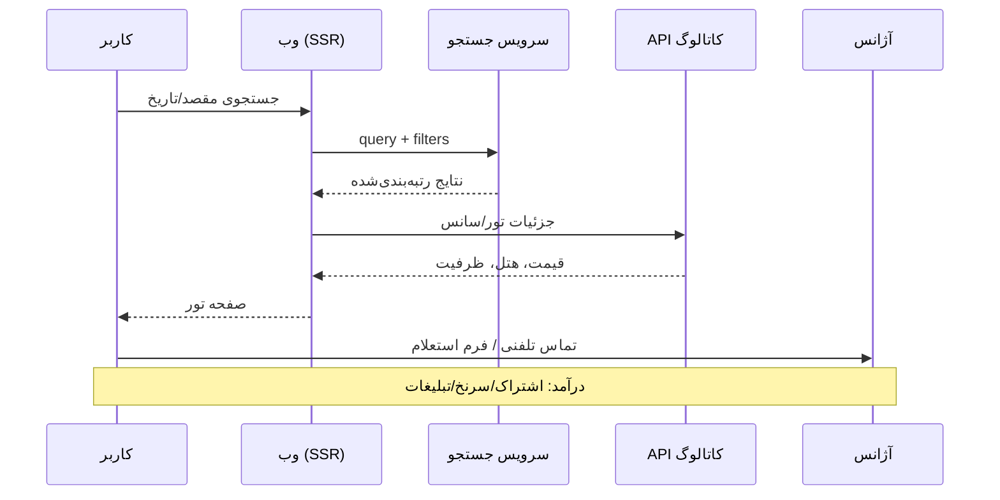
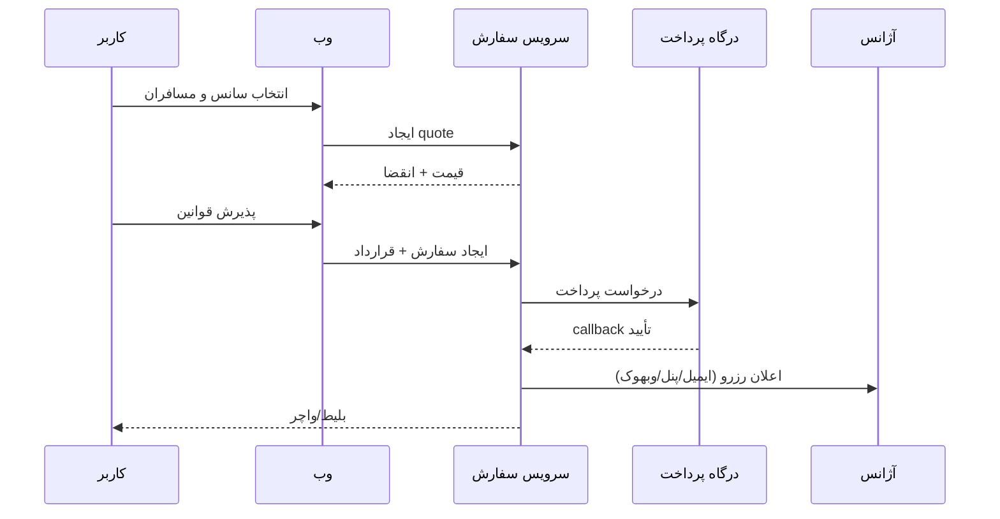
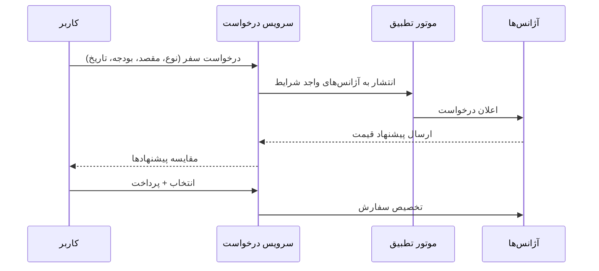
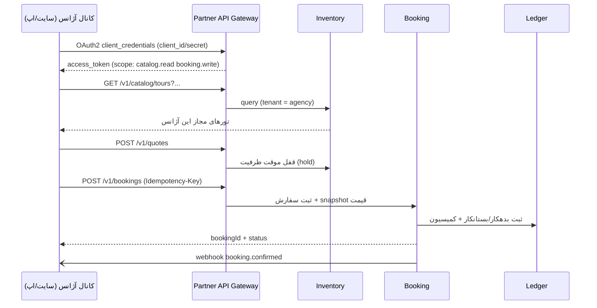
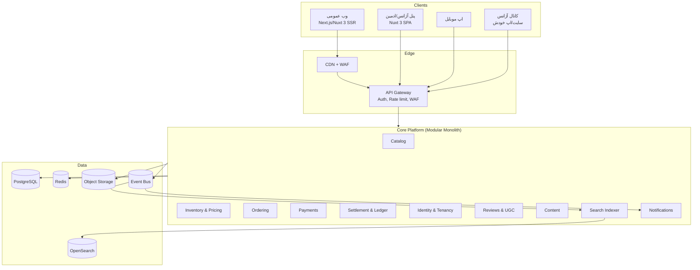

# گزارش معماری و تحلیل فنی سایت لست‌سکند (lastsecond.ir)

> ⚠️ **یادداشت مهم:** این سند **تحلیل سایت مرجع** است، نه تصمیم نهایی TravelCore.
> مدل پیشنهادی `TourProduct` متعلق به آژانس در این گزارش، در TravelCore **پذیرفته نشده** است.
> مدل قفل‌شده TravelCore «**TourProduct مشترک + AgencyOffer مستقل**» است.
> مرجع تصمیم: [`PLAN.md`](../../PLAN.md) و [`ADR-0002`](../adr/0002-shared-tour-product.md).

> **نوع سند:** بررسی معماری، محصول و آمادگی برای بازسازی + افزودن فروش API برای هر آژانس
> **تاریخ بررسی:** ۱۹ آبان ۱۴۰۵ (۱۰ نوامبر ۲۰۲۶)
> **روش کار:** مرور مستقیم صفحات با مرورگر، استخراج DOM و متن، بررسی درخواست‌های شبکه، تحلیل باندل‌های JavaScript، استخراج نقشه مسیرهای فرانت‌اند، بررسی هدرهای HTTP، robots.txt و Lighthouse
> **دامنه:** نسخه عمومی سایت (بدون ورود) + مسیرهای عمومی پنل + سرویس‌های API قابل مشاهده

---

## ۱. خلاصه مدیریتی

لست‌سکند یک **مارکت‌پلیس/تجمیع‌کننده سفر** است، نه یک OTA کلاسیک با انبار اختصاصی. ارزش اصلی آن سه چیز است:

1. **تجمیع عرضه:** بیش از ۲٬۰۰۰ آژانس (ادعای صفحه «درباره ما») که تورهای خود را ثبت می‌کنند؛ عنوان صفحه لیست از ۸۰۰+ تور فعال حرف می‌زند.
2. **محتوای عمیق و سئو:** هتل‌ها (~۱۰ هزار)، رستوران‌ها (~۸٬۷۰۰)، جاذبه‌ها (~۱۰ هزار)، سفرنامه، خاطرات سفر، ویدیو، بلاگ و صدها لندینگ شهری.
3. **تولید سرنخ (Lead) و درخواست قیمت:** در بسیاری از تورها «رزرو آنلاین» وجود ندارد و CTA اصلی «تماس با آژانس» یا «درخواست استعلام» است. مدل درآمدی ترکیبی از **اشتراک آژانس + تبلیغات + کمیسیون/سرنخ** است (نرخ کمیسیون قابل مشاهده نبود).

**یافته‌های کلیدی فنی:**

| موضوع | یافته |
|---|---|
| فرانت اصلی | Nuxt 2.7.16 (Vue 2) با رندر سمت سرور (SSR)، به احتمال زیاد BootstrapVue |
| پنل | Nuxt 3 SPA روی `panel.lastsecond.ir` با مسیرهای Admin و Agency |
| APIها | `api.lastsecond.ir` (Express) + `rapi.lastsecond.ir` + `search.lastsecond.ir` (نام داخلی Avijeh) |
| CDN/WAF | لبه ایرانی با هدر `server: NSIN` و `nsn-edge` |
| تصاویر | `last-cdn.com` جدا از دامنه اصلی |
| احراز هویت | کوکی نشست + XSRF + ورود با موبایل/OTP + Google Sign-In |
| API آژانس | در پنل بخش «Webservice API Keys» و «Agency IPs» وجود دارد؛ زیرساخت API شرکا از قبل هست، ولی به‌نظر برای «ورود موجودی» است نه «فروش از کانال خود آژانس» |
| سئو | JSON-LD غنی (FAQPage، LodgingBusiness، FoodEstablishment، LocalBusiness، Article، BreadcrumbList)، SSR کامل، Lighthouse SEO = ۱۰۰ |
| دسترس‌پذیری | Lighthouse Accessibility = ۸۳؛ مشکلات contrast، landmark، نام لینک، غیرفعال‌بودن zoom |
| Sitemap | در مسیرهای متداول پیدا نشد (نقطه ضعف سئو) |

**نتیجه برای پروژه شما:** ساختن «کپی عملکردی» این سایت شدنی است، اما سختی در UI نیست؛ در سه لایه است: (۱) مدل موجودی و قیمت‌گذاری تور، (۲) چرخه سفارش/قرارداد/پرداخت/تسویه با آژانس، (۳) پلتفرم API چندمستأجری برای فروش هر آژانس.

---

## ۲. مدل کسب‌وکار و محصول

| خط محصول | ماهیت | شواهد |
|---|---|---|
| تور خارجی/داخلی | موجودی آژانس‌ها، قیمت تومان/دلار/یورو | صفحه تور، ماتریس قیمت اتاق، پرواز، هتل‌های تور |
| هتل | محتوا + استعلام قیمت | دکمه «درخواست استعلام قیمت» و `/requests?type=hotel` |
| ویزا | سرویس واسطه‌گری با قیمت ثابت | جدول قیمت بزرگسال/کودک، مدارک، FAQ |
| سفرساز (RFQ) | درخواست سفر سفارشی و تطبیق با ۲۰۰۰+ آژانس | صفحه `/safarsaz` |
| بلیط هواپیما | در سفرساز به‌عنوان گزینه ذکر شده؛ فروش مستقیم در ناوبری دیده نشد | صفحه سفرساز |
| تبلیغات | جایگاه تبلیغاتی و کلیک‌شمار | `/base/ads/go/600` و صفحه تبلیغات |
| اشتراک آژانس | پنل آژانس «تاریخ اتمام اشتراک» دارد | پاسخ API `agency/dashboard/home` |

**مدل درآمدی (استنباطی):** اشتراک آژانس برای انتشار تور (شواهد قوی)، تبلیغات، کمیسیون/کارمزد سفارش‌های آنلاین، حاشیه سرویس ویزا، و احتمالاً فروش سرنخ برای تورهای بدون رزرو آنلاین.

> تصمیم مهم: اگر نسخه جدید می‌سازید، **مرچنت اصلی پرداخت** را تعیین کنید؛ این تصمیم روی معماری پرداخت، مالیات، تسویه و API اثر مستقیم دارد.

---

## ۳. نقشه کامل سایت (Sitemap)

روتر عمومی سایت **۷۱۲ مسیر** دارد که بخش بزرگی از آن‌ها لندینگ‌های برنامه‌ای شهرها/مقاصد است. ۶۶ قالب مستقل شناسایی شد:

```
/
├── search                          جستجوی همه‌جانبه (تور، هتل، رستوران، جاذبه، سفرنامه، آژانس، ویدیو، بلاگ)
├── tours
│   ├── /tours                      لیست تور + فیلترهای چندوجهی
│   ├── /tours/تور-{city}           لندینگ شهری (صدها مسیر)
│   ├── /tours/{type}-tours         general | luxury | offer | pre-sale | recommended | lastsecond | eco-tourism | short-term | installment
│   ├── /tours/{id}-{slug}          جزئیات تور
│   ├── /tours/g{id}-{slug}         تور گروهی/بیزینسی با «تایید و ادامه» (چرخه سفارش)
│   ├── /tours/b{id} , /tours/a{id} aliasهای سئویی
│   └── /lastsecond-tours           تور لحظه آخری
├── visa            /visa , /visa/{country}
├── hotels          /hotels , /hotels/{id}-{slug}
├── restaurants     /restaurants , /restaurants/{id}-{slug}
├── attractions     /attractions , /attractions/{id}-{slug}
├── agencies        /agencies , /agencies/{id}-{slug}
├── itineraries     سفرنامه + /itineraries/{sYY...}
├── travel-memories خاطرات سفر
├── videos          /videos , /videos/{id}-{slug}
├── blog            /blog , /blog/{id}-{slug} , /blog/{category} , /authors/{id}
├── u/{username}    پروفایل | /badges , /badges/{username}
├── safarsaz        درخواست سفر سفارشی (RFQ) + /safarsaz/{id}/invoice
├── unknown-tour    سفر به ناکجا | /blind-tour بلایند تور
├── gathering , hamsafar1402 , careers , pages/{slug} , contact
├── auth/login , auth/register , auth/logout , auth/switch-account , auth/profile
├── wizard , wizard/{request}/contract , wizard/{request}/ticket , wizard/{request}/cancelled
├── trip-wizard , trip-wizard/{request}/contract
├── payment-result , payment-requests/{uuid} , payment-requests/{uuid}/invoice
└── /{slug}         لندینگ مکان (برنامه‌ای، سئو)
```

### ۳.۱. صفحاتی که واقعاً بازدید و بررسی شدند

| # | صفحه | یافته مهم |
|---|---|---|
| ۱ | `/` | هاب تور ویژه، داخلی/خارجی، ویزا، سفرنامه، بلاگ؛ CTA جستجو |
| ۲ | `/tours` | فیلتر مبدا/مقصد/تاریخ/مدت/هتل + مرتب‌سازی؛ کارت با قیمت و تاریخ |
| ۳ | `/tours/277568-...` | پرواز، هتل‌های تور، ماتریس قیمت، مدارک، کنسلی، تماس آژانس |
| ۴ | `/tours/277663-...` | قیمت دو/یک تخته/کودک/نوزاد + آژانس + «اعلام مغایرت» |
| ۵ | `/tours/g2739-...` | تور گروهی + دکمه «تایید و ادامه» → چرخه سفارش آنلاین |
| ۶ | `/tours/offer-tours` | لندینگ نوع تور با قالب یکسان لیست |
| ۷ | `/lastsecond-tours` | لحظه آخری، فیلتر هتلی/پکیجی |
| ۸ | `/visa` | ۲۰+ کشور، قیمت و زمان، FAQPage schema |
| ۹ | `/visa/japan` | جدول قیمت، مدارک، مراحل، FAQ |
| ۱۰ | `/hotels` | ۵ قاره، فیلتر امکانات/ستاره/امتیاز، نقشه |
| ۱۱ | `/hotels/5449-konak-park-hotel` | نقد چندمعیاره، امکانات، آلبوم، استعلام قیمت |
| ۱۲ | `/restaurants` | فیلتر سطح قیمت/نوع/امکانات |
| ۱۳ | `/restaurants/1097-...` | FoodEstablishment schema، نقشه، نقد |
| ۱۴ | `/attractions` | رتبه در شهر، اطراف، نقشه |
| ۱۵ | `/attractions/7841-...` | LocalBusiness schema، فاصله تا هتل/رستوران |
| ۱۶ | `/agencies` | تعداد آژانس per شهر؛ تهران ۱۴۳۷ |
| ۱۷ | `/agencies/2265-...` | ۷ زیرمعیار نقد، مجوز، تورها، تماس |
| ۱۸ | `/itineraries` | فیلتر مقصد/موضوع، بازدید/نظر |
| ۱۹ | `/itineraries/s0526934-...` | BlogPosting schema، کامنت، گالری |
| ۲۰ | `/travel-memories` | محتوای UGC سبک |
| ۲۱ | `/blog` | دسته‌بندی، صفحه‌بندی |
| ۲۲ | `/blog/9810-what-is-mochi` | Article schema، فهرست مطالب، کامنت |
| ۲۳ | `/videos` | بازدید، سطح کاربر، مدت |
| ۲۴ | `/search?q=استانبول` | تب‌های همه/تور/لوکیشن/هتل/رستوران/جاذبه/سفرنامه/آژانس/ویدیو/بلاگ |
| ۲۵ | `/contact` | فرم با دپارتمان (مدیریت، تبلیغات، پشتیبانی، هتل، انتقادات) |
| ۲۶ | `/pages/aboutus` | ۵۰۰ هزار کاربر، ۲۰۰۰ آژانس، مجوز بند ب |
| ۲۷ | `/pages/advertisement` | شرایط همکاری آژانس‌ها |
| ۲۸ | `/requests/agency/general-info` | redirect به ثبت‌نام کاربر |
| ۲۹ | `/auth/login` | موبایل/ایمیل/نام کاربری + Google |
| ۳۰ | `/auth/register` | نام، موبایل، پذیرش قوانین |
| ۳۱ | `/safarsaz` | ۵ مسیر: تور، هتل، بلیط، ویزا، طراحی اختصاصی |
| ۳۲ | `/unknown-tour` | ثبت شماره تماس، تیزر ویدیو |
| ۳۳ | `/blind-tour` | فرم عضویت، FAQ، روایت محصول |
| ۳۴ | `/wizard` | نیازمند ورود؛ قرارداد/بلیط/لغو |
| ۳۵ | `panel.lastsecond.ir` | Nuxt 3؛ Admin/Agency؛ Webservice API Keys؛ Agency IPs |

> صفحات لاگین‌محور (پروفایل، سفارش‌های من، پنل آژانس، فرم چندمرحله‌ای سفارش) فقط تا مرحله احراز هویت دیده شدند؛ جزئیات داخلی از نام مسیرها، باندل‌ها و APIها استنباط شده است.

---

## ۴. قابلیت‌ها به تفکیک ماژول

### ۴.۱. تور (هسته محصول)

- فیلتر چندوجهی: مبدا، مقصد، بازه تاریخ، مدت، درجه هتل، قیمت، نوع تور، نوع سفر، وسیله نقلیه، وعده غذایی، امکانات، آژانس، ایرلاین، باندل، کابین، رزرو آنلاین، تخفیف‌دار
- مرتب‌سازی: آخرین به‌روزرسانی، کمترین قیمت، کمترین/بیشترین مدت
- کارت تور: عنوان، مدت، آژانس، ساعت رفت/برگشت، قیمت تومان + ارز
- جزئیات تور: مسیر پرواز (ساعت/مدت/بار/کلاس)، اقامت به تفکیک شهر، هتل‌های قابل انتخاب + وعده غذایی + امتیاز، ماتریس قیمت (دو تخته/یک تخته/کودک با و بدون تخت/نوزاد)، مدارک، خدمات، قوانین کنسلی، تماس آژانس، اعلام مغایرت، تورهای مشابه
- تور گروهی (`g`): تایید و ادامه → قرارداد → پرداخت → بلیط/واچر
- تورهای لحظه آخری، آفر، لوکس، اقساطی، پیش‌فروش، طبیعت‌گردی، کوتاه‌مدت، پیشنهادی

### ۴.۲. هتل / رستوران / جاذبه

- محتوای غنی + نقشه + رتبه در شهر + درصد پیشنهاد کاربران
- نقد چندمعیاره (هتل: غذا، نظافت، کارکنان، امکانات، موقعیت، ارزش)
- آلبوم تصاویر کاربران
- «استعلام قیمت» به‌جای رزرو آنلاین
- جاذبه: رستوران/هتل/جاذبه/فرودگاه‌های اطراف با فاصله
- رستوران: سطح قیمت ($/$$/$$$)، نوع، امکانات

### ۴.۳. ویزا

- صفحه هر کشور: قیمت بزرگسال/کودک، زمان اخذ، مدارک هویتی/شغلی/مالی، مراحل، FAQ
- CTA «ثبت درخواست» — ساختار داده مناسب کاتالوگ سرویس، نه موجودی

### ۴.۴. محتوا و جامعه

- سفرنامه چندقسمتی، خاطرات سفر، بلاگ، ویدیو، نویسنده، دسته‌بندی، تگ
- پروفایل کاربر، سطح، نشان (Badge)، امتیاز، لایک، کامنت، بازدید
- گیمیفیکیشن مشهود (سطح ۰ تا ۷ در ویدیوها)

### ۴.۵. سفرساز (RFQ)

- انتخاب نوع خدمت (تور/هتل/بلیط/ویزا/طراحی اختصاصی)
- ثبت درخواست و تطبیق با شبکه آژانس‌ها
- پیشنهاد قیمت و انتخاب
- فاکتور و پرداخت (`/safarsaz/{id}/invoice`)

### ۴.۶. پنل (Admin + Agency)

بر اساس نقشه مسیرهای پنل و باندل‌ها:

- **آژانس:** داشبورد، اعتبار اشتراک، مدیریت Slots (سانس/ظرفیت تور)، درخواست‌های سفر، جستجوی تورهای بیزینسی
- **ادمین:** آژانس‌ها، IPهای آژانس، API Keyهای وب‌سرویس، سفارش‌ها، پرداخت‌ها، تسویه/گزارش پرداخت سفر، اسلات‌ها و قیمت اسلات، تورها، ویزاها، هتل/رستوران/جاذبه، نظرات، بلیت پشتیبانی، CRM، کمپین/بنر، برچسب، مستندات، قوانین آنلاین، خطوط هوایی/فرودگاه‌ها، گزارش‌ها
- **زیرساخت پنل:** Nuxt 3 + احراز هویت مشترک + سوکت (چت/اعلان) + جدول‌های داده AJAX

---

## ۵. تحلیل فنی (Technical Teardown)

### ۵.۱. فرانت‌اند

| مورد | مقدار |
|---|---|
| فریم‌ورک | Nuxt 2.7.16 / Vue 2 |
| رندر | SSR (`data-server-rendered`) |
| UI Kit | شواهد قوی BootstrapVue (شناسه‌های `__BVID__`، کلاس‌های `b-*`) |
| باندل | فایل‌های هش‌دار `*.modern.js` روی CDN |
| PWA | Service Worker فعال |
| فونت | IranYekan (لایسنس fontiran) |
| جهت | RTL کامل |
| پنل | Nuxt 3 (Vite، importmap، `/_nuxt/*`) |

### ۵.۲. سرویس‌ها و APIهای مشاهده‌شده

| سرویس | نمونه endpoint | توضیح |
|---|---|---|
| `api.lastsecond.ir` | `/base/auth/me`, `/base/notices` | هسته/auth/اعلان؛ هدر `x-powered-by: Express` |
| `api.lastsecond.ir` | `/spots/hotels/index`, `/spots/locations/index`, `/spots/restaurants/index`, `/spots/attractions/index` | کاتالوگ مکان‌ها؛ ورودی `{filters:{...}}`، خروجی `{items:[...]}` |
| `api.lastsecond.ir` | `/content/posts/index`, `/content/videos/index`, `/content/travelogues/index` | محتوا |
| `rapi.lastsecond.ir` | `/top-search/tour-selected-filters` | فیلترهای تور/خواندنی |
| `search.lastsecond.ir` | `/search` | سرویس جستجوی مستقل؛ در ریشه: «Avijeh Api! Don't Bother.» |
| `last-cdn.com` | تصاویر | CDN رسانه جدا |
| `panel.lastsecond.ir` | `agency/dashboard/home`, `admin/webservice-api-keys` | پنل مدیریت/آژانس |

**الگوی پاسخ API (نمونه هتل):**

```json
{
  "items": [
    {
      "id": 3670,
      "titleFa": "دبلیو استانبول",
      "titleEn": "W Istanbul",
      "reviewsCount": 1,
      "averageReviewScore": 2.3,
      "location": { "id": 456, "titleFa": "استانبول", "hotelsLink": "/hotels/istanbul" },
      "country": { "id": 442, "titleFa": "ترکیه", "hotelsLink": "/hotels/turkey" },
      "grade": { "key": "FIVE_STAR", "stars": 5 },
      "ranking": { "reviewRate": 3.7453, "spotsCount": 603, "reviewRank": 192 },
      "coordinates": [29.0024, 41.0422],
      "logo": "https://last-cdn.com/...",
      "link": "/hotels/3670-w-istanbul"
    }
  ]
}
```

نکات: camelCase، `id` عددی، لینک آماده در پاسخ (BFF-style)، بدون نسخه در مسیر، CORS محدود به دامنه اصلی، ETag و gzip.

### ۵.۳. احراز هویت و امنیت (مشاهده‌شده)

- ورود با موبایل/ایمیل/نام کاربری → احتمالاً OTP
- Google Sign-In (client_id در متا)
- کوکی نشست + هدر `x-xsrf-token`
- CORS محدود به `https://lastsecond.ir`
- در CORS برخی سرویس‌ها هدرهای `signature-input`, `signature-agent`, `Signature` مجاز شده‌اند → **HTTP Message Signatures** برای کلاینت‌های API
- در پنل: `WebserviceApiKeys` و `AgencyIps` → کلید API + محدودیت IP برای آژانس‌ها
- reCAPTCHA در فرم‌های کامنت/تماس
- Enamad در فوتر

### ۵.۴. سئو و عملکرد

- SSR + متا و OG اختصاصی هر صفحه
- JSON-LD: `BreadcrumbList`, `FAQPage`, `LodgingBusiness`, `FoodEstablishment`, `LocalBusiness`, `Article`/`BlogPosting`
- robots.txt: مسدودسازی پارامترهای فیلتر (کنترل خزش faceted)
- **sitemap پیدا نشد**؛ برای سایتی با این حجم محتوای برنامه‌ای فرصت از دست رفته است
- Lighthouse خانه: **SEO 100**، **Accessibility 83**، **Best Practices 83**
- مشکلات: کنتراست رنگ، نبود `main` landmark، لینک/دکمه بدون نام قابل‌دسترس، `user-scalable=no`، نسبت تصویر نامناسب
- خانه: ~۷۳ درخواست، ~۱۳۵۴ نود DOM؛ PWA و کش استاتیک خوب، ولی تعداد chunkهای JS بالاست

### ۵.۵. تحلیل لایه سرویس

```
Nuxt 2 (www)  ─┬─> api.lastsecond.ir    (base / spots / content)
               ├─> rapi.lastsecond.ir   (فیلترها/خواندنی تور)
               ├─> search.lastsecond.ir (Avijeh)
               └─> api.lastsecond.ir/base/ads/go/{id} (تبلیغات)

Nuxt 3 (panel) ──> API پنل (agency/*, admin/*) + WebSocket
CDN: cdn.lastsecond.ir (assets) / last-cdn.com (media) / NSIN (edge)
```

این الگو برای شروع خوب است، اما برای «فروش API هر آژانس» کافی نیست: نه مدل چندمستأجری صریح دارد، نه قرارداد API نسخه‌دار عمومی، نه چرخه hold/confirm برای جلوگیری از oversell.

---

## ۶. مدل دامنه پیشنهادی

| Aggregate | موجودیت | فیلدهای کلیدی |
|---|---|---|
| سازمان | Agency | id, name, licenseNo (بند ب), city, phones, subscriptionValidUntil, rating, status, ipAllowlist |
| سازمان | AgencyUser | agencyId, userId, role (owner/operator/finance) |
| هویت | User | id, mobile, email, name, googleSub, roles, status |
| کاتالوگ | TourProduct | id, agencyId, title, type, originLocationId, destinations[], durationDays, transport, itinerary, services, cancellationPolicy, docs, media[], status |
| موجودی | TourDeparture (Slot) | id, tourId, startDate, endDate, capacity, seatsLeft, flightLegs[], status, onlineReservable, updatedAt, version |
| قیمت | DeparturePrice | departureId, roomType (DOUBLE/SINGLE/CHILD_BED/CHILD_NO_BED/INFANT), amount, currency, cost, commission |
| اقامت | TourHotelOption | departureId, hotelId, nights, mealPlan, roomType, price |
| مکان | Hotel / Restaurant / Attraction | id, type, nameFa/En, locationId, coords, grade, amenities[], description, media[], ranking |
| مکان | Location | id, parentId, type (country/province/city), nameFa/En, slug |
| ویزا | VisaService | countryId, type, priceByAge, processingDays, docs[], steps[], faq[] |
| محتوا | Post / Travelogue / Memory / Video | id, authorId, categoryId, title, body, media, tags, publishedAt, stats |
| نقد | Review | id, subjectType, subjectId, userId, scores{criteria}, text, likes, status, createdAt |
| تجارت | Order | id(uuid), userId, agencyId, departureId, pax{}, amount, currency, status, contractId, createdAt |
| تجارت | Contract | id, orderId, version, snapshotJson, acceptedAt, ip |
| تجارت | Payment | id, orderId, gateway, amount, refId, status, paidAt |
| تجارت | Invoice | id, number, orderId, items[], tax, total, pdfUrl |
| تجارت | Ticket/Voucher | id, orderId, type, fileUrl, issuedAt |
| تجارت | Amendment/Cancellation | id, orderId, reason, penalty, status |
| مالی | Settlement | id, agencyId, periodStart, periodEnd, gross, commission, net, status, paidAt |
| مالی | LedgerEntry | id, account, debit, credit, refType, refId |
| پلتفرم | ApiClient | id, agencyId, clientId, secretHash, scopes[], ipAllowlist[], rateLimit, status, lastUsedAt |
| پلتفرم | WebhookEndpoint | id, agencyId, url, secret, events[], status |
| پلتفرم | WebhookDelivery | id, endpointId, eventId, attempt, statusCode, nextRetryAt |
| پلتفرم | IdempotencyKey | key, clientId, requestHash, responseJson, expiresAt |
| پلتفرم | AuditLog | actor, action, entity, before, after, ip, at |

**قواعد مهم:**

- هر `TourProduct` و `TourDeparture` مالک دارد (`agencyId`) و همه کوئری‌ها باید tenant-scoped باشند.
- قیمت و ظرفیت روی **Departure** است، نه Tour؛ تور کاتالوگ است و سانس موجودی.
- قیمت باید snapshot شود؛ تغییر بعدی آژانس نباید سفارش قبلی را عوض کند.
- یک سفارش می‌تواند چند مسافر با انواع قیمت (بزرگسال/کودک/نوزاد) داشته باشد.
- نقد و بررسی به هر موجودیت (`subjectType`) وصل می‌شود، نه فقط تور.
- نمای موجودی API باید از `agencyId` فیلتر شود، حتی اگر کاتالوگ مشترک باشد.

---

## ۷. جریان‌های کلیدی

### ۷.۱. کشف تور و سرنخ (مدل فعلی)



### ۷.۲. سفارش آنلاین (مسیر wizard)



### ۷.۳. سفرساز (RFQ)



### ۷.۴. فروش از API خود آژانس (خواسته جدید)



---

## ۸. تحلیل شکاف: «هر آژانس با API خودش بفروشد»

### ۸.۱. دو تفسیر که باید روشن شود

| تفسیر | معنی | معماری |
|---|---|---|
| **A. کانال فروش آژانس (Channel API)** | پلتفرم به هر آژانس API می‌دهد تا روی سایت/اپ خودش بفروشد | Outbound Partner API + چندمستأجری + تسویه |
| **B. تأمین‌کننده (Supplier API)** | آژانس موجودی و قیمت را با API به پلتفرم می‌فرستد | Inbound Ingestion API + اعتبارسنجی + همگام‌سازی |
| **C. هر دو** | پلتفرم دوطرفه: آژانس هم تأمین‌کننده هم کانال | هر دو دروازه با یک هویت و یک دفتر کل |

شواهد فعلی لست‌سکند بیشتر به **B** نزدیک است (`WebserviceApiKeys` + `AgencyIps` + `Slots`). خواسته شما «فروش» است، پس حداقل **A** و احتمالاً **C** لازم است.

### ۸.۲. قابلیت‌های لازم برای A

1. **هویت ماشین:** client_id/secret، OAuth2 client credentials، اسکوپ، انقضا، چرخش کلید
2. **محدودسازی:** IP allowlist، mTLS اختیاری، امضای درخواست، rate limit
3. **کاتالوگ محدود به tenant:** آژانس فقط تورهای خودش/مجاز را ببیند
4. **موجودی لحظه‌ای:** availability با قفل موقت (hold) و TTL
5. **قیمت‌گذاری:** quote با تفکیک پایه/مالیات/کودک/نوزاد/اضافه‌ها
6. **سفارش ایدمپوتنت:** جلوگیری از دوبار ثبت با `Idempotency-Key`
7. **وبهوک:** تغییر وضعیت سفارش، پرداخت، لغو، تغییر سانس
8. **مالی و تسویه:** کمیسیون، فاکتور، دوره تسویه، گزارش قابل دانلود
9. **سندباکس و مستندات:** محیط تست، داده نمونه، OpenAPI/Postman
10. **پایش و پشتیبانی:** traceId، داشبورد مصرف، هشدار خطا، SLA

### ۸.۳. تصمیم‌های کلیدی قبل از کدنویسی

- **Merchant of Record:** پول به حساب کی می‌رود؟
  - اگر پلتفرم: درگاه واحد، تسویه با آژانس، ریسک بازپرداخت
  - اگر آژانس: API فقط «ثبت سفارش» است، پرداخت سمت آژانس، کمیسیون از طریق صورت‌حساب
- **قیمت‌گذاری:** آیا آژانس می‌تواند قیمت کانال خودش را تعیین کند؟ حداقل قیمت؟
- **برند:** وایت‌لیبل کامل یا «Powered by»؟
- **مالکیت مشتری:** داده مسافر و بازاریابی مجدد متعلق به کیست؟
- **انبار مشترک:** آیا موجودی کانال و سایت یکی است؟ (بله → نیاز به قفل توزیع‌شده)

---

## ۹. معماری هدف پیشنهادی

### ۹.۱. انتخاب سبک

| گزینه | مزیت | عیب | توصیه |
|---|---|---|---|
| **A. مونولیت ماژولار + API Gateway** | سرعت تحویل، تراکنش ساده، هزینه کم، تیم کوچک | مقیاس‌پذیری تیمی محدود | ✅ ۱۲–۲۴ ماه اول |
| B. میکروسرویس کامل | استقلال تیم‌ها، مقیاس انتخابی | پیچیدگی DevOps، تراکنش توزیع‌شده | فقط وقتی تیم > ۲۵ نفر |
| C. خرید پلتفرم تجارت (Medusa/Vendure) | سرعت اولیه | عدم تطابق با مدل تور/سانس/آژانس ایرانی | ❌ |

**توصیه:** مونولیت ماژولار با مرزهای دامنه‌ای واضح + یک **Partner API Gateway** مستقل (Kong/APISIX یا Fastify/NestJS) + Outbox برای رویدادها. هر ماژول بعداً قابل جداسازی است.

### ۹.۲. نمای سیستم



### ۹.۳. انتخاب فناوری پیشنهادی

| لایه | پیشنهاد | دلیل |
|---|---|---|
| وب | Next.js 15 (App Router) یا Nuxt 3 | SSR/ISR، سئو، RTL، اکوسیستم |
| پنل | Next.js/Nuxt 3 + shadcn/ui | یکپارچگی طراحی |
| بک‌اند | NestJS (TypeScript) یا ASP.NET Core | ماژولار، DI، اعتبارسنجی، OpenAPI |
| دیتابیس | PostgreSQL 16 | تراکنش، JSONB، RLS |
| کش/قفل | Redis | session، hold، rate limit |
| جستجو | OpenSearch + آنالایزر فارسی | faceted search، synonym، رتبه‌بندی |
| صف/رویداد | RabbitMQ (شروع) → Kafka (مقیاس) | outbox، وبهوک، همگام‌سازی |
| فایل | S3-compatible داخلی + CDN | تصاویر، PDF قرارداد/فاکتور |
| API Gateway | Kong/APISIX یا Gateway اختصاصی | کلید، اسکوپ، rate limit، لاگ |
| Observability | OpenTelemetry + Grafana/Loki/Tempo | traceId سرتاسری |
| CI/CD | GitLab CI/GitHub Actions + Docker | محیط staging/sandbox |

> اگر تیم شما .NET است، ASP.NET Core + EF Core + PostgreSQL گزینه کم‌ریسک‌تری است. انتخاب زبان مهم نیست؛ **مرزهای دامنه** مهم است.

### ۹.۴. چندمستأجری (Multi-tenancy)

**مدل پیشنهادی:** یک دیتابیس، یک schema، ستون `tenant_id` + **Row Level Security** در Postgres.

- جدول‌های کاتالوگ مشترک (هتل، مکان، محتوا): بدون tenant
- جدول‌های موجودی/سفارش/مالی: `tenant_id` اجباری
- در لایه دسترسی: `TenantContext` از توکن/کلید استخراج شود؛ هیچ کوئری بدون فیلتر tenant اجرا نشود
- تست خودکار: «هیچ درخواست tenant A نباید رکورد tenant B را ببیند»
- برای مشتریان بزرگ: schema جدا یا دیتابیس جدا به‌عنوان escape hatch

### ۹.۵. مدل احراز هویت API

**پیشنهاد اصلی:** OAuth2 Client Credentials + API Key به‌عنوان شناسه + امضای درخواست برای عملیات حساس.

```http
POST /oauth/token
Content-Type: application/x-www-form-urlencoded

grant_type=client_credentials
&client_id=ag_2265_live
&client_secret=...
&scope=catalog.read inventory.read booking.write
```

```http
GET /partner/v1/catalog/tours
Authorization: Bearer eyJ...
X-Request-Id: 7f3c...
```

وبهوک:

```http
POST https://agency.example.com/webhooks/lastsecond
X-Signature: t=1730000000,v1=hex(hmac_sha256(secret, timestamp + "." + rawBody))
```

**قواعد:** secret فقط یک بار نمایش داده شود و hash (Argon2id) ذخیره شود؛ کلید تست/زنده جدا؛ IP allowlist پیش‌فرض روشن؛ چرخش کلید با overlap ۷ روزه؛ rate limit بر اساس client + endpoint + tenant.

---

## ۱۰. طراحی API پیشنهادی (Partner API v1)

پیشوند: `https://api.example.com/partner/v1`

### ۱۰.۱. Endpointها

| متد | مسیر | توضیح | اسکوپ |
|---|---|---|---|
| GET | `/catalog/tours` | لیست تورهای مجاز | catalog.read |
| GET | `/catalog/tours/{tourId}` | جزئیات تور | catalog.read |
| GET | `/catalog/tours/{tourId}/departures` | سانس‌ها | catalog.read |
| GET | `/inventory/departures/{departureId}` | ظرفیت/قیمت لحظه‌ای | inventory.read |
| POST | `/quotes` | استعلام قیمت + قفل موقت | booking.write |
| GET | `/quotes/{quoteId}` | وضعیت quote | booking.read |
| POST | `/bookings` | ثبت سفارش | booking.write |
| GET | `/bookings/{bookingId}` | جزئیات سفارش | booking.read |
| GET | `/bookings` | لیست سفارش‌ها | booking.read |
| POST | `/bookings/{bookingId}/cancel` | لغو | booking.write |
| POST | `/bookings/{bookingId}/amend` | اصلاح | booking.write |
| GET | `/settlements` | صورت‌حساب دوره‌ای | finance.read |
| GET | `/settlements/{id}/invoice.pdf` | فاکتور | finance.read |

### ۱۰.۲. نمونه: استعلام قیمت

```http
POST /partner/v1/quotes
Authorization: Bearer ...
Idempotency-Key: 0b7c2f9e-...
Content-Type: application/json

{
  "departureId": "dep_9f2",
  "pax": { "adults": 2, "children": 1, "infants": 0 },
  "roomType": "DOUBLE",
  "addons": ["VISA", "INSURANCE"]
}
```

```json
{
  "quoteId": "quo_8a1",
  "departureId": "dep_9f2",
  "currency": "IRR",
  "lines": [
    { "code": "ADULT_DOUBLE", "qty": 2, "unit": 450900000, "total": 901800000 },
    { "code": "CHILD_WITH_BED", "qty": 1, "unit": 408900000, "total": 408900000 },
    { "code": "VISA", "qty": 3, "unit": 12000000, "total": 36000000 }
  ],
  "subtotal": 1346700000,
  "tax": 0,
  "total": 1346700000,
  "expiresAt": "2026-11-10T13:55:00Z",
  "holdAvailable": true
}
```

### ۱۰.۳. نمونه: ثبت سفارش

```http
POST /partner/v1/bookings
Idempotency-Key: 7c1e...
```

```json
{
  "quoteId": "quo_8a1",
  "contact": { "name": "علی رضایی", "mobile": "0912...", "email": "a@b.com" },
  "travelers": [
    { "type": "ADULT", "firstName": "علی", "lastName": "رضایی", "nationalId": "...", "passportNo": "..." }
  ],
  "notes": "درخواست اتاق کنار هم"
}
```

```json
{
  "bookingId": "bkg_42f",
  "status": "PENDING_PAYMENT",
  "paymentUrl": "https://pay.example.com/...",
  "expiresAt": "2026-11-10T14:10:00Z",
  "total": 1346700000,
  "currency": "IRR"
}
```

### ۱۰.۴. خطاها (RFC 7807)

```json
{
  "type": "https://api.example.com/errors/inventory-not-available",
  "title": "Inventory not available",
  "status": 409,
  "code": "INVENTORY_NOT_AVAILABLE",
  "detail": "ظرفیت این سانس تکمیل شده است.",
  "traceId": "7f3c9a...",
  "meta": { "departureId": "dep_9f2", "seatsLeft": 0 }
}
```

کدهای مهم: `400 VALIDATION_ERROR`، `401 INVALID_TOKEN`، `403 SCOPE_DENIED`، `404 NOT_FOUND`، `409 INVENTORY_NOT_AVAILABLE`، `409 IDEMPOTENCY_CONFLICT`، `422 PRICE_CHANGED`، `429 RATE_LIMITED`، `503 UPSTREAM_UNAVAILABLE`.

### ۱۰.۵. وبهوک‌ها

رویدادها: `booking.created`, `booking.confirmed`, `booking.cancelled`, `payment.succeeded`, `payment.failed`, `departure.changed`, `inventory.updated`, `settlement.paid`.

- حداقل یک بار تحویل (at-least-once) + idempotency در سمت گیرنده با `eventId`
- retry نمایی: ۱m, ۵m, ۳۰m, ۲h, ۶h, ۲۴h
- پس از ۲۴ ساعت → صف dead-letter + هشدار در پنل
- امضای HMAC + timestamp برای جلوگیری از replay
- داشبورد «آخرین تحویل‌ها» در پنل آژانس

### ۱۰.۶. هم‌زمانی و جلوگیری از oversell

1. `POST /quotes` یک **hold** با TTL ۱۵ دقیقه ایجاد می‌کند (Redis + رکورد در DB).
2. موجودی با `UPDATE ... WHERE seats_left >= :n` اتمیک کم می‌شود.
3. `POST /bookings` hold را مصرف می‌کند؛ اگر منقضی شده → `409 HOLD_EXPIRED`.
4. در صورت انصراف/خطای پرداخت → release صریح + job پاکسازی.
5. نسخه‌دار کردن رکورد (`version`) برای تشخیص تغییر قیمت بین quote و booking.
6. برای چند انبار/چند کانال: قفل توزیع‌شده یا مدل «سهمیه per channel» (allotment).

### ۱۰.۷. نسخه‌بندی و سازگاری

- مسیر `/v1`؛ تغییرات شکستنی فقط در `v2`
- افزودن فیلد جدید = non-breaking
- هدرهای `Sunset` و `Deprecation` برای بازنشستگی
- Changelog عمومی + محیط sandbox با داده ثابت

---

## ۱۱. الزامات غیرعملکردی (NFR)

> اعداد زیر **فرض طراحی** هستند و باید با داده واقعی کسب‌وکار جایگزین شوند.

| شاخص | هدف |
|---|---|
| دسترس‌پذیری وب | ۹۹.۹٪ ماهانه |
| دسترس‌پذیری Partner API | ۹۹.۹۵٪ |
| p95 خواندن کاتالوگ | < ۲۵۰ms |
| p95 جستجو | < ۴۰۰ms |
| p95 ثبت سفارش | < ۸۰۰ms |
| ظرفیت اوج | ۳۰۰ RPS خواندن / ۳۰ RPS نوشتن |
| تعداد آژانس فعال | ۵۰۰–۲٬۰۰۰ |
| سانس فعال | ۲۰٬۰۰۰–۱۰۰٬۰۰۰ |
| RPO / RTO | ۵ دقیقه / ۱ ساعت |
| نرخ خطای 5xx | < ۰.۱٪ |
| پوشش تست دامنه | > ۸۰٪ برای Order/Inventory |

**راهکارها:** کش CDN برای صفحات عمومی، Redis برای session/quote/hold، ایندکس OpenSearch، read replica برای گزارش، outbox برای رویداد، صف برای وبهوک/ایمیل/پیامک، circuit breaker برای درگاه پرداخت و سرویس آژانس.

---

## ۱۲. امنیت، انطباق و ریسک عملیاتی

| موضوع | اقدام |
|---|---|
| OWASP Top 10 | اعتبارسنجی ورودی، خروجی امن، CSRF، SSRF، injection |
| رمزها و کلیدها | Argon2id، Vault/KMS، چرخش دوره‌ای، عدم لاگ کلید |
| PII | رمزنگاری at-rest، ماسک در لاگ، سیاست نگهداشت، دسترسی مبتنی بر نقش |
| پرداخت | عدم ذخیره PAN؛ درگاه معتبر داخلی؛ PCI-DSS در حد SAQ |
| تقلب | rate limit، تحلیل رفتار، بلک‌لیست، بررسی سفارش‌های پرتکرار |
| مجوز آژانس | اعتبارسنجی «بند ب» + تاریخ انقضا + هشدار تمدید |
| انطباق داخلی | نماد اعتماد (Enamad)، قوانین مالیاتی، فاکتور رسمی، نگهداری داده در ایران |
| API abuse | اسکوپ حداقلی، IP allowlist، HMAC، سهمیه، هشدار ناهنجاری |
| Audit | ثبت تغییر قیمت/ظرفیت/سفارش/کلید با before/after |
| بکاپ | روزانه + PITR + تست بازیابی فصلی |

---

## ۱۳. نقشه راه پیشنهادی

| فاز | مدت | خروجی | معیار پذیرش |
|---|---|---|---|
| ۰. کشف و طراحی | ۲–۳ هفته | مدل دامنه، قرارداد API، جریان UX، تصمیم merchant/commission | تأیید ذی‌نفعان + OpenAPI اولیه |
| ۱. MVP مارکت‌پلیس | ۱۰–۱۲ هفته | احراز هویت، کاتالوگ تور، جستجو، صفحه تور، لید/استعلام، پنل آژانس (CRUD سانس)، ادمین، محتوا، سئو | یک آژانس واقعی تور منتشر کند و کاربر لید بدهد |
| ۲. Partner API v1 | ۶–۸ هفته | OAuth، کاتالوگ/موجودی/quote/hold/booking، وبهوک، سندباکس، مستندات، rate limit، دفتر کل | یک کانال تستی end-to-end رزرو کند |
| ۳. پرداخت و تسویه | ۶–۸ هفته | درگاه، قرارداد، بلیط/واچر، لغو/بازپرداخت، تسویه دوره‌ای، فاکتور | اولین تسویه واقعی با آژانس |
| ۴. مقیاس و بهینه‌سازی | مستمر | OpenSearch، کش، observability، DR، اپ موبایل، پیشنهاددهی | SLOها پایش و رعایت شوند |

**تیم حداقلی:** ۱ معمار، ۴–۶ بک‌اند، ۲–۳ فرانت، ۱ DevOps، ۱ QA، ۱ طراح، ۱ محصول/عملیات سفر، ۱ سئو/محتوا.

---

## ۱۴. ریسک‌ها و اشتباهات رایج

| ریسک | اثر | کاهش |
|---|---|---|
| موجودی کهنه / oversell | نارضایتی، جریمه، بازپرداخت | hold، همگام‌سازی دوره‌ای، هشدار کهنگی، تایید دستی برای تورهای حساس |
| کیفیت داده آژانس‌ها | صفحه ناقص/قیمت غلط | اعتبارسنجی اجباری، امتیاز کیفیت، تعلیق خودکار |
| عدم پذیرش API توسط آژانس | سرمایه‌گذاری بی‌بازده | سندباکس ساده، Postman، پشتیبانی، مهاجرت تدریجی |
| اختلاف تسویه | دعوای مالی | دفتر کل دوطرفه، گزارش شفاف، تایید دوطرفه |
| کپی محتوا/برند | ریسک حقوقی | محتوای تولیدی خودتان، برند مستقل، قوانین کپی‌رایت |
| وابستگی به سئو | نوسان ترافیک | کانال‌های متنوع، ایمیل/پوش، اپ، API |
| محدودیت‌های زیرساخت ایران | قطعی/تحریم | CDN داخلی، درگاه‌های متعدد، fallback |
| امنیت کلید API | نشت و سوءاستفاده | چرخش، اسکوپ حداقلی، IP allowlist، مانیتورینگ |
| گسترش بی‌رویه دامنه | تأخیر | MVP باریک؛ بلیط هواپیما خارج از فاز اول |

---

## ۱۵. سؤالات باز (قبل از شروع)

1. منظور از «API خود آژانس» **کانال فروش** است یا **تأمین موجودی**؟ یا هر دو؟
2. مرچنت اصلی پرداخت کیست؟ پول به حساب کی می‌رود؟
3. مدل درآمد: اشتراک، کمیسیون، فی عضو، تبلیغات؟ نرخ‌ها؟
4. آیا آژانس حق تعیین قیمت کانال خودش را دارد؟ حداقل قیمت؟
5. وایت‌لیبل کامل مجاز است یا «Powered by»؟
6. مالکیت داده مسافر و ارتباط بازاریابی با کیست؟
7. حجم مورد انتظار: چند آژانس، چند سانس، چند سفارش در روز؟
8. SLA و جریمه عدم‌موجودی چطور تعریف می‌شود؟
9. کدام خطوط محصول در MVP؟ (پیشنهاد: تور، سپس ویزا، سپس هتل)
10. الزامات قانونی/مالیاتی خاص (فاکتور رسمی، مالیات بر ارزش افزوده، نگهداری سوابق)؟

---

## ۱۶. جمع‌بندی معمارانه

- لست‌سکند از نظر **محصول و سئو** بالغ است، اما در **تجارت آنلاین** محافظه‌کارانه عمل می‌کند: بسیاری از مسیرها به تماس/استعلام ختم می‌شوند و رزرو آنلاین محدود است.
- زیرساخت فعلی «چند سرویس کوچک + SSR + پنل» است؛ برای API فروش چندمستأجری به **هسته موجودی/سفارش با قفل و snapshot** و **دروازه شریک با هویت ماشین** نیاز دارید.
- مسیر کم‌ریسک:
  1. MVP مارکت‌پلیس با تمرکز بر تور + لید
  2. افزودن Partner API برای **یک آژانس پایلوت**
  3. تعمیم به همه آژانس‌ها + تسویه خودکار
- مهم‌ترین تصمیم‌ها به ترتیب: **merchant of record**، **مدل قیمت/کمیسیون**، **مالکیت موجودی**، **قرارداد SLA آژانس**.
- از کپی کردن صرف UI و محتوا پرهیز کنید؛ ارزش دفاع‌پذیر شما **شبکه آژانس‌ها + داده موجودی + API قابل‌اعتماد** است.

---

## پیوست الف: هدرهای کلیدی مشاهده‌شده

| هدر | مقدار | معنا |
|---|---|---|
| `server` | NSIN | لبه/CDN داخلی |
| `nsn-edge` | IRMA | لبه ایرانی |
| `nsn-cache-status` | DYNAMIC | کش لبه برای HTML فعال نبود |
| `alt-svc` | h3=":443" | HTTP/3 |
| `x-powered-by` | Express | بک‌اند Node.js |
| `vary` | Origin, Accept-Encoding | CORS/فشرده‌سازی |
| `access-control-allow-origin` | https://lastsecond.ir | محدودسازی CORS |
| `etag` | W/"..." | کش شرطی |

## پیوست ب: چیزهایی که قابل تأیید نبود

- ساختار داخلی دیتابیس و وجود/نبود multi-tenancy صریح
- نرخ کمیسیون، قرارداد آژانس‌ها، شرایط تسویه
- درگاه پرداخت و PSP مورد استفاده
- جزئیات کامل چرخه سفارش پس از ورود (نیازمند حساب کاربری)
- تعداد دقیق رکوردها (اعداد صفحه، ادعای سایت هستند)
- وجود یا نبود sitemap در مسیرهای غیرمتعارف
- ارائه‌دهنده پیامک/OTP و سرویس چت

## پیوست ج: واژه‌نامه

- **Slot / Departure:** سانس اجرای تور با تاریخ، ظرفیت و قیمت مشخص
- **Hold:** قفل موقت ظرفیت برای مدت کوتاه
- **Quote:** پیش‌فاکتور قیمت با انقضا
- **Settlement:** تسویه مالی دوره‌ای بین پلتفرم و آژانس
- **Merchant of Record:** نهاد مسئول دریافت پول و صدور فاکتور
- **RFQ:** درخواست قیمت (سفرساز)
- **RLS:** Row Level Security در Postgres
